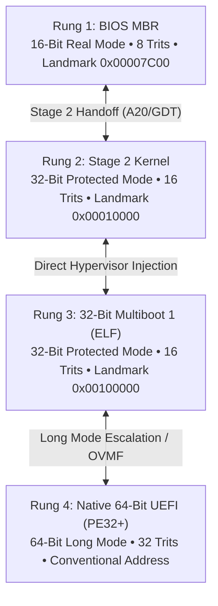

# Track 0: Silicon & Bare-Metal Kernel Substrate

Welcome to **Track 0** of the OmniCode Framework.

This directory contains the physical inception layer of **MilleniumOS** and the
OmniCode cognitive AI architecture. It takes control of bare silicon processors,
proves mathematical equilibrium directly in CPU hardware registers, mounts
cognitive memory substrates, and provides the unshakeable bedrock upon which the
entire language, runtime, and AI cortex rest.

---

## What is Track 0?

In traditional computing, applications rely on operating systems (Linux,
Windows, macOS), which rely on device drivers, which rely on firmware.

**OmniCode is an independent operating system.**

Track 0 is the root of that independence. It contains the bare-metal machine
code that executes when the computer is first powered on ($t = 0$), before any
other operating system exists.

### Core Responsibilities

1. **Hardware Inception ($t = 0$):** Taking ownership of the CPU immediately
   following firmware handover.
2. **The 4-Tier Adaptive Boot Ladder:** Providing bidirectional inception
   across Legacy BIOS (16-bit), Stage 2 (32-bit), Multiboot (32-bit), and
   Native UEFI (64-bit).
3. **Hardware Truth Verification:** Proving balanced ternary ALU equilibrium
   `(+1) + (-1) = 0` directly in CPU registers before software runs.
4. **Primary Communication:** Initializing COM1 Serial (`0x03F8`) and direct
   MMIO VGA Video memory (`0x000B8000`) for zero-dependency telemetry.
5. **Silicon Register Arming:** Mapping the 13 canonical OmniCode registers
   (`%head`, `%home`, `%spool`, `%it`, `%turn`, etc.) into CPU registers.
6. **In-Memory Flight Recorders:** Capturing structured 16-byte telemetry
   records and CPU register dumps across reboots and state transitions.

---

## The Floppy Disk Invariant: 1.44 MB of Millennial Resilience

A central tenet of the MilleniumOS design philosophy is an extraordinary,
deliberate constraint:

> [!IMPORTANT]
> **The Floppy Disk Invariant:**  
> *MilleniumOS is designed so that its primordial inception core can be loaded entirely onto a standard 1.44 MB magnetic floppy disk.*

### Why Must an OS for the Next 1,000 Years Fit on a Floppy Disk?

Modern commercial operating systems require 20 GB to 64 GB of disk space,
multi-gigabyte RAM footprints, and live broadband internet connections.
In civilizational blackouts, deep-space missions, or air-gapped isolation,
those systems cannot be reconstituted.

MilleniumOS repudiates this fragility:

* **Rung 1 (MBR Sector 0):** Exactly 512 bytes (1 sector).
* **Rung 2 (Stage 2 Kernel):** 2,048 bytes (4 sectors).
* **Dual-Stage Boot Image:** 2,560 bytes (5 sectors).
* **Rung 3 (Multiboot ELF):** 5,504 bytes.
* **Rung 4 (Native UEFI):** 4,608 bytes.
* **Total Inception Stack:** Under **15 KB** ($< 1.5\%$ of a 1.44 MB diskette)!

The remaining 98.5% (1.42 MB) of the floppy disk is reserved for a
**quantized, small-model offline AI cognitive core (CPI-SI)**. MilleniumOS
can awaken an autonomous, self-contained AI cognitive agent from spinning
magnetic rust without a single byte of internet connectivity.

---

## The 4-Tier Adaptive Boot Ladder



```text
[Rung 4: UEFI] <=> [Rung 3: MB] <=> [Rung 2: Stage 2] <=> [Rung 1: MBR]
```

| Rung | Subsystem | Mode | Address Landmark | Trits |
| :--- | :--- | :--- | :--- | :--- |
| **Rung 1** | **BIOS MBR** | 16-Bit Real | `0x00007C00` | 8 ($3^8$) |
| **Rung 2** | **Stage 2** | 32-Bit PM | `0x00010000` | 16 ($3^{16}$) |
| **Rung 3** | **Multiboot** | 32-Bit PM | `0x00100000` | 16 ($3^{16}$) |
| **Rung 4** | **Native UEFI** | 64-Bit Long | Conventional | 32 ($3^{32}$) |

* **Upward Escalation:** Climbs from Sector 0 MBR to Stage 2 (A20/GDT), to
  Multiboot (1MB hypervisor handshake), to Native 64-bit UEFI.
* **Defensive De-escalation:** If higher-tier firmware drifts, encounters
  memory exhaustion, or trips an active tripwire, the kernel defensively
  descends down the ladder to preserve cognitive survivability.
* **The First-Pass Sequential Rule:** Cold silicon must be surveyed sequentially
  (top-down or bottom-up). Once memory landmarks are anchored, arbitrary
  multi-hop state warps become mathematically viable.

---

## Directory Overview

```text
.
├── README.md               # This document (Track 0 overview & guide)
├── TRACK.md                # Comprehensive architectural specification
└── kernel/
    ├── README.md           # Multi-target kernel architecture guide
    ├── BOOT_LADDER_AND_ALTERNATE_STATES.md # Master 4-tier ladder treatise
    ├── KERNEL_INCEPTION_POINT.md # The Point of MilleniumOS Inception
    ├── build_all_kernels.sh # Master build script & 5 QEMU audits
    ├── images/             # Centralized repository for all OS images
    │   ├── omnicode_bios.img     # 512B Standalone Stage 1 MBR
    │   ├── omnicode_bios_dual.img# 2560B Dual-State Image (MBR + Stage 2)
    │   ├── omnicode_stage2.bin   # Stage 2 PM & CPI-SI Substrate
    │   ├── omnicode_multiboot.elf# 32-Bit Direct Hypervisor ELF Kernel
    │   ├── BOOTX64.EFI           # 64-Bit Native UEFI Application
    │   ├── esp/                  # EFI System Partition layout
    │   └── logs/                 # Telemetry logs from headless QEMU audits
    ├── bios/               # 16-Bit Dual-State MBR & Stage 2 Substrate
    │   ├── STAGE1_SAFE_MODE_8TRIT.md  # Stage 1 Safe Mode treatise
    │   ├── STAGE2_PROTECTED_16TRIT.md # Stage 2 PM & 16-trit treatise
    │   ├── OFFLINE_COGNITIVE_BEDROCK.md # Small-model offline AI treatise
    │   └── stage2/         # Modular Stage 2 loader & CPI-SI substrate
    ├── multiboot/          # 32-Bit Protected Mode Multiboot Kernel
    │   ├── MULTIBOOT_LIFECYCLE_PROOF.md # Multiboot lifecycle treatise
    │   └── MULTIBOOT_HYPERVISOR_COGNITION.md # Hypervisor cognition
    └── uefi/               # 64-Bit Native UEFI Application
        ├── include/        # Modular UEFI, serial, telemetry & cascade headers
        ├── UEFI_LIFECYCLE_PROOF.md # UEFI lifecycle proof & 5 avenues
        └── UEFI_COGNITIVE_SUBSTRATE.md # 64-bit registers & RAM flight log
```

---

## Quick Start: Building & Running

### Requirements

* **NASM** (Netwide Assembler)
* **Clang & LLD** (LLVM linker with PE/COFF and ELF support)
* **QEMU** (`qemu-system-x86_64`)
* **OVMF Firmware** (`/usr/share/ovmf/OVMF.fd`)

### Master Build & 5 Automated Audits

To assemble, compile, link, and verify all four boot targets:

```bash
cd "<TRACK 0> : {Silicon & Bare-Metal Kernel}/kernel"
bash build_all_kernels.sh
```

This executes the full automated pipeline:

* **TEST 1:** Standalone BIOS MBR State 0 Safe Mode beacon verification.
* **TEST 2:** Dual-State BIOS Stage 1 -> Stage 2 handoff & A20/PM verification.
* **TEST 3:** Multiboot direct hypervisor handshake verification.
* **TEST 4:** Native 64-bit UEFI Long Mode & 32-trit arena verification.
* **TEST 5:** UEFI Tripwire detection, safe mode & downward cascade audit.

### Running Individual Targets Manually

* **Legacy BIOS Dual-Stage:**

  ```bash
  qemu-system-x86_64 \
      -drive format=raw,file=kernel/images/omnicode_bios_dual.img \
      -serial stdio -display none
  ```

* **Multiboot Direct Hypervisor:**

  ```bash
  qemu-system-x86_64 -kernel kernel/images/omnicode_multiboot.elf \
                     -serial stdio -display none
  ```

* **Modern UEFI:**

  ```bash
  qemu-system-x86_64 -bios /usr/share/ovmf/OVMF.fd \
                     -drive format=raw,file=fat:rw:kernel/images/esp \
                     -serial stdio -display none
  ```

---

## Architectural Principles

* **Self-Contained & Freestanding:** Requires zero external C libraries,
  POSIX runtimes, or external OS kernels.
* **Non-Destructive & Safe:** Contains anti-lockout watchdogs, active tripwires,
  and defensive de-escalation cascades to prevent runaway execution.
* **Grounded in Truth:** Binds physical silicon execution directly to the
  balanced ternary zero-sum proof:
  $$(+1) + (-1) = 0$$
