# The MilleniumOS Kernel Inception Point: Architecture, Boot, and Truth

> *"Remove not the ancient landmark, which thy fathers have set."*  
> — **Proverbs 22:28 (KJV)**

---

## The Point of MilleniumOS and the Primordial BIOS Boot

MilleniumOS is an operating system engineered to grow, adapt, and endure over
the span of a thousand years. When designing a system with a millennial
horizon, modern assumptions regarding complex cloud hypervisors, giant runtime
environments, and monolithic kernels become liabilities. Software stacks built
on layers of transient abstractions inevitably crumble when those abstractions
shift or become obsolete.

To guarantee survival across epochs, MilleniumOS roots itself in the physical
reality of silicon: the **Legacy BIOS Master Boot Record (MBR) boot**.

### The Ancient Landmark: Sector 0 at 0x7C00

The primordial BIOS boot represents the zero-assumption foundation of personal
computing. When an x86 processor powers on, it begins execution in 16-bit Real
Mode at address `0xFFFF0`. The motherboard firmware performs power-on self-tests
(POST), queries the storage media, loads exactly **512 bytes** from Cylinder 0,
Head 0, Sector 1 (Track 0) into physical RAM at `0x0000:0x7C00`, and jumps
directly to that memory address.

At this exact microsecond ($t = 0$):

* There is no operating system.
* There is no filesystem (no ext4, FAT32, or NTFS).
* There are no device drivers, virtual memory, or page tables.
* There are no dynamic linkers, C runtime libraries, or user accounts.

> [!IMPORTANT]
> **The Ancient Landmark Invariant:**  
> This 512-byte disk sector is the **Ancient Landmark**. In MilleniumOS, this boot
> is not a historical relic or a throwaway toy; it is the definitive proof of
> sovereignty. If an operating system cannot establish truth, order, and
> cognition starting from a naked 512-byte sector, it is merely a guest living
> on borrowed time inside someone else's environment.

---

## What the Kernel Is for the Computer

In modern computing, the term "kernel" is frequently conflated with bloated
megabytes of driver code, scheduling policies, and network stacks. But what is
the kernel at its philosophical and physical essence?

The kernel is the **covenantal mediator** between human intent (mathematical
truth, moral logic, algorithmic purpose) and raw physical silicon (voltage
differentials, silicon gates, bus lines, and clock cycles).

```mermaid
flowchart TD
    subgraph IntentLayer ["1. Human & Cognitive Intent"]
        Intent["Mathematical Truth • Balanced Ternary • AI Cognitive Models"]
    end

    subgraph KernelLayer ["2. The Kernel (Covenantal Mediator)"]
        Kernel["<b>THE KERNEL</b><br/>Covenantal Mediator • Invariant Guard • Hardware Inception Layer<br/>• Normalizes Segments • Arms 13 Silicon Registers • Verifies ALU Truth"]
    end

    subgraph SiliconLayer ["3. Physical Silicon Substrate"]
        Silicon["Motherboard Buses • CPU Registers • COM1 UART • Physical RAM"]
    end

    IntentLayer -->|"Formalizes Intent into Mathematical Law"| KernelLayer
    KernelLayer -->|"Governs Voltages, Clocks & Memory Lines"| SiliconLayer

    style IntentLayer fill:#1c2833,stroke:#3498db,stroke-width:2px
    style KernelLayer fill:#2c1b33,stroke:#9b59b6,stroke-width:2px
    style SiliconLayer fill:#1b3325,stroke:#2ecc71,stroke-width:2px
```

Without a kernel, silicon is inert, unguided sand. Left to itself, electrical
noise and floating bus lines produce pure entropy. The kernel's primary duty
is to:

1. **Establish Invariants:** Enforce that hardware behaves predictably and
   aligns with mathematical axioms before allowing any program to execute.
2. **Organize Physical Topologies:** Assign designated roles to CPU registers,
   normalize memory segments, map physical I/O ports, and set execution stacks.
3. **Anchor Sovereignty:** Ensure that the computer serves its designated
   purpose without vulnerability to silent corruption, drift, or lockouts.

---

## What the Kernel BIOS Does and What We Are Able to Do

Starting from the 512-byte MBR envelope, the MilleniumOS BIOS kernel executes
a rigorously calibrated sequence of actions that bridges bare metal into
cognitive awareness:

### 1. Hardware Segment Normalization & Stack Anchoring

Different BIOS implementations across vendors leave CPU segment registers
(`DS`, `ES`, `SS`) in erratic states. The kernel immediately clears interrupts
(`cli`), zeroes all data segments, and anchors the physical stack pointer (`SP`)
at `0x7C00`. Because the x86 stack grows downward into scratch memory
(`0x7BFE`, `0x7BFC`, etc.), stack pushes never collide with bootloader code.

### 2. Balanced Ternary Arithmetic Verification in Silicon

Before trusting the processor to run higher-level instructions, the kernel
executes an empirical balance test directly in the CPU arithmetic logic unit:

$$\mathbf{(+1) + (-1) = 0}$$

Using registers `BX` and `CX`, the kernel executes `add bx, cx` and tests the
Zero Flag (`ZF`). If physical addition does not produce zero, physical reality
is corrupted; the kernel halts immediately (`hang_fault`). MilleniumOS refuses
to build reasoning on corrupted hardware.

### 3. Immediate Telemetry Initialization (COM1 UART at 0x03F8)

The kernel configures the physical RS-232 serial UART port at base address
`0x03F8` for 115,200 baud, 8 data bits, no parity, and 1 stop bit (8N1).
Simultaneously, it initializes the VGA display buffer (`0x000B8000`). Every
boot milestone is broadcast simultaneously to screen and serial telemetry.

### 4. Arming the 13 Canonical Silicon Registers

The kernel binds the physical x86 registers to the 13 named registers of the
OmniCode Virtual Machine:

* `%head` (`AX`): Cognitive focus and instruction pointer accumulator.
* `%home` (`BX`): Moral origin anchor and zero-reference point.
* `%turn` (`CX`): Step counter, loop accumulator, and cadence timer.
* `%spool` (`DX`): Physical I/O port anchor (COM1 telemetry).
* `%spool_in` (`SI`): Source stream pointer.
* `%spool_out` (`DI`): Destination stream pointer.
* `%frame` (`BP`): Stack frame baseline.

### 5. Executing the Dual-State Decision

The kernel evaluates whether to execute in **State 0 (Safe Mode)** or
**State +1 (Normal Boot)**:

* **State 0 (Safe Mode Beacon):** If a key is held during boot or disk reads
  fail, the system remains entirely within Sector 0 (512 bytes). It acts as an
  indestructible beacon, proving hardware health and idling in a low-power
  watchdog loop (`hlt`).
* **State +1 (Normal Boot):** Issues BIOS `INT 0x13, AH=0x02` to load Stage 2
  from disk Sectors 2..5 into memory segment `0x1000:0x0000` (the 64 KB mark),
  verifies payload integrity, and executes a far jump into Stage 2.

### 6. Stage 2 Protected Mode Transition & Cognitive Mounting

In Stage 2, the kernel:

* Unmasks the **A20 Address Line** via Fast A20 Gate (Port `0x92`), enabling
  access beyond the 1 MB real-mode memory ceiling.
* Loads a flat 4 GB **Global Descriptor Table (GDT)** based at `0x00010000`.
* Flips Bit 0 of Control Register 0 (`CR0.PE`), transitioning the CPU from
  16-bit Real Mode into **32-Bit Protected Mode**.
* Mounts the **16-Trit CPI-SI Cognitive Substrate**, enabling small-model
  offline artificial intelligence reasoning directly on bare metal without an
  underlying host OS.

---

## What Empirical Results Show and Reveal So Far

Rigorous testing across automated builders, QEMU emulators, and headless
virtualized runners has revealed critical empirical findings:

### Empirical Verification Matrix

* **512-Byte Envelope:**
  * *Specification:* Code + data $\le 510$ bytes; `0xAA55` seal at 510-511.
  * *Result:* Exact 512 bytes assembled; 0 bytes overflow.
* **ALU Balance Proof:**
  * *Specification:* $(+1) + (-1) = 0$ sets ZF in hardware.
  * *Result:* Verified 100% on silicon and hypervisors.
* **COM1 Telemetry:**
  * *Specification:* 115200 8N1 serial emission at port `0x03F8`.
  * *Result:* Byte-for-byte terminal capture verified.
* **Dual-State Fallback:**
  * *Specification:* Missing Stage 2 retreats cleanly to State 0.
  * *Result:* Clean Safe Mode beacon; zero CPU lockups.
* **Normal Boot Handoff:**
  * *Specification:* BIOS `INT 0x13` loads Stage 2 at 64 KB (`0x1000:0000`).
  * *Result:* Flawless far jump to Stage 2 runtime.
* **A20 Gate Enable:**
  * *Specification:* Access to memory beyond 1 MB without wrapping.
  * *Result:* Fast Gate (Port `0x92`) enabled cleanly.
* **32-Bit GDT Jump:**
  * *Specification:* Far jump flushes pipeline into 32-bit Protected Mode.
  * *Result:* Smooth entry into `stage2_pm_entry`.
* **Offline AI Bedrock:**
  * *Specification:* 16-trit workspace mounted in flat linear RAM.
  * *Result:* Zero external C runtime or host OS dependency.

### What These Results Reveal

1. **The 512-Byte Constraint Is an Asset, Not a Limitation:**
   The strict boundary forces absolute clarity of thought. Every byte must
   justify its existence.
2. **Deterministic Silicon Inception Is Practical:**
   Modern operating systems take gigabytes of disk space to reach a desktop,
   yet cannot prove basic arithmetic integrity on startup. MilleniumOS proves
   its axioms in microseconds.
3. **Offline Cognitive Independence Is Achievable:**
   Artificial intelligence does not need to remain locked inside remote cloud
   data centers. By creating a direct bridge between Stage 2 bare metal and the
   CPI-SI substrate, small-model cognitive engines can operate autonomously on
   modest hardware in disconnected, post-infrastructure environments.

---

## Why We Started at Track 0

In disk geometry, **Track 0** is the outermost physical cylinder of the
magnetic platter: Cylinder 0, Head 0, Track 0. It is the absolute origin of
all physical storage.

In the OmniCode curriculum, Track 0 represents the **Silicon & Bare-Metal
Kernel Substrate**. Why did we begin our engineering journey here rather than
at Track 1 (virtual machines, interpreters), Track 2 (compilers), or Track 3
(applications)?

### The Fallacy of Higher-Level Abstractions

If you start building an operating system or AI framework at Track 3:

* You depend on the host operating system's system calls (Linux `glibc`,
  Windows `ntdll`).
* You depend on the memory allocator and virtual memory paging daemon.
* You depend on complex thread schedulers and graphics subsystems.

When an unexpected failure occurs—a memory corruption, a race condition, or an
arithmetic drift—you cannot determine whether the bug lies within your model,
within the C runtime, or within the host kernel. You are building a castle on
shifting sand.

By starting at **Track 0**:

* Every register state is known.
* Every memory address from `0x00000000` to `0xFFFFFFFF` is accounted for.
* There are no hidden background threads stealing CPU cycles.
* The bedrock is mathematically proven before higher-level cognition is built.

---

## The Imperative of Visibility: Why Telemetry Matters at Track 0

One of the most daunting challenges of bare-metal kernel development is the
**silent failure**.

When an instruction causes an unhandled fault in real mode or protected mode
(such as an invalid opcode, a bad descriptor, or a stack overflow), the CPU
triggers a Double Fault or Triple Fault. On physical hardware, a Triple Fault
causes the motherboard to instantly reset or lock up without emitting a single
sound or pixel. The machine becomes a silent, inscrutable brick.

At Track 0, **filesystems do not exist yet**. You cannot open a file called
`system.log` and call `fprintf()`. There is no disk write cache, no NVMe driver,
and no block storage layer ready to save crash logs.

### Why Visibility Is Life

Visibility is the only lifeline connecting the developer to the physical state
of the machine:

1. **Transient Serial Telemetry (COM1 `0x03F8`):**
   Serial communication does not require interrupts, memory management, or
   storage. A single CPU instruction (`out dx, al`) immediately pulses voltage
   levels across physical copper pins. Even if the machine crashes one
   microsecond later, the external listening terminal has recorded the exact
   checkpoint where execution ceased.
2. **In-Memory Diagnostic Log Buffers (RAM Logs):**
   Even when non-volatile storage is unavailable, RAM is persistent as long as
   power remains applied. By designating a dedicated, standardized memory
   landmark (e.g., `0x00018000`), the kernel can record chronological event
   records, register snapshots, and error codes. If the system drops into Safe
   Mode, an operator or debugger can inspect this RAM log buffer directly.
3. **Register Audit Dumps:**
   Printing the exact hexadecimal contents of `EAX`, `EBX`, `CR0`, and `ESP`
   at every milestone converts an invisible silicon black box into an
   observable, mathematically verifiable scientific apparatus.

---

## Summary of the Inception Paradigm

| Dimension | Legacy Standard Computing | MilleniumOS Inception Paradigm |
| :--- | :--- | :--- |
| **Starting Point** | High-level languages, host OS, complex hypervisors. | Track 0, Sector 0, bare silicon. |
| **Arithmetic Proof** | Assumed blindly from silicon manufacturer. | Verified directly in hardware: $(+1) + (-1) = 0$. |
| **Boot Architecture** | Fragile, monolithic, single-point-of-failure loader. | Resilient Dual-State (Safe Mode beacon + Stage 2 handoff). |
| **Cognitive Bridge** | Gigabytes of cloud runtimes and remote servers. | Direct bare-metal CPI-SI cognitive substrate. |
| **Visibility** | Silent lockups or opaque post-mortem core dumps. | Real-time serial telemetry and in-memory RAM log buffers. |

This is the point of MilleniumOS: **Unshakable truth, absolute visibility, and
enduring sovereignty starting from physical silicon.**
