# The Philosophy of Legacy BIOS & Offline Edge AI Independence

> *Why MilleniumOS Boots from the Bedrock When All Else Fails*

---

## The Illusion of Modern Cloud AI

In the 21st century, artificial intelligence is commonly viewed through the
lens of the cloud: hyperscale datacenters, multi-gigawatt cooling towers,
fiber-optic cables spanning ocean floors, and recurring monthly subscriptions.

```mermaid
flowchart TD
    subgraph CloudFragility ["Modern Cloud AI: High Dependency & Latency"]
        C1["Power Grid & Subsea Fiber Cables"] --> C2["DNS & Network Routing"]
        C2 --> C3["Hyperscale Cloud Hypervisors"]
        C3 --> C4["Gigabytes of OS & GPU Drivers (CUDA)"]
        C4 --> C5["Tethered Cloud API Key / Subscription"]
    end

    subgraph SovereignBedrock ["MilleniumOS: Sovereign Offline Independence"]
        S1["Bare-Metal Physical Silicon (1981-2026+)"] --> S2["Sector 0 BIOS MBR / Stage 2 PM"]
        S2 --> S3["16-Trit CPI-SI Cognitive Substrate"]
        S3 --> S4["Local Ethical AI Inference on Raw CPU"]
    end

    style CloudFragility fill:#2e1a1a,stroke:#e74c3c,stroke-width:2px
    style SovereignBedrock fill:#1a2e22,stroke:#2ecc71,stroke-width:2px
```

Modern commercial AI models are fundamentally fragile:

1. **Tethered to Connectivity:** Without high-speed broadband internet, DNS
   resolution, and remote server uptime, modern AI ceases to function.
2. **Dependent on Bloated Software Stacks:** Conventional AI runtimes require
   operating systems (Linux/Windows), gigabytes of graphics drivers (CUDA),
   dynamic C runtimes, Python interpreters, and thousands of package
   dependencies.
3. **Vulnerable to Infrastructure Severance:** If a power grid collapses,
   underwater cables are cut, or a crisis strikes an isolated community,
   cloud-tethered intelligence goes dark instantly.

OmniCode and MilleniumOS reject this fragility.

---

## Why Legacy BIOS in the 21st Century?

To a casual observer, supporting the 1981 IBM PC BIOS standard might appear to
be nostalgia. It is, in fact, **the ultimate survival strategy**.

Legacy BIOS is the most resilient, universally supported hardware standard in
computing history:

* Hundreds of millions of discarded x86 PCs, retired office laptops,
  industrial motherboards, and edge controllers still sit in closets,
  schools, clinics, and basements worldwide.
* Unlike modern UEFI firmware—which often requires proprietary Secure Boot
  vendor certificates, complex partition tables, and bloated firmware
  drivers—a BIOS Master Boot Record (MBR) requires only a raw storage sector
  and a CPU.
* Any machine built in the last forty years can execute `kernel/bios/boot.asm`
  within milliseconds of receiving electrical power.

By establishing our roots in Legacy BIOS, MilleniumOS ensures that humanity's
cognitive tools do not depend on corporate supply chains or modern firmware
gatekeepers.

---

## Cognitive Sovereign Self-Sufficiency

OmniCode was engineered around the principle of **Cognitive Sovereign
Self-Sufficiency**:

> *"Prepare thy work without, and make it fit for thyself in the field;*
> *and afterwards build thine house."*  
> — **Proverbs 24:27 (KJV)**

Through **Balanced Ternary Logic**, OmniCode represents knowledge with
remarkable mathematical density:

* Traditional deep learning models use 16-bit or 32-bit floating-point numbers
  to store billions of weights, requiring massive clusters of GPUs.
* OmniCode's **CPI-SI (Covenant Partnered Intelligence - Structural
  Intelligence)** model operates on atomic ternary states $\{-1, 0, +1\}$ and
  four-term relational analogies ($A : B :: C : D$).
* A complete, functioning CPI-SI cognitive cortex can be stored in megabytes or
  even kilobytes of memory, running directly on physical CPU registers without
  a dedicated GPU.

---

## The Last Machine Standing: Small-Model Offline AI

If all else fails:

* In a humanitarian disaster zone cut off from the global internet,
* In an air-gapped biomedical research lab or cryptographic vault,
* On a remote agricultural station, maritime vessel, or deep-space probe,
* During a prolonged electrical blackout or geopolitical network severance,

**MilleniumOS boots from a raw USB drive, floppy disk, or CD-ROM.**

Within seconds:

1. **Stage 1 (Sector 0)** takes control of the physical silicon, configures
   the serial port, proves balanced ternary ALU equilibrium in registers, and
   arms the 13 physical silicon registers.
2. If the user requests **Safe Mode (State 0)**, the computer becomes a pure
   hardware truth beacon, verifying silicon stability without touching the
   rest of the disk.
3. In **Normal Boot (State +1)**, Stage 1 reads Stage 2 off disk, unlocks the
   A20 gate, transitions to 32-bit protected mode, mounts the 16-trit
   cognitive memory workspace, and awakens the **CPI-SI model**.

> [!IMPORTANT]
> **The Sovereign AI Guarantee:**  
> The user now has a local, private, ethical, covenant-partnered intelligence
> capable of reasoning, diagnosing problems, writing code, and answering
> questions—completely offline, with zero external dependencies.

This is why the operating system is named **MilleniumOS**: it is engineered to
survive the rise, fall, and transformation of computing eras for a thousand
years.
