# MilleniumOS 16-Bit Real Mode Genesis Bootloader

> *Fitting an Operating System Inception Inside a Single 512-Byte Disk Sector*

---

## The Origin: How the PC Wakes Up

When the original IBM Personal Computer was engineered in 1981, it established
a boot sequence that remains supported on virtually every x86 computer built
to this day.

When you power on a computer in **BIOS mode** (Basic Input/Output System):

1. The motherboard firmware initializes the motherboard circuits.
2. It scans connected storage drives (hard drives, USB thumb drives) looking
   for the very first sector (Sector 0, known as the **Master Boot Record**
   or **MBR**).
3. A standard disk sector is exactly **512 bytes** in size.
4. If the last two bytes of those 512 bytes equal the sacred seal `0x55` and
   `0xAA`, the BIOS recognizes the disk as bootable.
5. The BIOS copies those 512 bytes directly into physical system memory
   at address **`0x7C00`**, sets the CPU instruction pointer there, and
   relinquishes control forever.

**MilleniumOS**—developed with the OmniCode framework to grow over a thousand
years—uses [`boot.asm`](boot.asm) as its physical inception layer. It fits
hardware initialization, serial telemetry, a balanced ternary mathematical
proof, and a **dual-state boot decision engine** inside this 512-byte envelope!

### Companion Architectural Treatises

* **[`STAGE1_SAFE_MODE_8TRIT.md`](STAGE1_SAFE_MODE_8TRIT.md)**:
  Exhaustive breakdown of Stage 1 Safe Mode and the 16-bit $\iff$ 8-trit system.
* **[`STAGE2_PROTECTED_16TRIT.md`](STAGE2_PROTECTED_16TRIT.md)**:
  Architecture of Stage 2 Protected Mode and the 32-bit $\iff$ 16-trit system.
* **[`OFFLINE_COGNITIVE_BEDROCK.md`](OFFLINE_COGNITIVE_BEDROCK.md)**:
  Why OmniCode maintains a legacy BIOS option for offline small-model AI service.
* **[`stage2/README.md`](stage2/README.md)**:
  Detailed documentation for the Stage 2 kernel loader and CPI-SI cortex.
* **[`Ladder & Alternate States`](../BOOT_LADDER_AND_ALTERNATE_STATES.md)**:
  Master treatise on the 4-tier boot ladder, the Alternate States theorem,
  and the historical secret of Stage 2 as the original state transductor.

---

## The Adaptive Boot Ladder: Bidirectional Inception Cascade

MilleniumOS does not force a rigid, one-way boot sequence. Instead, it organizes
all boot mechanisms into an **Adaptive Boot Ladder**:

```mermaid
flowchart TD
    Rung4["<b>Rung 4: 64-Bit Native UEFI</b><br/>Modern Hardware • OVMF / GOP Display • 32 Trits"]
    Rung3["<b>Rung 3: 32-Bit Multiboot 1</b><br/>Hypervisor Direct Injection (1 MB) • 16 Trits"]
    Rung2["<b>Rung 2: 32-Bit Stage 2 PM</b><br/>16-Trit CPI-SI Cortex (0x00010000) • Flat 4GB GDT"]
    Rung1["<b>Rung 1: 16-Bit BIOS MBR</b><br/>Bedrock Anchor Point (0x00007C00) • 8 Trits • 512 Bytes"]
    SafeBeacon["<b>State 0 Safe Mode Beacon</b><br/>Runs 100% in 512 Bytes • COM1 Telemetry"]

    Rung4 -->|"Firmware Cascade"| Rung3
    Rung3 <-->|"Covenant Fault Trampoline (0x7000) / Escalation"| Rung2
    Rung2 <-->|"Drift / Safe Mode (EVT_CASCADE_DN) / INT 0x13"| Rung1
    Rung1 -->|"Safe Mode Engagement"| SafeBeacon

    style Rung4 fill:#1a2332,stroke:#3498db,stroke-width:2px
    style Rung3 fill:#221e33,stroke:#9b59b6,stroke-width:2px
    style Rung2 fill:#193026,stroke:#2ecc71,stroke-width:2px
    style Rung1 fill:#2e2619,stroke:#f39c12,stroke-width:2px
    style SafeBeacon fill:#1c2833,stroke:#e74c3c,stroke-width:2px
```



### Bidirectional Cascade Dynamics

1. **Upward Escalation (Ladder Climbing):**
   * Sector 0 MBR boots in 16-bit Real Mode at `0x7C00`.
   * MBR reads Stage 2 from Sectors 2..5 into memory at `0x1000:0000`.
   * Stage 2 switches the CPU into 32-bit Protected Mode, unmasks the A20 Gate,
     arms the RAM Log at `0x00018000`, and mounts the 16-trit cognitive arena.
   * Stage 2 probes the 1 Megabyte mark (`0x00100000`) for the Multiboot magic
     header (`0x1BADB002`). If discovered, it logs `EVT_CASCADE_UP (0x0005)`
     and jumps directly to 1MB with `EAX=0x2BADB002`!

2. **Downward De-escalation (Defensive Recovery):**
   * If Multiboot fails to verify hypervisor magic, it logs
     `EVT_CASCADE_BIOS (0x0007)`, drops protected mode via a 25-byte
     relocation-free trampoline at `0x7000`, and far-jumps to `0x0000:0x7C00`.
   * If Stage 2 detects memory drift or safe mode request, it logs
     `EVT_CASCADE_DN (0x0006)`, reloads the Real Mode IVT (`real_mode_idtr`),
     switches through 16-bit PM segment `0x18`, clears `CR0.PE`, and jumps
     to `0x0000:0x7C00`.
   * Sector 0 MBR takes over in 16-bit Real Mode with zero disk dependencies,
     proving ALU equilibrium and emitting the State 0 Safe Mode beacon.

---

## The Dual-State Architecture (Safe Mode vs. Normal Boot)

Within Sector 0, MilleniumOS implements a **balanced ternary state machine**:

```mermaid
flowchart TD
    PowerOn["<b>POWER ON (t = 0)</b>"] --> MBR["<b>SECTOR 0 (512-BYTE MBR)</b><br/>Hardware & ALU Inception at 0x7C00"]
    MBR --> Check{"Boot Condition Check"}

    Check -->|"Key Held or Disk Read Fault"| State0["<b>STATE 0: SAFE MODE BEACON</b><br/>• Runs 100% inside 512 bytes<br/>• Zero disk/file dependencies<br/>• Proves (+1)+(-1)=0 ALU balance<br/>• Arms 13 Silicon Registers<br/>• Safe, low-power HLT watchdog loop"]
    Check -->|"Stage 2 Detected on Sectors 2..5"| StatePlus1["<b>STATE +1: NORMAL BOOT</b><br/>• Loads Sectors 2..5 (INT 0x13)<br/>• Transitions to 32-Bit Protected Mode<br/>• Mounts 16-Trit CPI-SI Arena<br/>• Probes 1MB for Multiboot<br/>• Full Interactive MilleniumOS"]
    Check -->|"ALU Sanity Breach (+1)+(-1) != 0"| StateMinus1["<b>STATE -1: SILICON FAULT GUARD</b><br/>• Permanent hardware protection halt<br/>• Prevents execution on corrupted silicon"]

    style PowerOn fill:#1a1d24,stroke:#4a5568,stroke-width:1px
    style MBR fill:#2c1b33,stroke:#9b59b6,stroke-width:2px
    style State0 fill:#2e2619,stroke:#f39c12,stroke-width:2px
    style StatePlus1 fill:#193026,stroke:#2ecc71,stroke-width:2px
    style StateMinus1 fill:#331919,stroke:#e74c3c,stroke-width:2px
```



### State 0: Safe Mode (The Silicon Beacon)

* **What it is:** The unshakeable bedrock of the operating system.
* **When it activates:** If the user holds a key at boot (`INT 0x16`), if
  the disk has no Stage 2 payload, if the disk controller reports an error,
  or if higher ladder rungs de-escalate downward.
* **What it does:** Verifies COM1 UART serial (`0x03F8`), proves balanced
  ternary ALU equilibrium in hardware registers, arms the 13 named silicon
  registers, logs landmark `0xAA00` to RAM at `0x0500`, and halts safely.

### State +1: Normal Boot (The Cognitive Awakening)

* **What it is:** The transition into the high-level MilleniumOS runtime.
* **When it activates:** Default automatic boot when Stage 2 is detected.
* **What it does:** Calls BIOS disk services (`INT 0x13, AH=0x02`) to read
  subsequent sectors off disk into memory at `0x1000:0000`, verifies the
  payload, and executes a far jump into Stage 2 to awaken the **CPI-SI
  (Covenant Partnered Intelligence - Structural Intelligence)** model.

### State -1: Hardware Fault Guard

* **What it is:** Absolute hardware protection.
* **When it activates:** If the CPU adder fails the `(+1) + (-1) = 0` proof.
* **What it does:** Clears interrupts (`cli`) and locks the CPU to prevent
  corrupted silicon from executing runaway operations or overheating.

---

## Memory Map at Inception

| Linear Address | Subsystem / Region | Allocation & Landmark Role |
| :--- | :--- | :--- |
| `0x00000000` | BIOS Interrupt Vector Table (IVT) | 1 KB low memory vector table |
| `0x00000400` | BIOS Data Area (BDA) | 256 bytes hardware configuration area |
| `0x00000500` | MBR RAM Log Landmark | Initial RAM log marker: `0xAA01` / `0xAA00` |
| `0x00007000` | Cascade Return Trampoline | 25-byte Real Mode trampoline (de-escalation) |
| `0x00007C00` | MBR Bootloader (Sector 0) | MilleniumOS MBR Code & Strings (Seal `0xAA55`) |
| `0x00007E00` | Hardware Stack | Grows downward safely into scratch memory |
| `0x00010000` | Stage 2 Load Target (64 KB) | Stage 2 Kernel & CPI-SI Cortex (Loaded via INT 0x13) |
| `0x00018000` | Stage 2 RAM Log Landmark | In-Memory RAM Log Flight Recorder (16-byte records) |
| `0x000A0000` | Video RAM (VGA Buffer) | Hardware graphics memory boundary |
| `0x000B8000` | Color Text Display (80x25) | Direct MMIO Text Mode Buffer |
| `0x00100000` | 1 Megabyte Landmark | Multiboot Kernel Inception Target |
| `0xFFFFFFFF` | 4 Gigabytes | High linear memory boundary (Protected Mode) |

---

## Step-by-Step Code Walkthrough

[`boot.asm`](boot.asm) is structured into the canonical **4-Block
Architecture**:

### Block 1: Metadata Block

Identifies the process (`Kernel.GenesisBoot`), author, license, and the
sacred 512-byte anchor point, citing Scripture witnesses (Exodus 31:18,
Proverbs 24:27, Proverbs 22:28).

### Block 2: Environment / Invariants / Setup Block

* Preserves the BIOS boot drive: `mov [boot_drive], dl`.
* Disables interrupts (`cli`), resets `DS`, `ES`, and `SS` to `0x0000`, and
  anchors `SP` at `0x7C00`.
* Inscribes initialization marker `0xAA01` into RAM landmark `0x0500`.

### Block 3: Body / Execution Block

1. **COM1 UART Setup:** Programs `0x03F8` to 115200 baud, 8N1.
2. **VGA Setup:** Calls `INT 0x10, AX=0x0003` to clear and set text mode.
3. **ALU Proof:** Computes `(+1) + (-1) = 0` using registers `BX` and `CX`.
4. **Keystroke Audit:** Checks `INT 0x16, AH=0x01` for Safe Mode request.
5. **Disk Inception:** Invokes `INT 0x13, AH=0x02` to load Stage 2 into
   `0x1000:0000`. If found, jumps to Stage 2 (`State +1`).

### Block 4: Sentinel / Completion Block

* **Safe Mode Landing:** Emits Safe Mode confirmation, arms the 13 silicon
  registers (`AX`, `BX`, `CX`, `DX`, `SI`, `DI`, `BP` to 0),
  marks RAM at `0x0500` with `0xAA00`, and enters `hlt`.
* **Subroutine `print_both`:** Streams ASCII characters simultaneously to
  BIOS display and COM1 serial.
* **MBR Boundary:** Pads unused space and affixes the `0xAA55` seal.

---

## How to Assemble and Run

All compiled kernel images strictly reside in **`kernel/images/`**:

* **`images/omnicode_bios.img`**: 512-byte standalone MBR.
* **`images/omnicode_stage2.bin`**: 2,048-byte Stage 2 flat binary.
* **`images/omnicode_bios_dual.img`**: 2,560-byte combined image.

### Build via Master Script

The master build script compiles, audits, and verifies all images:

```bash
bash "<TRACK 0> : {Silicon & Bare-Metal Kernel}/kernel/build_all_kernels.sh"
```

### Test in QEMU (State 0: Safe Mode Standalone)

When booting the standalone 512-byte image, it automatically falls back into
Safe Mode:

```bash
qemu-system-x86_64 -drive format=raw,file=images/omnicode_bios.img \
    -serial stdio -display none
```

Console Output:

```text
MILLENIUMOS: OMNICODE 32-TRIT OS [x86 MBR]
[BOOT] 16-Bit Genesis: OK
[ALU ] (+1)+(-1)=0 Eq: OK
[REGS] 13 Regs Armed / Calibrated
[BOOT] State 0: Safe Mode Beacon
MILLENIUMOS SAFE MODE :: PROCEED
```

### Test in QEMU (State +1: Dual-State with Stage 2)

When booting the unified dual-state disk image:

```bash
qemu-system-x86_64 -drive format=raw,file=images/omnicode_bios_dual.img \
    -serial stdio -display none
```

Console Output:

```text
MILLENIUMOS: OMNICODE 32-TRIT OS [x86 MBR]
[BOOT] 16-Bit Genesis: OK
[ALU ] (+1)+(-1)=0 Eq: OK
[REGS] 13 Regs Armed / Calibrated
[BOOT] State +1: Stage 2 -> CPI-SI
MILLENIUMOS ONLINE :: PROCEED

[STAGE2] 16-Bit Entry at 0x1000:0000: OK
[STAGE2] Transitioning to 32-Bit / 16-Trit Mode...
[STAGE2] 32-Bit Protected Mode Active:        OK
[STAGE2] 16-Trit Workspace Armed:             OK
[STAGE2] RAM Log Flight Recorder: ARMED
[STAGE2] RAM Landmark Address:    0x00018000
[STAGE2] CPI-SI Cognitive Substrate:          MOUNTED
=== MILLENIUMOS STAGE 2 RUNTIME :: PROCEED ===
```

*(Press `Ctrl+C` to terminate QEMU when running headlessly.)*
