# Stage 1 Safe Mode & The 16-Bit / 8-Trit Physical Silicon Envelope

> *The Primordial Genesis of MilleniumOS at the 512-Byte Ancient Landmark*

---

## The First Microsecond: Physical Reality at $t = 0$

When power surges through an x86 processor, before any operating system,
filesystem, or network exists, the CPU executes in **16-Bit Real Mode**.

In this primordial state, the processor is functionally equivalent to the
original Intel 8086 created in 1978. It cannot access virtual memory, it
cannot protect memory regions, and it has no access to operating system
APIs.

The motherboard firmware reads exactly **512 bytes** from Sector 0 of the
boot drive into physical system memory at address **`0x7C00`**.

This boundary is what OmniCode calls an **Ancient Landmark** (Proverbs 22:28).
It is a hard physical law:

* **Total Envelope:** 512 Bytes.
* **Payload Space:** Bytes 0 through 509.
* **Sacred Seal:** Bytes 510 and 511 must be `0x55` and `0xAA` (`dw 0xAA55`).

> [!IMPORTANT]
> **The 512-Byte Hard Limit:**  
> If this envelope is violated by even one byte, the motherboard firmware
> refuses to recognize the media and will not boot. Every byte must justify its
> existence through mathematical necessity.

---

## The 16-Bit Binary $\iff$ 8-Trit Balanced Ternary Bridge

Modern computers are built on binary transistors (low voltage = 0, high
voltage = 1). But OmniCode and MilleniumOS are grounded in **Balanced Ternary
Logic**, where every unit of thought (a **trit**) holds one of three balanced
states:

$$\text{Trit} \in \{-1,\; 0,\; +1\} \iff \{\text{Retreat},\; \text{Rest / Balance},\; \text{Proceed}\}$$

```mermaid
flowchart LR
    subgraph BinarySilicon ["16-Bit Binary Register (x86 Real Mode)"]
        Bits["2^16 = 65,536 Discrete Electrical States"]
    end

    subgraph TernarySubstrate ["8-Trit Balanced Word (OmniCode VM)"]
        Trits["3^8 = 6,561 Symmetrical Cognitive States<br/>Range: -3,280 to +3,280"]
    end

    BinarySilicon <-->|"Exact Bounded Container Injection"| TernarySubstrate

    style BinarySilicon fill:#1c2833,stroke:#3498db,stroke-width:2px
    style TernarySubstrate fill:#1b3325,stroke:#2ecc71,stroke-width:2px
```



### Mathematical Alignment

* A 16-bit binary integer has $2^{16} = 65,536$ states.
* An 8-trit balanced word has $3^8 = 6,561$ states.

By encoding **8 balanced trits** inside a 16-bit physical silicon register,
MilleniumOS creates a perfectly bounded mathematical container where:

1. Arithmetic carries and borrows are symmetrical around zero.
2. Sign negation requires no two's-complement overflow tricks (inverting
   trits simply mirrors $+1 \iff -1$).
3. Zero is represented by natural equilibrium ($00000000_3 = 0$), preventing
   floating-point drift or undefined signed zero states (`+0` vs `-0`).

---

## The Balanced Ternary ALU Proof in Silicon

Before MilleniumOS executes any software instructions or cognitive reasoning,
it proves that the physical silicon arithmetic logic unit (ALU) obeys
mathematical truth:

$$\mathbf{(+1) + (-1) = 0}$$

In `kernel/bios/boot.asm`, this is verified directly in CPU registers:

```nasm
mov bx, 1
mov cx, -1
add bx, cx
test bx, cx     ; Tests ALU Zero Flag (ZF)
jnz hang_fault  ; Halt immediately if corrupt!
```

If the CPU addition results in zero, the processor sets the **Zero Flag**,
proving that physical silicon voltages and mathematical logic are in harmony.
If physical degradation, overheating, or cosmic rays corrupt this operation,
the machine clears interrupts (`cli`) and halts permanently (`State -1`).

OmniCode refuses to construct cognitive reasoning upon corrupted silicon.

---

## The 13 Named Silicon Registers

At $t = 0$, MilleniumOS binds the 13 physical architectural registers of the
16-bit x86 CPU directly to the canonical registers of the OmniCode Cognitive
Virtual Machine:

| Register | OmniCode Name | Role in Cognitive Inception | Plain-English Intuition |
| :--- | :--- | :--- | :--- |
| **`AX`** | **`%head`** | Cognitive focus register & accumulator | The reading eye on the active thought tape |
| **`BX`** | **`%home`** | Moral origin & Decalogue covenant anchor | The immovable ground milestone of the system |
| **`CX`** | **`%turn`** | Step counter & inference loop index | The heartbeat tick counter keeping cadence |
| **`DX`** | **`%spool`** | Hardware I/O telemetry & serial port | The serial port anchor (`0x03F8` COM1) |
| **`SI`** | **`%spool_in`** | Source stream read head | Inbound sensor reading stream pointer |
| **`DI`** | **`%spool_out`** | Destination transcription write head | Outbound action inscriber stream pointer |
| **`BP`** | **`%frame`** | Cognitive execution frame boundary | Execution stack frame baseline marker |
| **`SP`** | **`%stack`** | Physical stack anchored at `0x7C00` | Stack pointer growing safely downward |
| **`CS`** | **`%code_seg`** | Physical code execution envelope | Active 64KB code segment boundary |
| **`DS`** | **`%data_seg`** | Zero-base normalized data address space | Default normalized data address space |
| **`ES`** | **`%extra_seg`** | Secondary buffer window (Stage 2 handoff) | Staging buffer window targeting `0x1000` |
| **`SS`** | **`%stack_seg`** | Hardware stack segment envelope | Hardware stack segment boundary |
| **`FLAGS`** | **`%balance`** | Hardware zero, sign, and parity status | Physical arithmetic balance indicator |

---

## State 0: Safe Mode (The Silicon Beacon)

The defining architectural feature of Stage 1 is **State 0 (Safe Mode)**.

```mermaid
flowchart TD
    Init["Stage 1 Initialized (COM1 + VGA)"] --> Check{"Keystroke Check (INT 0x16)"}
    Check -->|"Key Held at Boot"| SafeMode["<b>STATE 0: SAFE MODE BEACON</b><br/>• Arms 13 Silicon Registers<br/>• Inscribes 0xAA00 at RAM 0x0500<br/>• Emits Telemetry to COM1 & VGA<br/>• Enters Low-Power HLT Loop"]
    Check -->|"No Key Held"| DiskRead{"Load Stage 2 (INT 0x13)"}
    DiskRead -->|"Read Fails"| SafeMode
    DiskRead -->|"Read Succeeds"| Stage2["<b>STATE +1: STAGE 2 TRANSITION</b><br/>Far jump to 0x1000:0000"]

    style Init fill:#1c2833,stroke:#3498db,stroke-width:1px
    style SafeMode fill:#2e2619,stroke:#f39c12,stroke-width:2px
    style Stage2 fill:#193026,stroke:#2ecc71,stroke-width:2px
```



### Why Safe Mode is an Autonomous Invariant

In traditional operating systems, if a disk controller fails or an operating
system file is corrupted, the machine crashes with a black screen or blinking
cursor.

In MilleniumOS, **Safe Mode requires zero external dependencies**:

* It does not require Sectors 1 through $N$.
* It does not require a filesystem.
* It does not require disk controller drivers.

### How State 0 Operates

1. Stage 1 initializes the COM1 serial UART (`0x03F8`) and standard VGA text
   screen (`0x000B8000`).
2. It executes a non-blocking keystroke check via BIOS `INT 0x16, AH=0x01`.
3. If a key is held at boot, or if the subsequent Stage 2 disk read fails,
   Stage 1 gracefully locks into **State 0: Safe Mode Beacon**.
4. It arms all 13 registers, emits:

   ```text
   MILLENIUMOS SAFE MODE :: PROCEED
   ```

   and enters a calibrated low-power halt loop (`hlt`), maintaining active
   serial audit capabilities indefinitely.
