# Stage 2 Protected Mode & The 32-Bit / 16-Trit Cognitive Substrate

> *Unlocking 4 Gigabytes of Linear Silicon and Awakening the CPI-SI Cortex*

---

## The Escape from 16-Bit Boundedness

Stage 1 MBR fulfills a crucial mission: it proves physical ALU balance in bare
silicon and establishes an unshakeable Safe Mode beacon in 512 bytes.

However, 16-Bit Real Mode is physically constrained:

1. **Memory Ceiling:** The CPU can only address 1 Megabyte of RAM.
2. **Segment Fragmentation:** Memory pointers are broken into 64-kilobyte
   segments (`segment:offset`), requiring continuous segment arithmetic.
3. **No Memory Protection:** Code can accidentally overwrite hardware tables.

To run an interactive AI cognitive system—with token embeddings, episodic
memory scrolls, and neural weight matrices—MilleniumOS requires a flat, linear,
unrestricted memory space.

**Stage 2** ([`stage2/stage2.asm`](stage2/stage2.asm)) provides this transition.

---

## Loading at the 64 Kilobyte Boundary (`0x1000:0x0000`)

Stage 1 loads Stage 2 from disk Sectors 2 through 5 using BIOS `INT 0x13`:

* **Source:** Sectors 2..5 on the boot drive.
* **Size:** 4 sectors = 2,048 bytes of machine code and tables.
* **Target Memory Address:** Segment `0x1000`, Offset `0x0000` (physical linear
  address `0x00010000`, the 64 Kilobyte mark).

This memory region is safe: it sits well above the BIOS Interrupt Vector Table
(`0x00000000`), BIOS Data Area (`0x00000400`), and Stage 1 stack (`0x7C00`),
yet comfortably below the VGA video buffer (`0x000A0000`).

---

## The 32-Bit Binary $\iff$ 16-Trit Cognitive System

In OmniCode's mathematical architecture, cognitive scalability progresses in
balanced ternary increments:

$$\text{Stage 1 (16-Bit)} \iff 8 \text{ Trits } (3^8 = 6,561)$$
$$\text{Stage 2 (32-Bit)} \iff 16 \text{ Trits } (3^{16} = 43,046,721)$$

### Why 16 Trits Matter for Cognitive AI

A 16-trit balanced integer represents over **43 million discrete values**,
spanning symmetrically from $-21,523,360$ to $+21,523,360$.

This 16-trit coordinate system provides the exact mathematical capacity needed
to represent:

1. **Four-Term Proportional Analogies:** $A : B :: C : D$, the bedrock of
   relational intelligence in the CPI-SI cortex.
2. **Quantized Neural Weights:** Ternary synaptic weights $\{-1, 0, +1\}$
   packed into 16-trit dense blocks.
3. **Linear Memory Pointers:** Addressing up to 4 Gigabytes of flat memory
   without segment manipulation.

---

## Hardware Transition: Unlocking the Gates

To transition from 16-bit real mode into 32-bit protected mode, Stage 2
executes three coordinated hardware steps:

### 1. Enabling the Fast A20 Line (Port `0x92`)

On vintage PC architectures, memory address line 20 was grounded to simulate
the 8086 memory wrap. Stage 2 enables the line via System Control Port A:

```nasm
in al, 0x92
or al, 0x02
and al, 0xFE
out 0x92, al
```

Now, the CPU can read and write all 4 Gigabytes of RAM without address wrapping.

### 2. Loading the Global Descriptor Table (GDT)

Stage 2 defines a flat GDT with two primary 4GB segments based at `0x00010000`:

* Selector `0x08`: 32-bit Kernel Code Segment (Execute/Read).
* Selector `0x10`: 32-bit Kernel Data Segment (Read/Write).

It loads this table into the CPU's internal GDTR register:

```nasm
cli
lgdt [gdt_descriptor]
```

### 3. Setting the Protection Enable Bit & Far Jump

Stage 2 sets Bit 0 of Control Register 0 (`CR0.PE = 1`) and performs an
immediate far jump:

```nasm
mov eax, cr0
or al, 0x01
mov cr0, eax
jmp CODE_SEG:stage2_pm_entry
```

The instant this jump completes, the 16-bit processor has vanished. In its
place stands a full **32-Bit Protected Mode Machine** capable of executing
billions of 32-bit instructions per second.

---

## Stage 2 Safe Mode (Two-Tier Resilience)

A core tenet of MilleniumOS is that every stage must have an autonomous
recovery path:

```mermaid
flowchart TD
    Check["Stage 2 Protected Mode Memory & Parity Check"] --> Decision{"Memory & Substrate Status"}

    Decision -->|"Pass: State +1"| Awake["<b>AWAKE CPI-SI CORTEX</b><br/>• Mounts 4GB AI Workspace<br/>• Initializes RAM Log at 0x00018000<br/>• Enters Cognitive Inference Loop"]
    Decision -->|"Drift / Fault: State -1"| SafeMode["<b>STAGE 2 SAFE MODE ACTIVE</b><br/>• Reports drift over COM1 serial<br/>• Cascades down to 0x7C00 if requested<br/>• Enters low-power HLT loop"]

    style Check fill:#1c2833,stroke:#3498db,stroke-width:1px
    style Awake fill:#193026,stroke:#2ecc71,stroke-width:2px
    style SafeMode fill:#2e2619,stroke:#f39c12,stroke-width:2px
```



If high memory contains parity errors or RAM hardware is drifting, Stage 2
routes execution to `stage2_safe_mode_32`, alerts COM1 serial telemetry, and
enters low-power halt rather than executing corrupted neural weights.

---

## Mounting the CPI-SI Cognitive Substrate

Once 32-bit memory is verified, Stage 2 prepares the linear execution space
where the **CPI-SI (Covenant Partnered Intelligence - Structural Intelligence)**
model runs:

```text
[STAGE2] 16-Bit Entry at 0x1000:0000: OK
[STAGE2] Transitioning to 32-Bit / 16-Trit Mode...
[STAGE2] 32-Bit Protected Mode Active:        OK
[STAGE2] 16-Trit Workspace Armed:             OK
[STAGE2] RAM Log Flight Recorder: ARMED
[STAGE2] RAM Landmark Address:    0x00018000
[STAGE2] CPI-SI Cognitive Substrate:          MOUNTED
=== MILLENIUMOS STAGE 2 RUNTIME :: PROCEED ===
```

The physical silicon is now fully armed, providing the fertile, stable soil
upon which the higher cognitive faculties of MilleniumOS flourish.
