# MilleniumOS Stage 2 Kernel Loader

> *Bridging 16-Bit Real Mode to 32-Bit / 16-Trit Protected Mode*

---

## What is Stage 2?

In the legacy BIOS boot sequence, the motherboard firmware only loads a single
512-byte sector (**Stage 1 / MBR**) into memory at `0x7C00`.

While 512 bytes is enough to initialize the serial port, prove balanced ternary
ALU equilibrium, and arm the 13 named silicon registers, it is not large
enough to configure high memory, load neural weights, or execute 32-bit flat
memory instructions.

**Stage 2** ([`stage2.asm`](stage2.asm)) is the second half of the BIOS boot
rocket:

* It resides in disk **Sectors 2 through 5** (a 2,048-byte payload).
* Stage 1 reads Stage 2 into memory at physical address **`0x1000:0x0000`**
  (the 64 Kilobyte mark, linear address `0x00010000`).
* Stage 2 takes control, unlocks the entire 4 Gigabytes of system RAM,
  switches the CPU into **32-Bit Protected Mode**, and mounts the **16-Trit
  CPI-SI Cognitive Substrate**.
* Serves as the middle bridge in the **Adaptive Boot Ladder**, capable of
  escalating upward into 32-bit Multiboot or de-escalating downward back to
  16-bit Sector 0 MBR.

---

## Memory & Hardware Mechanics

### 1. Enabling the A20 Gate (Port `0x92`)

On the original IBM PC AT (1984), memory addresses above 1 Megabyte wrapped
around to 0 for backward compatibility with the Intel 8086 processor.

To access memory beyond 1MB without wrapping, Stage 2 enables the **Fast A20
Gate** using physical I/O port `0x92`:

```nasm
in al, 0x92
or al, 0x02
and al, 0xFE
out 0x92, al
```

### 2. The Global Descriptor Table (GDT)

In 16-bit Real Mode, memory addresses use segments (`segment * 16 + offset`).
In 32-bit Protected Mode, the processor uses the **Global Descriptor Table
(GDT)** to map memory:

* **Kernel 32-Bit Code (`0x08`):** Base `0x00010000`, Limit 4GB, Exec/Read.
* **Kernel 32-Bit Data (`0x10`):** Base `0x00010000`, Limit 4GB, Read/Write.
* **Kernel 16-Bit Code (`0x18`):** Base `0x00000000`, Limit 64KB, Exec/Read.
* **Kernel 16-Bit Data (`0x20`):** Base `0x00000000`, Limit 64KB, Read/Write.

The 16-bit descriptors (`0x18` and `0x20`) provide the hardware mechanism
for dropping back down from 32-bit Protected Mode into 16-bit Real Mode
during de-escalation cascade events.

Stage 2 loads the GDT using `lgdt [gdt_descriptor]`, sets bit 0 of Control
Register 0 (`CR0.PE = 1`), and executes a far jump into 32-bit code:

```nasm
jmp CODE_SEG:stage2_pm_entry
```

---

## The 32-Bit $\iff$ 16-Trit Cognitive Substrate

In OmniCode, numbers and logic are rooted in **Balanced Ternary**:

* A 16-bit word maps to **8 balanced trits** ($3^8 = 6,561$).
* A 32-bit double-word maps to **16 balanced trits** ($3^{16} = 43,046,721$).

Once Stage 2 switches the CPU into 32-bit mode, it arms a 16-trit cognitive
memory arena, mounting the **CPI-SI (Covenant Partnered Intelligence -
Structural Intelligence)** execution envelope.

---

## The Adaptive Boot Ladder: Escalation & De-escalation

Stage 2 does not operate in a vacuum. It implements bidirectional cascade
awareness across the machine boot lifecycle:

```mermaid
flowchart TD
    Rung3["<b>Rung 3: 32-Bit Multiboot ELF (1 MB / 0x00100000)</b><br/>Direct Hypervisor Inception"]
    Rung2["<b>Rung 2: 32-Bit Protected Mode Stage 2 (0x00010000)</b><br/>A20 Gate Active • Flat 4GB GDT • 16-Trit CPI-SI Arena"]
    Rung1["<b>Rung 1: 16-Bit Real Mode Sector 0 MBR (0x00007C00)</b><br/>512-Byte Ancient Landmark Bedrock"]

    Rung2 -->|"Probe 0x1BADB002 Header (EVT_CASCADE_UP 0x0005)"| Rung3
    Rung3 -->|"Multiboot Magic Invalid (EVT_CASCADE_BIOS 0x0007)"| Rung2
    Rung1 -->|"INT 0x13 Sector Read (State +1 Normal Boot)"| Rung2
    Rung2 -->|"Memory Drift / Safe Mode (EVT_CASCADE_DN 0x0006)"| Rung1

    style Rung3 fill:#221e33,stroke:#9b59b6,stroke-width:2px
    style Rung2 fill:#193026,stroke:#2ecc71,stroke-width:2px
    style Rung1 fill:#2e2619,stroke:#f39c12,stroke-width:2px
```



### Upward Escalation to Multiboot (Step 13)

Before entering the final application loop, Stage 2 inspects physical memory
at the 1 Megabyte boundary (`0x00100000`):

```nasm
cmp dword [0x00100000], 0x1BADB002
jne stage2_halt32

mov eax, EVT_CASCADE_UP             ; Event 0x0005
mov ebx, [0x00100000]
mov ecx, 0x00100000
call stage2_log_event32

mov eax, 0x2BADB002                 ; Multiboot loader covenant magic
mov ebx, 0x00010000                 ; Staged boot info pointer
jmp 0x00100000                      ; Escalate into Multiboot kernel!
```

If a compliant Multiboot kernel has been pre-staged in high memory, Stage 2
promotes execution directly into the higher-tier 32-bit hypervisor runtime.

### Defensive De-escalation to Sector 0 MBR

If Stage 2 encounters memory verification drift, ALU corruption, or safe mode
activation:

1. Inscribes `EVT_SAFE_MODE (0xEEEE)` and `EVT_CASCADE_DN (0x0006)` into the
   RAM Log Flight Recorder.
2. Emits full 32-bit register telemetry over COM1 UART serial (`0x03F8`).
3. Reloads the Real Mode Interrupt Vector Table: `lidt [real_mode_idtr]`.
4. Far-jumps to 16-bit Protected Mode descriptor `0x18`.
5. Clears Protection Enable bit: `CR0.PE = 0`.
6. Far-jumps back to the ancient landmark: `jmp 0x0000:0x7C00`!

This guarantees that hardware is never locked into an irrecoverable state.
Control drops cleanly down the ladder back to the 512-byte bedrock MBR.

---

## In-Memory RAM Log Flight Recorder

Stage 2 maintains an in-memory black-box telemetry recorder at physical
address **`0x00018000`** (`0x00010000 + 0x8000`):

* **Offset `+0`:** Entry count (`u32`). Capped at 64 entries.
* **Entries `+4`:** Array of 16-byte telemetry event records:
  `[ event_id (u32), arg1 (u32), arg2 (u32), status (u32) ]`.

### Telemetry Event Registry

| Event ID | Constant | Meaning | Plain-English Significance |
| :--- | :--- | :--- | :--- |
| `0x0001` | `EVT_STAGE2_PM` | 32-Bit Protected Mode active | CPU successfully escaped real mode segmentation |
| `0x0002` | `EVT_A20_GDT` | A20 Gate unmasked & GDT armed | Full 4GB linear RAM access without wrapping |
| `0x0003` | `EVT_REGS_AUDIT` | CPU silicon register snapshot recorded | 13 silicon registers locked to telemetry baseline |
| `0x0004` | `EVT_CPISI_MOUNT` | 16-Trit cognitive substrate mounted | Cognitive AI reasoning workspace active |
| `0x0005` | `EVT_CASCADE_UP` | Escalating up ladder to Multiboot at 1MB | High-tier hypervisor handover initiated |
| `0x0006` | `EVT_CASCADE_DN` | De-escalating down ladder to MBR at 0x7C00 | Safe recovery cascade executed |
| `0xEEEE` | `EVT_SAFE_MODE` | Stage 2 Safe Mode fallback engaged | Watchdog sentinel armed for diagnostics |

---

## Building and Verification

Stage 2 is assembled using NASM as a flat binary:

```bash
nasm -f bin stage2.asm -o ../images/omnicode_stage2.bin
```

It is unified with Sector 0 MBR to create the dual-state bootable image:

```bash
cat ../images/omnicode_bios.img ../images/omnicode_stage2.bin \
    > ../images/omnicode_bios_dual.img
```

Automated compilation and QEMU telemetry verification are driven by
`kernel/build_all_kernels.sh`.
