# Multiboot 1 Hypervisor Handshake & 32-Bit Cognitive Inception

> *"Prepare thy work without, and make it fit for thyself in the field;*
> *and afterwards build thine house."*  
> — **Proverbs 24:27 (KJV)**

---

## The Role of Multiboot in MilleniumOS

In the architectural framework of MilleniumOS, **Legacy BIOS** serves as the
primordial bedrock for bare silicon and embedded hardware, anchored to the
512-byte Master Boot Record.

However, in the modern cloud and data center era, operating systems are rarely
booted directly from physical magnetic platters. Instead, they are instantiated
inside virtual machines, cloud hypervisors (QEMU, KVM, Xen, bhyve), and
standard bootloaders (GNU GRUB).

The **Multiboot 1 Specification** provides the standard bridge between cloud
hypervisors and the MilleniumOS kernel. Rather than forcing virtual machines to
simulate a slow 16-bit 8086 processor, floppy drives, and segmented memory,
Multiboot allows the hypervisor to initialize the CPU directly into **32-Bit
Protected Mode** and hand over execution at the 1 Megabyte memory mark
(`0x00100000`).

This document details the covenantal contract, memory discovery mechanics,
dual-state hypervisor architecture, and telemetric visibility of the
MilleniumOS Multiboot engine.

---

## The Hypervisor Handshake & Memory Invariants

When a compliant bootloader or hypervisor passes control to the MilleniumOS
Multiboot kernel at `_start`, the machine operates under strict architectural
invariants:

### 1. The Pre-Configured 32-Bit CPU State

* **CPU Mode:** 32-Bit Protected Mode. Flat 4-gigabyte code and data segments
  are active; segmentation is neutralized.
* **A20 Gate:** Unmasked and enabled. All physical memory above 1 MB can be
  addressed without wrapping.
* **Interrupts:** Disabled (`cli`). The kernel retains exclusive control of
  the instruction stream.
* **Paging:** Disabled. All memory addresses represent 1:1 physical RAM.

### 2. The Covenant Registers: EAX and EBX

The hypervisor does not simply jump to code blindly. It presents two physical
CPU registers as an architectural contract:

1. **`%eax` (The Magic Covenant Seal):**
   Must contain the exact 32-bit value:
   $$\mathbf{0x2BADB002}$$
   This magic value serves as physical proof that the loader recognized the
   Multiboot specification and established all required environmental
   preconditions. If `%eax` contains any other value, the handover was
   corrupted or executed by an unauthorized entity.

2. **`%ebx` (Pointer to the Multiboot Information Structure):**
   Contains the 32-bit physical memory address of `multiboot_info_t`. Through
   this data table, the hypervisor provides the kernel with an exhaustive
   telemetry audit of physical hardware:
   * `flags` (Offset `+0`): Feature bitmask indicating available fields.
   * `mem_lower` (Offset `+4`): Kilobytes of conventional memory ($< 640$ KB).
   * `mem_upper` (Offset `+8`): Kilobytes of extended memory ($> 1$ MB).
   * `boot_device` (Offset `+12`): BIOS disk drive and partition identifiers.
   * `cmdline` (Offset `+16`): Physical pointer to kernel boot command string.
   * `mods_count` & `mods_addr` (Offsets `+20`, `+24`): External boot modules
     (such as small-model AI neural weights or CPI-SI process tapes).
   * `mmap_length` & `mmap_addr` (Offsets `+44`, `+48`): The full system
     memory map specifying usable RAM versus reserved device memory.

---

## Memory Topology: The 1 Megabyte Landmark

To preserve legacy hardware structures and ensure deterministic memory layout,
the GNU Linker script ([`linker.ld`](linker.ld)) positions the Multiboot ELF
kernel at the **1 Megabyte boundary (`0x00100000`)**:

| Linear Memory Landmark | Region / Subsystem | Invariant Architectural Role |
| :--- | :--- | :--- |
| `0x00000000` | Real Mode IVT & BDA Tables | Preserved legacy interrupt & hardware tables |
| `0x00000500` | Conventional Scratch Memory | Scratchpad RAM for low-memory discovery |
| `0x000A0000` | MMIO Video Text Buffer | Hardware display memory boundary |
| `0x000B8000` | VGA Text Buffer (80x25 chars) | Direct text output on graphical/virtual consoles |
| `0x00100000` | Kernel Base (`1 MB`) | .multiboot header, .text instructions, .rodata |
| `0x00108000` | RAM Log Flight Recorder | 16-byte structured telemetry records (O(1)) |
| `0x00200000` | CPI-SI Cognitive Workspace | Flat linear workspace for 16-trit AI tensors |
| `0xFFFFFFFF` | 4 Gigabytes Free RAM | High linear memory boundary |

---

## Dual-State Hypervisor Architecture

In alignment with the foundational design of MilleniumOS, the Multiboot kernel
operates on a balanced ternary dual-state model:

```mermaid
flowchart TD
    Hypervisor["Hypervisor Enters at _start (0x00100000)"] --> MagicCheck{"Is EAX == 0x2BADB002 in Silicon?"}

    MagicCheck -->|"Yes: Valid Hypervisor Seal"| StatePlus1["<b>STATE +1: HYPERVISOR AWARE & COGNITIVE MOUNT</b><br/>• Audits physical RAM via EBX table<br/>• Proves (+1)+(-1)=0 in EBX/ECX registers<br/>• Initializes RAM Log at 0x00108000<br/>• Arms 13 Named Silicon Registers<br/>• Mounts CPI-SI Cognitive Substrate at 0x00200000"]

    MagicCheck -->|"No: Corrupted / Unauthorized Handover"| State0["<b>STATE 0: MULTIBOOT SAFE MODE BEACON</b><br/>• Logs discrepancy over COM1 (0x03F8)<br/>• Proves standalone ALU balance in registers<br/>• Enters anti-lockout low-power HLT watchdog loop<br/>• Prevents execution on uncertified hypervisor"]

    style Hypervisor fill:#1c2833,stroke:#3498db,stroke-width:1px
    style StatePlus1 fill:#193026,stroke:#2ecc71,stroke-width:2px
    style State0 fill:#2e2619,stroke:#f39c12,stroke-width:2px
```

### State 0: Multiboot Safe Mode Beacon

If `%eax` does not match `0x2BADB002`, or if memory tables are corrupted, the
kernel retreats to State 0 Safe Mode. It does not crash or panic; it:

1. Logs the discrepancy over COM1 serial (`0x03F8`).
2. Proves balanced ternary equilibrium in registers: $(+1) + (-1) = 0$.
3. Enters an anti-lockout low-power watchdog loop (`hlt`).

### State +1: Hypervisor Aware & Cognitive Mount

When the magic seal is verified:

1. **Memory Discovery:** Reads `mem_lower` and `mem_upper` from the Multiboot
   information table pointed to by `%ebx`.
2. **ALU Proof in Hardware:** Executes $(+1) + (-1) = 0$ directly in physical
   CPU registers (`EBX` and `ECX`).
3. **RAM Log Flight Recorder (`0x00108000`):** Initializes the in-memory
   diagnostic event buffer with structured 16-byte records.
4. **Register Telemetry Snapshot:** Dumps live contents of `EAX`, `EBX`, `ECX`,
   `EDX`, `ESP`, and `CR0` over COM1 serial.
5. **Mount CPI-SI Substrate:** Arms the 32-trit / 16-trit cognitive memory
   workspace at physical address `0x00200000` (2 MB mark).

---

## Why Multiboot Matters for Small-Model Offline AI

A core tenet of MilleniumOS is that artificial intelligence reasoning must not
remain captive to centralized cloud corporations or massive multi-gigabyte
software containers.

In the BIOS environment, we demonstrated that small-model AI (CPI-SI) can awaken
directly from raw disk sectors. In the **Multiboot environment**, we achieve the
next evolution:

* The kernel boots inside any cloud virtual machine (AWS Nitro, Google Cloud
  Compute Engine, KVM, VirtualBox) in less than **10 milliseconds**.
* It requires no Linux distribution, no systemd, no glibc, and no Docker
  daemon.
* The hypervisor passes model weights directly as Multiboot modules
  (`mods_addr`).
* The CPI-SI cognitive engine runs with 100% CPU dedication, zero OS context
  switching, and complete mathematical determinism.

> [!IMPORTANT]
> **Sovereign Cloud Intelligence:**  
> This is the ultimate realization of sovereign, zero-dependency intelligence:
> **an AI substrate that boots instantaneously on any hypervisor on earth**,
> bypassing corporate OS bloat and executing mathematical truth directly on virtual silicon.
