# MilleniumOS Multiboot 1 Direct Hypervisor Kernel

> *Instant 32-Bit Protected Mode Inception for Virtual Machines & Cloud Clouds*

---

## What is Multiboot in MilleniumOS?

In the early days of personal computing, every operating system had to invent
its own custom bootloader to load code off a disk. This meant writing complex,
fragile assembly code to read disk sectors and transition the CPU from 16-bit
mode into 32-bit mode.

In 1995, the **Multiboot Specification** was created by the Free Software
Foundation to standardize this boundary.

In **MilleniumOS** (developed using the OmniCode framework), Multiboot 1
provides our instant cloud and hypervisor inception door. It allows virtual
machines, cloud environments (QEMU, KVM, Xen, VirtualBox), and modern boot
managers (GNU GRUB) to boot MilleniumOS in less than **10 milliseconds** without
simulating floppy disks or disk sector geometry.

### Companion Architectural Treatises

* **[`MULTIBOOT_LIFECYCLE_PROOF.md`](MULTIBOOT_LIFECYCLE_PROOF.md)**:
  Exhaustive architectural breakdown of why the linker was upgraded ($W \oplus
  X$ page isolation), the 5 Multiboot avenues (Safe Mode, Modules, Memory Map,
  Framebuffer, Cmdline), Multiboot's role in the 1,000-year OS lifecycle, and
  its proof of architectural invariance.
* **[`MULTIBOOT_HYPERVISOR_COGNITION.md`](MULTIBOOT_HYPERVISOR_COGNITION.md)**:
  Detailed analysis of the hypervisor register handshake (`0x2BADB002`),
  memory map traversal, 16-byte RAM flight recorder, and small-model offline AI
  substrate mounting.
* **[`Ladder & Alternate States`](../BOOT_LADDER_AND_ALTERNATE_STATES.md)**:
  Master treatise on the 4-tier boot ladder, the Alternate States theorem,
  and the historical secret of Stage 2 as the original state transductor.

---

## Memory & Environmental Invariants

When the hypervisor loads our Multiboot kernel, the machine operates under
rigorous architectural invariants:

* **CPU Mode:** 32-Bit Protected Mode. Flat 4-gigabyte address space.
  Segment registers (`cs`, `ds`, `es`, `ss`) point to flat 4GB descriptors.
* **A20 Gate:** Fully enabled (all memory above 1 megabyte is accessible).
* **Interrupts:** Disabled (`cli`). Exclusive control of the CPU instruction
  stream.
* **Paging:** Disabled. Memory addresses are 1:1 physical hardware addresses.
* **Magic Register Handshake:** The hypervisor places the magic value
  `0x2BADB002` in register `%eax` as covenantal proof of compliance.
* **Information Structure:** `%ebx` holds the physical address of the
  `multiboot_info_t` table detailing memory maps, modules, and command line.

### Memory Map: The 1 Megabyte Boundary

To preserve legacy hardware structures and guarantee deterministic placement,
the GNU Linker script ([`linker.ld`](linker.ld)) positions the Multiboot ELF
kernel at the **1 Megabyte boundary (`0x00100000`)**:

```mermaid
flowchart TD
    subgraph MemoryTopology ["Physical Linear Memory Space (4GB Flat)"]
        LowRAM["0x00000000 - 0x0009FFFF: Legacy BIOS IVT, BDA & Conventional Scratch (640KB)"]
        VGARAM["0x000A0000 - 0x000BFFFF: MMIO Video Buffer (VGA Text 0x000B8000)"]
        Kernel1MB["0x00100000: Kernel Base (1MB)<br/>• .multiboot Header (PT_LOAD R_E)<br/>• .text Instructions (PT_LOAD R_E)<br/>• .rodata Telemetry (PT_LOAD R__)<br/>• .data & .bss State (PT_LOAD RW_)"]
        RAMLog["0x00108000: In-Memory RAM Flight Recorder (16-Byte Telemetry Records)"]
        CognitiveArea["0x00200000 - 0xFFFFFFFF: CPI-SI Cognitive Workspace (16/32-Trit Tensors)"]

        LowRAM --> VGARAM --> Kernel1MB --> RAMLog --> CognitiveArea
    end

    style LowRAM fill:#1c2833,stroke:#4a5568,stroke-width:1px
    style VGARAM fill:#221e33,stroke:#9b59b6,stroke-width:1px
    style Kernel1MB fill:#193026,stroke:#2ecc71,stroke-width:2px
    style RAMLog fill:#2e2619,stroke:#f39c12,stroke-width:2px
    style CognitiveArea fill:#1a2332,stroke:#3498db,stroke-width:2px
```



---

## The 5 Architectural Avenues of Multiboot

Beyond legacy MBR booting, Multiboot unlocks five advanced avenues:

1. **Dual-State Hypervisor Duality:**
   If `EAX != 0x2BADB002` or command-line contains `safe`, MilleniumOS retreats
   to **State 0 Safe Mode** (serial beacon, VGA warning banner, standalone ALU
   proof, register dump, low-power halt loop). If valid, it engages
   **State +1 Full Cognitive Substrate**.
2. **Boot Module Ingestion (`mods_addr`):**
   The hypervisor preloads arbitrary binary payloads (small-model AI weights,
   CPI-SI process tapes) directly into physical RAM before execution.
   Zero disk drivers or filesystem layers required!
3. **Dynamic Physical Memory Discovery (`mmap_addr`):**
   Parses E820-style physical memory descriptors from `EBX` to dynamically
   size the trit cognitive container (16-trit up to 32-trit or 64-trit).
4. **High-Resolution Linear Framebuffer (Flag Bit 2):**
   Firmware sets up linear 32-bit graphical displays without requiring
   complex graphics drivers.
5. **Kernel Command-Line Parameterization (`cmdline`):**
   Passes runtime configuration flags directly from cloud orchestrators
   to kernel boot code.

---

## Building and Testing with QEMU

The Multiboot ELF kernel is linked using GNU `ld`:

```bash
nasm -f elf32 boot.asm -o boot.o
ld -m elf_i386 -T linker.ld -o omnicode_multiboot.elf boot.o
```

To boot directly inside QEMU in hypervisor mode:

```bash
qemu-system-x86_64 -kernel omnicode_multiboot.elf -serial stdio -display none
```

Expected serial output:

```text
[MULTIBOOT] 32-Bit Direct Hypervisor Inception: OK
[ALU      ] (+1)+(-1)=0 Equilibrium:          OK
[REGS     ] 13 Named Silicon Registers:         ARMED
[RAM_LOG  ] Flight Recorder Initialized:        0x00108000
[COGNITION] CPI-SI Substrate Mounted:           16-TRIT
MILLENIUMOS MULTIBOOT RUNTIME :: PROCEED
```
