# Native 64-Bit Modern UEFI Application

> *Direct 64-Bit Silicon Inception on 21st-Century Hardware*

---

## What is UEFI in MilleniumOS?

For nearly thirty years, personal computers booted using the legacy BIOS
system. But as computing hardware grew more powerful—with multi-terabyte drives,
high-resolution graphical displays, and massive physical memory—the 16-bit
and 32-bit limitations of legacy firmware became a major bottleneck.

In the mid-2000s, the computing industry standardized **UEFI** (Unified
Extensible Firmware Interface).

When a modern computer powers on today:

1. The motherboard firmware does not start in 16-bit Real Mode.
2. It initializes the CPU directly into native **64-Bit Long Mode**.
3. It initializes memory controllers, PCI Express buses, and storage devices.
4. It mounts a FAT32 filesystem partition known as the **EFI System Partition**
   (ESP).
5. It discovers `/EFI/BOOT/BOOTX64.EFI` and executes it directly.

In **MilleniumOS**, `kernel/uefi/` represents the top rung of our
**Adaptive Boot Ladder**. It provides direct 64-bit silicon inception on modern
hardware with zero external operating system dependencies.

### Companion Architectural Treatises

* **[`UEFI_LIFECYCLE_PROOF.md`](UEFI_LIFECYCLE_PROOF.md)**:
  Deep architectural analysis of UEFI in the 1,000-year OS lifecycle, 64-bit
  $\iff$ 32-trit mathematical equivalence, the 5 UEFI avenues, and proof of
  architectural invariance.
* **[`UEFI_COGNITIVE_SUBSTRATE.md`](UEFI_COGNITIVE_SUBSTRATE.md)**:
  Exhaustive breakdown of the 64-bit silicon register architecture, the
  In-Memory RAM Log Flight Recorder, register dump diagnostics, and offline
  small-model AI execution.

---

## Modular Subsystem Architecture

To ensure clean separation of concerns and maximum maintainability, the UEFI
subsystem is modularized into dedicated header components:

```text
kernel/uefi/
├── include/
│   ├── uefi.h          <-- Core UEFI types, status codes, tables & protocols
│   ├── serial.h        <-- COM1 UART serial drivers (0x03F8) & port I/O
│   ├── telemetry.h     <-- In-Memory RAM Log (0x200000) & register dumper
│   └── cascade.h       <-- Adaptive Boot Ladder inspection & safe mode
├── main.c              <-- Master 4-block inception entrypoint (EfiMain)
├── README.md           <-- Subsystem overview & execution guide
├── UEFI_LIFECYCLE_PROOF.md
└── UEFI_COGNITIVE_SUBSTRATE.md
```

---

## The Complete 4-Rung Adaptive Boot Ladder

MilleniumOS unites all boot options into a bidirectional ladder:

```mermaid
flowchart TD
    Rung4["<b>Rung 4: Native 64-Bit UEFI (PE32+)</b><br/>Top Rung: Modern Long Mode • 32 Trits • Landmark 0x00200000"]
    Rung3["<b>Rung 3: 32-Bit Multiboot 1 (ELF)</b><br/>Direct Hypervisor Injection • 16 Trits • Landmark 0x00100000"]
    Rung2["<b>Rung 2: 32-Bit Stage 2 Kernel PM</b><br/>16-Trit CPI-SI Arena (0x00010000) • A20 & Flat GDT"]
    Rung1["<b>Rung 1: 16-Bit Legacy BIOS MBR</b><br/>Bedrock Anchor (0x00007C00) • 8 Trits • 512-Byte Ancient Landmark"]
    SafeBeacon["<b>State 0 Safe Mode Beacon</b><br/>Runs 100% in 512 Bytes with Seal • COM1 0x03F8"]

    Rung4 <-->|"Escalation / Defensive De-escalation (EVT_CASCADE_DOWN)"| Rung3
    Rung3 <-->|"Escalation / Covenant Fault Trampoline (0x7000)"| Rung2
    Rung2 <-->|"Normal Boot (INT 0x13) / Drift Safe Mode (EVT_CASCADE_DN)"| Rung1
    Rung1 -->|"Safe Mode Engagement"| SafeBeacon

    style Rung4 fill:#1a2332,stroke:#3498db,stroke-width:2px
    style Rung3 fill:#221e33,stroke:#9b59b6,stroke-width:2px
    style Rung2 fill:#193026,stroke:#2ecc71,stroke-width:2px
    style Rung1 fill:#2e2619,stroke:#f39c12,stroke-width:2px
    style SafeBeacon fill:#1c2833,stroke:#e74c3c,stroke-width:2px
```



### Bidirectional Cascade & The Alternate States Theorem

* **Upward Escalation:** Legacy BIOS ascends from Sector 0 MBR to Stage 2,
  and Stage 2 inspects 1MB (`0x00100000`) to escalate directly into Multiboot.
  On modern UEFI systems, Rung 4 boots directly at $t=0$.
* **Defensive De-escalation (The Tripwire Effect):** If UEFI detects
  memory exhaustion, firmware anomalies, or arithmetic drift, it triggers an
  automated tripwire (`uefi_tripwire_trigger()`), records `EVT_SAFE_MODE` and
  `EVT_CASCADE_DOWN`, dumps the 64-bit register bank, and sequentially probes
  `Rung 4 (UEFI)` $\to$ `Rung 3 (MB)` $\to$ `Rung 2 (Stage 2)` $\to$ `Rung 1 (MBR)`.
* **The First-Pass Sequential Rule:** On initial boot, traversal must be
  sequential to survey and certify physical RAM. Once landmarks are anchored
  in the Flight Recorder (`0x00200000`), the kernel can execute direct multi-hop
  warps across any pair of eigenstates!

For the master theoretical treatise, read:
[`BOOT_LADDER_AND_ALTERNATE_STATES.md`](../BOOT_LADDER_AND_ALTERNATE_STATES.md).

---

## Memory Map at Inception

| Linear Address Landmark | Region / Subsystem | Inception Scope & Allocation |
| :--- | :--- | :--- |
| `0x00000000` | Legacy IVT, BDA & Low RAM Space | Conventional memory baseline |
| `0x00007C00` | Sector 0 MBR Bootloader (Rung 1) | 512-byte Ancient Landmark |
| `0x00010000` | Stage 2 32-Bit Kernel (Rung 2) | 64KB mark (2 KB payload) |
| `0x00018000` | Stage 2 RAM Log | In-Memory RAM Log Flight Recorder |
| `0x00100000` | Multiboot ELF Kernel (Rung 3) | 1 Megabyte hypervisor landmark |
| `0x00108000` | Multiboot RAM Log | Multiboot in-memory telemetry buffer |
| `0x00200000` | UEFI In-Memory RAM Flight Recorder | 2 Megabyte landmark (16-byte records) |
| `0x00400000` | 32-Trit Cognitive Substrate Arena | Multi-gigabyte high linear RAM |
| `0xFFFFFFFFFFFFFFFF` | 16 Exabytes Address Space | Full 64-bit Long Mode address ceiling |

---

## Step-by-Step Code Walkthrough

[`main.c`](main.c) is structured according to the **4-Block Decalogue Schema**:

### Block 1: Metadata Block

Declares process identity (`Kernel.GenesisBoot.UEFI`), author, MIT/Apache-2.0
license, Scripture witnesses (Exodus 31:18, Proverbs 24:27, Proverbs 22:28),
and 6 core topological invariants.

### Block 2: Environment / Setup Block

Includes modular protocol headers ([`uefi.h`](include/uefi.h),
[`serial.h`](include/serial.h), [`telemetry.h`](include/telemetry.h),
[`cascade.h`](include/cascade.h)).

### Block 3: Body / Execution Block

1. **Serial Setup:** Initializes COM1 UART (`0x03F8`) at 115200 baud (8N1).
2. **RAM Log Inception:** Arms in-memory black box at address `0x00200000`.
3. **ALU Proof:** Verifies balanced ternary equilibrium $(+1) + (-1) = 0$
   in 64-bit machine registers. If broken, triggers `uefi_safe_mode()`.
4. **Memory Discovery:** Queries `SystemTable->BootServices->GetMemoryMap`.
5. **Registers Arming:** Calibrates the 13 named silicon registers.
6. **CPI-SI Substrate:** Mounts the 32-trit cognitive tensor substrate.
7. **Register Dump:** Streams formatted 64-bit register values to serial.
8. **Ladder Audit:** Probes lower ladder rungs (Multiboot, Stage 2, MBR).
9. **Display Emission:** Emits green text banner to screen and COM1 serial.

### Block 4: Sentinel / Completion Block

Enters a low-power, safe watchdog halt loop (`hlt`).

---

## How to Build and Run

All compiled boot images reside strictly in **`kernel/images/`**:

* **`images/BOOTX64.EFI`**: Native 64-bit UEFI application (4,608 bytes).
* **`images/esp/EFI/BOOT/BOOTX64.EFI`**: Bootloader staged for FAT drive mount.

### Master Build Script

Compile and audit all 4 targets with automated QEMU verification:

```bash
bash "<TRACK 0> : {Silicon & Bare-Metal Kernel}/kernel/build_all_kernels.sh"
```

### Standalone Compilation

```bash
clang -target x86_64-unknown-windows \
      -fuse-ld=lld-link \
      -nostdlib \
      -Wl,-subsystem:efi_application \
      -Wl,-entry:EfiMain \
      uefi/main.c \
      -o images/esp/EFI/BOOT/BOOTX64.EFI
```

### Run Under QEMU with OVMF Firmware

```bash
qemu-system-x86_64 -bios /usr/share/ovmf/OVMF.fd \
    -drive format=raw,file=fat:rw:images/esp \
    -serial stdio -display none
```

### Verified Telemetry Output

```text
========================================
  MILLENIUMOS 32-TRIT OS [UEFI x86_64]
  Native 64-Bit Long Mode Inception
========================================
[BOOT] Native 64-Bit Long Mode:         OK
[BOOT] 64-Bit Silicon Envelope Mounted: OK
[BOOT] RAM Log Flight Recorder (200000): ARMED
[ALU ] Balanced (+1)+(-1)=0 Eq:         VERIFIED
[BOOT] Firmware Memory Map Discovery:   OK
[REGS] 13 Named Silicon Registers:      ARMED
[BOOT] 32-Trit CPI-SI Cognitive Arena:  MOUNTED
[DBG ] REGS: RAX=0x0000000007E8E660 RBX=0x0000000007E8E6A8
[DBG ] REGS: RCX=0x0000000007E8E668 RDX=0x0000000007E8E670
[DBG ] REGS: RSP=0x0000000007E8E640 RBP=0x0000000007E8E810
[DBG ] REGS: CR0=0x0000000080010033 CR3=0x0000000007801000
[LADDER] Adaptive Boot Ladder Rung 4 (Native UEFI): ACTIVE
========================================
MILLENIUMOS UEFI OS ONLINE :: PROCEED
========================================
```

*(Press `Ctrl+A` then `X` to exit QEMU.)*
