# MilleniumOS 64-Bit UEFI Cognitive Substrate

> *Hardware Telemetry, 64-Bit Register Architecture & 32-Trit AI Bedrock*

---

## The 64-Bit Silicon Architecture

When MilleniumOS awakens via UEFI, it gains immediate native control over the
full 64-bit x86_64 register space. Rather than treating registers as anonymous
temporary storage, OmniCode maps them to **13 Named Silicon Registers**:

```mermaid
flowchart LR
    subgraph Silicon64 ["64-Bit Physical x86_64 Register"]
        Reg["64 Binary Bits (IA-32e Architecture)"]
    end

    subgraph TernaryWord ["32-Trit Balanced Word"]
        Trits["3^32 ≈ 1.85 × 10^15 Symmetrical States<br/>Range: -9.26 × 10^14 to +9.26 × 10^14"]
    end

    Silicon64 <-->|"Bijective Dual-Rail Inscription"| TernaryWord

    style Silicon64 fill:#1a2332,stroke:#3498db,stroke-width:2px
    style TernaryWord fill:#193026,stroke:#2ecc71,stroke-width:2px
```



| Silicon Register | CPU Register | Cognitive Role in MilleniumOS | Plain-English Intuition |
| :--- | :--- | :--- | :--- |
| **`%head`** | `RAX` (64-Bit) | Cognitive Focus & Primary Accumulator | The reading and reasoning eye on the active tape |
| **`%home`** | `RBX` (64-Bit) | Moral Origin & Truth Landmark Baseline | The immutable moral anchor and origin pointer |
| **`%turn`** | `RCX` (64-Bit) | Instruction Step Counter & Loop Metric | The cadence tick counter measuring inference time |
| **`%spool`** | `RDX` (64-Bit) | Hardware Port I/O & UART Multiplexer | The primary serial I/O telemetric anchor (`0x03F8`) |
| **`%spool_in`** | `RSI` (64-Bit) | Stream Ingestion Source Pointer | Inbound token and sensory perception stream |
| **`%spool_out`** | `RDI` (64-Bit) | Stream Emission Destination Pointer | Outbound thought and inscription emission stream |
| **`%frame`** | `RBP` (64-Bit) | Transactional Call Frame Anchor | The cognitive boundary of the active reasoning frame |
| **`%stack`** | `RSP` (64-Bit) | Physical Hardware Execution Stack | Physical machine execution stack |
| **`%ext_al`** | `R8`  (64-Bit) | Neural Activation Tensor Lane 0 | Vector lane 0 for parallel ternary activation |
| **`%ext_ah`** | `R9`  (64-Bit) | Neural Activation Tensor Lane 1 | Vector lane 1 for parallel ternary activation |
| **`%ext_bl`** | `R10` (64-Bit) | Weight Matrix Accumulator Low | Low-order ternary neural weight accumulator |
| **`%ext_bh`** | `R11` (64-Bit) | Weight Matrix Accumulator High | High-order ternary neural weight accumulator |
| **`%sentinel`** | `R12` (64-Bit) | Anti-Lockout Watchdog Sentinel | Hardware watchdog monitoring execution bounds |

Each 64-bit register can house a complete **32-Trit Balanced Word**, enabling
parallel vector arithmetic directly in CPU general-purpose registers without
vector pipeline latency.

---

## The In-Memory RAM Log Flight Recorder

To provide total visibility into early kernel execution before storage drivers
or operating system filesystems are active, MilleniumOS establishes an
in-memory black box flight recorder:

* **Physical Memory Landmark:** Anchored at address **`0x00200000`** (2 MB).
* **Buffer Architecture:**
  * `+0x00` (4 Bytes): Entry Count (`u32`).
  * `+0x04` (4 Bytes): Reserved alignment pad.
  * `+0x08` (Array): Up to 64 structured 16-byte telemetry records:
    `[ event_id (u32), arg1 (u32), arg2 (u32), status (u32) ]`.

### Complete Telemetry Event Registry

| Event ID | Symbol | Significance | Plain-English Role |
| :--- | :--- | :--- | :--- |
| `0x0001` | `EVT_UEFI_ENTRY` | Native 64-Bit Long Mode entry acknowledged | Firmware handover completed successfully |
| `0x0002` | `EVT_BOOT_SERVICES` | Firmware Boot Services mapped & certified | Access to UEFI memory and display tables |
| `0x0003` | `EVT_MEM_DISCOVERED` | Physical memory map buffer size acquired | Linear RAM capacity audited |
| `0x0004` | `EVT_ALU_VERIFIED` | Balanced (+1)+(-1)=0 arithmetic proved | Silicon mathematical truth certified |
| `0x0005` | `EVT_REGS_ARMED` | 13 Named Silicon Registers calibrated | Cognitive register bank initialized |
| `0x0006` | `EVT_CPISI_MOUNT` | 32-Trit CPI-SI Cognitive Substrate armed | AI inference engine workspace mounted |
| `0x0007` | `EVT_CASCADE_DOWN` | Defensive de-escalation down ladder engaged | Safe fallback initiated without crash |
| `0x0008` | `EVT_CASCADE_UP` | Upward escalation signal acknowledged | High-tier promotion verified |
| `0xEEEE` | `EVT_SAFE_MODE` | Safe Mode fallback activated | Watchdog sentinel active for diagnostics |

---

## Silicon Register Telemetry Dumper

The diagnostic dumper ([`telemetry.h`](include/telemetry.h)) captures an
exact hardware snapshot of machine state and streams hexadecimal telemetry
across COM1 serial (`0x03F8`):

```text
[DBG ] REGS: RAX=0x0000000007E8E660 RBX=0x0000000007E8E6A8
[DBG ] REGS: RCX=0x0000000007E8E668 RDX=0x0000000007E8E670
[DBG ] REGS: RSP=0x0000000007E8E640 RBP=0x0000000007E8E810
[DBG ] REGS: CR0=0x0000000080010033 CR3=0x0000000007801000
```

* `CR0 = 0x80010033`: Confirms Protection Enable (`PE=1`), Paging (`PG=1`),
  and Task Switched (`TS=0`) in native 64-bit Long Mode.
* `CR3 = 0x07801000`: Identifies the physical base of the 4-level PML4
  page table established by the firmware.

---

## Small-Model Offline AI on Bare-Metal Hardware

Why run artificial intelligence directly from a bare-metal UEFI bootloader?

1. **Deterministic Execution:** By eliminating host operating system kernels
   (Linux/Windows), background daemons, garbage collection cycles, and thread
   scheduling jitter, neural inference latencies become 100% deterministic.
2. **Zero Ingestion Overhead:** Neural model weights and cognitive process
   tapes are loaded directly into physical memory pages by the firmware.
   Inference executes immediately without device driver handshakes.
3. **Air-Gapped Sovereign Reliability:** If internet connectivity fails, cloud
   hypervisors crash, or container runtimes corrupt, MilleniumOS can awaken on
   any raw modern motherboard and provide local cognitive assistance.

> [!IMPORTANT]
> **Deterministic Silicon AI:**  
> The 64-bit UEFI cognitive substrate guarantees that the AI core operates directly on
> bare silicon with zero intermediate abstraction penalty, achieving true computational sovereignty.
