# MilleniumOS Native 64-Bit UEFI Lifecycle Proof

> *Top Rung of Adaptive Boot Ladder & Modern 64-Bit Long Mode Invariance*

---

## The Master Problem: Modern Firmware & The 1,000-Year Substrate

Every operating system designed to endure for a thousand years must resolve
a fundamental architectural paradox:

1. **Hardware Evolves Aggressively:** Silicon architectures transition across
   word sizes, bus protocols, and firmware interfaces (from 16-bit IBM PC BIOS
   in 1981, to 32-bit Protected Mode and Multiboot in 1995, to 64-bit Native
   UEFI Class 3+ firmware in 2020+).
2. **Firmware Decoupling:** Modern enterprise servers, laptops, and cloud
   hypervisors have eliminated the Compatibility Support Module (CSM). They
   refuse to execute 16-bit Real Mode MBR boot sectors or legacy INT 10h/13h
   BIOS interrupts.
3. **The OmniCode Covenant:** Truth must remain invariant regardless of the
   silicon door through which the machine awakens. The balanced ternary
   arithmetic equilibrium $(+1) + (-1) = 0$, the 13 named silicon registers,
   the in-memory telemetry recorder, and the Quad-State accumulator loop must
   materialize with identical semantics whether booting on a 1981 IBM PC AT
   or a 2026 64-core AMD EPYC server.

`kernel/uefi/` provides this top-tier modern gateway. It compiles directly as a
freestanding PE32+ EFI application (`BOOTX64.EFI`) loaded by the firmware boot
manager directly in **64-Bit Native Long Mode**.

---

## The Complete 4-Rung Adaptive Boot Ladder

MilleniumOS organizes its hardware inception into a unified, bidirectional
hierarchy known as the **Adaptive Boot Ladder**:

```mermaid
flowchart TD
    Rung4["<b>Rung 4: Native 64-Bit UEFI (PE32+)</b><br/>Top Rung: Modern Long Mode • 32 Trits • Landmark 0x00200000"]
    Rung3["<b>Rung 3: 32-Bit Multiboot 1 (ELF)</b><br/>Direct Hypervisor Injection • 16 Trits • Landmark 0x00100000"]
    Rung2["<b>Rung 2: 32-Bit Stage 2 Kernel PM</b><br/>16-Trit CPI-SI Arena (0x00010000) • A20 & Flat GDT"]
    Rung1["<b>Rung 1: 16-Bit Legacy BIOS MBR</b><br/>Bedrock Anchor (0x00007C00) • 8 Trits • 512-Byte Ancient Landmark"]
    SafeBeacon["<b>State 0 Safe Mode Beacon</b><br/>Runs 100% in 512 Bytes with Seal • COM1 0x03F8"]

    Rung4 <-->|"Escalation / Defensive De-escalation (EVT_CASCADE_DOWN)"| Rung3
    Rung3 <-->|"Escalation / Covenant Fault Trampoline (0x7000)"| Rung2
    Rung2 <-->|"Normal Boot (INT 0x13) / Drift Safe Mode (EVT_CASCADE_DN)"| Rung1
    Rung1 -->|"Safe Mode Engagement"| SafeBeacon

    style Rung4 fill:#1a2332,stroke:#3498db,stroke-width:2px
    style Rung3 fill:#221e33,stroke:#9b59b6,stroke-width:2px
    style Rung2 fill:#193026,stroke:#2ecc71,stroke-width:2px
    style Rung1 fill:#2e2619,stroke:#f39c12,stroke-width:2px
    style SafeBeacon fill:#1c2833,stroke:#e74c3c,stroke-width:2px
```



### Bidirectional Inception Cascade Dynamics

The Adaptive Boot Ladder enables the operating system to dynamically negotiate
between maximum hardware capability and maximum execution stability:

#### 1. Ladder Ascent (Ascending to Peak Modern Capability)

* When booted on legacy hardware, the system starts at **Rung 1 (MBR)** in
  16-bit Real Mode.
* MBR loads **Rung 2 (Stage 2)** from disk Sectors 2..5, transitioning the CPU
  to 32-bit Protected Mode and unmasking the A20 Gate.
* Stage 2 inspects physical memory address `0x00100000` (1MB). If a Multiboot
  kernel is pre-staged, it promotes execution upward to **Rung 3 (Multiboot)**.
* On modern UEFI systems, the motherboard firmware executes **Rung 4 (UEFI)**
  immediately at $t=0$, skipping legacy rungs entirely and initializing directly
  in 64-bit Long Mode with full access to the 64-bit address space.

#### 2. Ladder Descent (Defensive De-escalation & Recovery)

* If **Rung 4 (UEFI)** encounters memory exhaustion, broken ternary symmetry,
  or safe mode conditions, it records `EVT_CASCADE_DOWN (0x0007)`, dumps 64-bit
  register state, and inspects lower rungs (Multiboot at 1MB or BIOS MBR).
* If **Rung 3 (Multiboot)** fails to verify hypervisor magic `0x2BADB002`, it
  records `EVT_CASCADE_BIOS (0x0007)`, copies its 25-byte relocation-free
  trampoline to `0x7000`, clears `CR0.PE`, and jumps down to `0x0000:0x7C00`.
* If **Rung 2 (Stage 2)** encounters RAM drift, it records `EVT_CASCADE_DN
  (0x0006)`, drops through 16-bit protected descriptor `0x18`, restores the
  Real Mode IVT (`real_mode_idtr`), and far-jumps down to `0x0000:0x7C00`.
* **Rung 1 (Sector 0 MBR)** serves as the unshakeable bedrock: it has zero
  external dependencies, proves ALU equilibrium directly in hardware registers,
  and beacons State 0 Safe Mode over COM1 serial.

---

## The 5 Architectural Avenues of UEFI

UEFI unlocks five powerful avenues for the MilleniumOS 1,000-year lifecycle:

### Avenue 1: Direct 64-Bit Flat Memory Addressing

Legacy BIOS operates with segmented 16-bit real mode memory (1MB limit), and
32-bit Protected Mode is bounded by 4 Gigabytes. Native 64-bit Long Mode
addresses up to 16 Exabytes ($2^{64}$ bytes) without page swapping or
bank switching. This enables hosting high-parameter neural weight matrices
directly in physical RAM.

### Avenue 2: Graphics Output Protocol (GOP) Linear Framebuffer

Unlike VGA 80x25 text mode (address `0x000B8000`), UEFI GOP provides direct
access to high-resolution linear truecolor framebuffers (1080p, 4K, 8K).
MilleniumOS utilizes this linear framebuffer for real-time visual neural
telemetry: activation heatmaps, loss gradients, and DAG execution flows.

### Avenue 3: Firmware Memory Map Traversal & Dynamic Pools

Through `SystemTable->BootServices->GetMemoryMap`, MilleniumOS inspects the
hardware memory topology, identifying reserved ACPI tables, NVS regions, and
conventional free RAM. It dynamically positions the **32-Trit CPI-SI Arena**
across contiguous physical memory pages.

### Avenue 4: Cryptographic Authenticode & Secure Boot Covenants

UEFI PE32+ binaries support embedded cryptographic signatures. MilleniumOS
validates mathematical covenant seals, preventing rootkit tampering and
ensuring that only verified process tapes awaken the silicon substrate.

### Avenue 5: Bidirectional Cascade & CSM Fallback

When firmware supports dual-mode booting (UEFI + CSM), the Adaptive Boot Ladder
can dynamically hand off execution across rungs, providing a resilient bridge
between legacy silicon and 21st-century microarchitectures.

---

## The 64-Bit $\iff$ 32-Trit Mathematical Duality

Balanced Ternary is the mathematical soul of OmniCode:

$$\text{Range}(N) = \left[ -(3^N - 1)/2, +(3^N - 1)/2 \right]$$

Across the Adaptive Boot Ladder, trit capacity expands systematically:

| Rung | CPU Mode | Word Size | Trits | States ($3^N$) | Mathematical Capacity |
| :--- | :--- | :--- | :--- | :--- | :--- |
| **Rung 1 (MBR)** | 16-Bit Real | 16-Bit | 8 Trits | 6,561 | Bounded cold-metal truth beacon |
| **Rung 2 (Stage 2)** | 32-Bit PM | 32-Bit | 16 Trits | 43,046,721 | Relational analogy coordinate grid |
| **Rung 3 (Multiboot)** | 32-Bit PM | 32-Bit | 16 Trits | 43,046,721 | Hypervisor cloud cognitive arena |
| **Rung 4 (UEFI)** | 64-Bit Long | 64-Bit | 32 Trits | ~1.85 × 10^15 | Massive high-dimensional AI tensors |

In 64-bit Native Long Mode, a single machine word represents **32 balanced
trits**, capable of encoding billions of discrete cognitive states in a single
CPU register!

---

## Freestanding Compilation Invariants

Rather than relying on proprietary SDKs or heavy external toolchains (EDK II),
`kernel/uefi/` uses **Clang** and **LLD-Link** to synthesize freestanding
PE32+ executables directly:

```bash
clang -target x86_64-unknown-windows \
      -fuse-ld=lld-link \
      -nostdlib \
      -Wl,-subsystem:efi_application \
      -Wl,-entry:EfiMain \
      uefi/main.c \
      -o images/esp/EFI/BOOT/BOOTX64.EFI
```

* `-target x86_64-unknown-windows`: Generates PE32+ binary with MS x64 ABI.
* `-nostdlib`: Eliminates standard C runtime dependencies.
* `-Wl,-subsystem:efi_application`: Declares standard EFI application headers.
* `-Wl,-entry:EfiMain`: Binds entrypoint directly to `EfiMain`.
