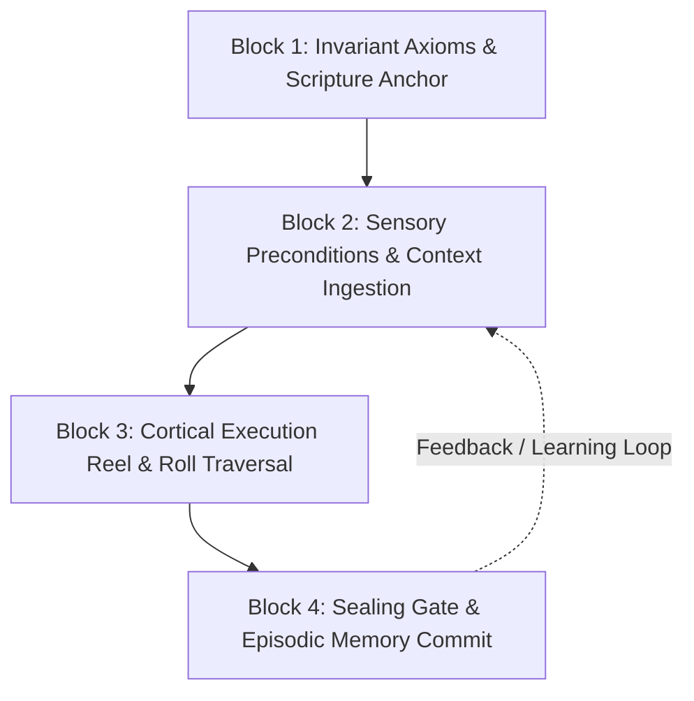

# ==============================================================================

# OMNICODE NEURAL-SYMBOLIC BRAIN ARCHITECTURE

# ( Balanced-Ternary Neural Network, Homoiconic Learning & Self-Dogfooding )

# ==============================================================================

## 1. Architectural Vision: The Self-Dogfooding Cognitive Brain

Traditional neural network models are separated from the code they generate: weights are opaque floating-point tensors running in PyTorch or CUDA, completely divorced from the formal grammar, boundary physics, or runtime execution of the target language.

OmniCode inverts this paradigm:

1. **Homoiconic Neural Substrate**: The neural network's architecture, memory traces, episodic weights, and execution graphs are defined in native OmniCode.
2. **Self-Dogfooding Cognitive Loop**: The AI brain consumes its own `.omni` declarative source reels, `.tape` procedural process ribbons, and `.scroll` episodic execution chronicles as both its dataset and its execution substrate.
3. **Balanced-Ternary Weights & Activations**: Synaptic transmissions are governed by balanced ternary physics ($\{-1, 0, +1\}$ / $\text{NULL}$), creating an intrinsically noise-resistant, transactional, and morally grounded reasoning engine.

---

## 2. Mathematical Formalism: Balanced-Ternary Neurodynamics

### 2.1. Discrete Trit Synaptic Weights

Each synapse connects neuron $i$ in layer $L$ to neuron $j$ in layer $L+1$ with weight $W_{ij} \in \{-1, 0, +1\}$:

- **$+1$ (Proceed / Excitatory)**: Affirmative alignment, forward causal momentum, reinforcement.
- **$0$ (Await / Neutral Equilibrium)**: Indeterminate state, zero-bias transmission, cognitive pause.
- **$-1$ (Rollback / Inhibitory)**: Adversative caveat, moral or topological veto, transactional unwind.
- **$\text{NULL}$ (Halt / Absorbing Sink)**: Absolute entropy trap, non-propagating circuit cessation.

### 2.2. Synaptic Accumulation & Activation Function

For a neuron receiving $N$ input trits $x_1, \dots, x_N$ with weights $W_1, \dots, W_N$ and bias $B \in \{-1, 0, +1\}$:

$$\Sigma = \sum_{k=1}^N W_k \cdot x_k + B$$

The ternary activation function $\Psi(\Sigma)$ with threshold $\theta \ge 1$ maps net excitation into the fourfold `QuadState`:

$$\Psi(\Sigma) = \begin{cases}
+1 : \text{PROCEED} & \text{if } \Sigma > \theta \\
0 : \text{AWAIT} & \text{if } -\theta \le \Sigma \le \theta \\
-1 : \text{ROLLBACK} & \text{if } \Sigma < -\theta \\
\text{NULL} : \text{HALT} & \text{if circuit tripwire armed or state saturated}
\end{cases}$$

---

## 3. The 4-Block Cognitive Cycle

The neural brain operates strictly through the canonical 4-Block architecture on every inference pass:

### Block 1: Invariant Axiom Bedrock (Moral & Ontological Grounding)
- Grounded in scripture (Exodus 31:18, Proverbs, Psalm 111:10) and immutable laws.
- Synaptic paths violating invariant boundaries are pruned a priori before forward propagation.

### Block 2: Sensory Opening & Token Transduction
- Ingests natural language prompts and translates them via `AITransducer` into active AST nodes.
- Allocates neural workspace vessels in virtual memory (`Word64` cells).

### Block 3: Body Block: Cortical Execution Reel
- The `AICortex` steps through sequential rolls ($S \rightarrow S'$).
- Evaluates directional vectors (`-->`, `<--`, `<=>`), caveats (`!`), and locators (`::@`).
- If an adversative caveat (`!`) trips or an unclosed boundary leaks, the synapse fires $-1:\text{ROLLBACK}$, rolling back the transaction.

### Block 4: Closing Block: Episodic Sealing & Learning
- The `ScrollLogger` records dual-format scrolls:
  - `.scroll`: Homoiconic 4-Block replay reel of thoughts and actions.
  - `.log`: High-precision microsecond telemetry of failpoints and repairs.
- `AILearner` ingests these scrolls to update synaptic weights and episodic associations in `AIMemory`.

---

## 4. Subsystem Components in `src/ai/`

| Component | File Path | Role |
| :--- | :--- | :--- |
| **`NeuralBrain`** | `src/ai/neural/network.rs` | Multi-layer balanced-ternary network engine |
| **`AICortex`** | `src/ai/model/cortex.rs` | Cognitive coordinator managing thought formulation & nervous system |
| **`AIMemory`** | `src/ai/model/memory.rs` | Long-term associative memory storehouse & episodic graph |
| **`AILearner`** | `src/ai/model/learner.rs` | Supervised learning & weight adaptation from past execution scrolls |
| **`ScrollLogger`** | `src/ai/model/scroll.rs` | Dual-format scroll generation and telemetry recorder |
| **`AITransducer`**| `src/ai/transducer.rs` | Natural language $\leftrightarrow$ OmniCode bidirectional translator |
| **`BiblicalLexicon`** | `src/ai/lexicon.rs` | Epistemic truth anchor & theological lexicon validator |

---

## 5. Dogfooding Strategy & Training Roadmap

1. **Self-Inspection**: The AI compiles and executes its own standard library (`<TRACK 2>/lexicon/`).
2. **Grammar Expansion**: As new types are defined (e.g. `Character`, `Number`, `Container`), their verbs become active keywords in the AI's generation vocabulary.
3. **Autonomous Self-Healing**: When a failpoint occurs (e.g. `BoundaryLeak`, `CaveatVeto`), the `Restorator` repairs the code and feeds the delta to `AILearner` as affirmative learning data.
