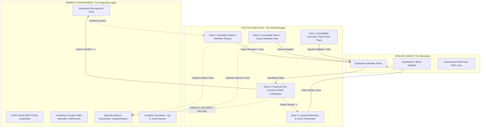

# OmniCode Diagnostic Debugger Subsystem

## The "Assess" Organ: The Focused Eyes of the DAR Cybernetic Loop

> **"Neither is there any creature that is not manifest in his sight: but all things are naked and opened unto the eyes of him with whom we have to do."**
> — *Hebrews 4:13 (KJV)*
>
> **"The eyes of the LORD are in every place, beholding the evil and the good."**
> — *Proverbs 15:3 (KJV)*
>
> **"His eyes behold, his eyelids try, the children of men."**
> — *Psalm 11:4 (KJV)*
>
> **"Prove all things; hold fast that which is good."**
> — *1 Thessalonians 5:21 (KJV)*
>
> **"For I am the LORD, I change not; therefore ye sons of Jacob are not consumed."**
> — *Malachi 3:6 (KJV)*
>
> **"Remove not the ancient landmark, which thy fathers have set."**
> — *Proverbs 22:28 (KJV)*

---

## 1. Architectural Philosophy: The Eyes vs. The Ambient Environment

In classical software environments, debugging is treated as a post-crash forensic autopsy. A debugger is attached only after an unhandled exception or segfault has halted the process.

In the **OmniCode Host Engine (Track 1)**, the debugger is an active, continuous organ within the **DAR Cybernetic Loop** ($\mathbf{DAR} = \langle \text{Detect}, \text{Assess}, \text{Restore} \rangle$):

$$\mathbf{Logger} \equiv \text{Ambient Environmental Awareness} \quad\longleftrightarrow\quad \mathbf{Debugger} \equiv \text{The Focused Pair of Eyes}$$



### The Metaphor Grounded

* **The Logger** is like looking around the environment as a whole. It senses temperature, sound, air pressure, monotonic time, and raw hardware landmarks. It records everything without judgment into circular ring buffers and persistent disk scrolls.
* **The Debugger** is the **focused pair of eyes**. Its job is to look intently at specific structural invariants within that environment:
  1. *Did that boundary actually close where it opened?*
  2. *Is that assignment attempting to mutate an immutable moral law or truth axiom?*
  3. *Is this rollback vector reversing causal momentum into an infinite loop?*
  4. *What truth state did this roll evaluate to—Commit (+1), Standby (0), Rollback (-1), or Void (NULL)?*
  5. *Does this candidate repair pass empirical test verification before we commit state to silicon?*

Whenever the debugger's eyes observe an anomaly, it doesn't crash the machine. It freezes the active execution frame, constructs an immutable snapshot, reverses the causal momentum vector (`-1:ROLLBACK`), and **passes structured telemetry back into the logger**, which then dispatches remediation tokens to the **Restorator** for self-healing.

---

## 2. The Five Gazes of the OmniDebugger

Following the canonical **4-Block Architecture**, the debugger subsystem is decomposed into specialized modules corresponding to the five distinct areas of scrutiny:

```text
src/diagnostics/debugger/
├── README.md         <-- Master Subsystem Reference (You are here)
├── mod.rs            <-- OmniDebugger coordinator, public facade & unit tests
├── boundary.rs       <-- Gaze 1: Delimiter stack, asymmetric crossings & leaks
├── immutable.rs      <-- Gaze 2: Rank 1 invariant protection & mutation vetoes
├── retroaction.rs    <-- Gaze 3: Causal momentum & infinite rollback loop trapping
├── state.rs          <-- Gaze 4: QuadState truth evaluation & null trap absorption
├── oracle.rs         <-- Gaze 5: Test verification sandboxes & log restoration
└── telemetry.rs      <-- Cognitive baton pass, gaze focus logs & probe frames
```

---

### Gaze 1: Boundary & Morphological Enclosures ([`boundary.rs`](file:///home/professorseanex/OmniCode/%3CTRACK%201%3E%20:%20%7BHost%20Engine%20&%20Virtual%20Machine%7D/src/diagnostics/debugger/boundary.rs))

*Scriptural Witness: Proverbs 22:28 ("Remove not the ancient landmark, which thy fathers have set")*

OmniCode's language grammar is governed by **boundary physics**. The debugger maintains a runtime LIFO stack of active [`BoundaryFrame`](file:///home/professorseanex/OmniCode/%3CTRACK%201%3E%20:%20%7BHost%20Engine%20&%20Virtual%20Machine%7D/src/diagnostics/debugger/boundary.rs#L32-L56) instances:

* **Opening Characters:** `<` (Invariant), `[` (Denotation), `{` (Connotation), `(` (Aside).
* **Closing Pairs:** Evaluated via [`BoundaryType::from_delimiters`](file:///home/professorseanex/OmniCode/%3CTRACK%201%3E%20:%20%7BHost%20Engine%20&%20Virtual%20Machine%7D/src/core/boundaries.rs#L107-L130), strictly preserving asymmetric emergences (`[ ... }` Rank 4 Bottom-Up) and impositions (`{ ... ]` Rank 5 Top-Down).
* **Failpoint Trapping:**
  * **Empty Stack:** Traps unmatched closing delimiters as [`FailpointType::BoundaryMismatch`](file:///home/professorseanex/OmniCode/%3CTRACK%201%3E%20:%20%7BHost%20Engine%20&%20Virtual%20Machine%7D/src/diagnostics/logger/failpoint/failpoint.rs).
  * **Mismatched Crossing:** Traps illegal pairs (e.g. `< ... ]`), generating an exact [`FixSuggestion`](file:///home/professorseanex/OmniCode/%3CTRACK%201%3E%20:%20%7BHost%20Engine%20&%20Virtual%20Machine%7D/src/diagnostics/logger/failpoint/remediation.rs) pointing to the matching partner (`>`).
  * **Boundary Leak:** At EOF, [`assert_all_boundaries_closed`](file:///home/professorseanex/OmniCode/%3CTRACK%201%3E%20:%20%7BHost%20Engine%20&%20Virtual%20Machine%7D/src/diagnostics/debugger/boundary.rs#L154-L197) ensures no unsealed enclosures leak into outer space.

---

### Gaze 2: Immutable Invariant Axioms ([`immutable.rs`](file:///home/professorseanex/OmniCode/%3CTRACK%201%3E%20:%20%7BHost%20Engine%20&%20Virtual%20Machine%7D/src/diagnostics/debugger/immutable.rs))

*Scriptural Witness: Malachi 3:6 ("For I am the LORD, I change not; therefore ye sons of Jacob are not consumed")*

Entities declared inside `< ... >` (e.g., `< Character >`, `< Covenant >`, `< Law_Truth >`) represent **Rank 1 Immutable Axioms**.

* The [`ImmutableRegistry`](file:///home/professorseanex/OmniCode/%3CTRACK%201%3E%20:%20%7BHost%20Engine%20&%20Virtual%20Machine%7D/src/diagnostics/debugger/immutable.rs#L29-L34) records all invariant identifiers upon declaration.
* When any subsequent assignment, mutation, or write operation targets an immutable identifier, the debugger intercepts the write via [`assert_mutation_permitted`](file:///home/professorseanex/OmniCode/%3CTRACK%201%3E%20:%20%7BHost%20Engine%20&%20Virtual%20Machine%7D/src/diagnostics/debugger/immutable.rs#L66-L101).
* **Failpoint Trapping:** Emits [`FailpointType::ImmutableMutation`](file:///home/professorseanex/OmniCode/%3CTRACK%201%3E%20:%20%7BHost%20Engine%20&%20Virtual%20Machine%7D/src/diagnostics/logger/failpoint/failpoint.rs) and synthesizes a [`FixKind::ConvertImmutableToMutable`](file:///home/professorseanex/OmniCode/%3CTRACK%201%3E%20:%20%7BHost%20Engine%20&%20Virtual%20Machine%7D/src/diagnostics/logger/failpoint/remediation.rs) patch (`[ Name ]`) if mutation was intended.

---

### Gaze 3: Causal Momentum & Retroaction Trapping ([`retroaction.rs`](file:///home/professorseanex/OmniCode/%3CTRACK%201%3E%20:%20%7BHost%20Engine%20&%20Virtual%20Machine%7D/src/diagnostics/debugger/retroaction.rs))

*Scriptural Witness: Ecclesiastes 1:9 ("The thing that hath been, it is that which shall be; and that which is done is that which shall be done")*

In balanced ternary execution physics, state reversals (`-1:ROLLBACK`) reverse the causal vector ($\vec{v} \rightarrow -\vec{v}$) to undo uncommitted transactions.

* The [`RetroactionTracker`](file:///home/professorseanex/OmniCode/%3CTRACK%201%3E%20:%20%7BHost%20Engine%20&%20Virtual%20Machine%7D/src/diagnostics/debugger/retroaction.rs#L29-L36) tracks rollback iterations per target scope.
* If a target rolls back repeatedly without making forward progress and exceeds `max_retroaction_depth`, it trips [`FailpointType::CyclicRetroaction`](file:///home/professorseanex/OmniCode/%3CTRACK%201%3E%20:%20%7BHost%20Engine%20&%20Virtual%20Machine%7D/src/diagnostics/logger/failpoint/failpoint.rs).
* This halts infinite undo/retry cycles and escalates to deep diagnostic reflection.

---

### Gaze 4: QuadState Execution Truth ([`state.rs`](file:///home/professorseanex/OmniCode/%3CTRACK%201%3E%20:%20%7BHost%20Engine%20&%20Virtual%20Machine%7D/src/diagnostics/debugger/state.rs))

*Scriptural Witness: Matthew 5:37 ("But let your communication be, Yea, yea; Nay, nay: for whatsoever is more than these cometh of evil")*

Tracks the fourfold commit truth state of the virtual machine and silicon registers:

1. `+1: PROCEED`: Transactional commit certified; logged to channel `"TERNARY"`.
2. `0: AWAIT`: Homeostatic standby; observation pending.
3. `-1: ROLLBACK`: State reversal triggered; emits [`FailpointType::RollbackTriggered`](file:///home/professorseanex/OmniCode/%3CTRACK%201%3E%20:%20%7BHost%20Engine%20&%20Virtual%20Machine%7D/src/diagnostics/logger/failpoint/failpoint.rs).
4. `NULL: HALT`: Catastrophic null collision or void trap; emits [`FailpointType::NullTrap`](file:///home/professorseanex/OmniCode/%3CTRACK%201%3E%20:%20%7BHost%20Engine%20&%20Virtual%20Machine%7D/src/diagnostics/logger/failpoint/failpoint.rs).

Every evaluation increments the debugger's monotonic `step_count` and records a focused probe frame into the flight recorder ring buffer.

---

### Gaze 5: Empirical Test Oracles & Self-Healing ([`oracle.rs`](file:///home/professorseanex/OmniCode/%3CTRACK%201%3E%20:%20%7BHost%20Engine%20&%20Virtual%20Machine%7D/src/diagnostics/debugger/oracle.rs))

*Scriptural Witness: 1 Thessalonians 5:21 ("Prove all things; hold fast that which is good")*

The debugger serves as the **verification gate** before any candidate code patch or state mutation can be committed:

* [`execute_verification_test`](file:///home/professorseanex/OmniCode/%3CTRACK%201%3E%20:%20%7BHost%20Engine%20&%20Virtual%20Machine%7D/src/diagnostics/debugger/mod.rs#L313-L352): Spawns an isolated child debugger sandbox. If the candidate passes, logs `ORACLE_SUCCESS` observation for AI memory. If it fails, logs `ORACLE_FAILURE` and vetoes state commit.
* [`verify_candidate_repair`](file:///home/professorseanex/OmniCode/%3CTRACK%201%3E%20:%20%7BHost%20Engine%20&%20Virtual%20Machine%7D/src/diagnostics/debugger/oracle.rs#L42-L78): Verifies restored source strings against a provided test oracle closure.
* [`execute_restoration_from_log`](file:///home/professorseanex/OmniCode/%3CTRACK%201%3E%20:%20%7BHost%20Engine%20&%20Virtual%20Machine%7D/src/diagnostics/debugger/oracle.rs#L91-L158): Ingests a structured [`LogEvent`](file:///home/professorseanex/OmniCode/%3CTRACK%201%3E%20:%20%7BHost%20Engine%20&%20Virtual%20Machine%7D/src/diagnostics/logger/universal/bus.rs#L58-L73) containing a [`FixSuggestion`], executes the surgical patch, and requires test oracle certification before returning the restored source.

---

## 3. The Cognitive Baton Pass ([`telemetry.rs`](file:///home/professorseanex/OmniCode/%3CTRACK%201%3E%20:%20%7BHost%20Engine%20&%20Virtual%20Machine%7D/src/diagnostics/debugger/telemetry.rs))

The Debugger never operates in a silo. Every focused gaze is translated into machine observability and passed back to the ambient environment:

```text
================================================================================
                    DEBUGGER TELEMETRY BATON PASS
================================================================================
  Focused Scrutiny Action (Push, Pop, Invariant Veto, Oracle Verification)
                              │
                              ▼
                   [ telemetry::log_debugger_focus ]
                   Channel: "DEBUGGER", "BOUNDARY", "IMMUTABILITY", "VECTOR"
                              │
               ┌──────────────┴──────────────┐
               ▼                             ▼
  [ Flight Recorder Probe Frame ]    [ Episodic Cognitive Note ]
  RollFrame appended to ring buffer  Inscribed to category "REFLECTION"
  Verb: "PUSH_BOUNDARY", "ORACLE"    Taxonomy: ["debugger", "gaze", ...]
  State: QuadState (+1, -1, NULL)    Context Snippet: target token / symbol
               │                             │
               └──────────────┬──────────────┘
                              │
                              ▼
                     [ DiagnosticLogger ]
                              │
        ┌─────────────────────┼─────────────────────┐
        ▼                     ▼                     ▼
  [ AICortex Reflection ] [ Restorator Immune ] [ Query Engine ]
  Learns invariant focus  Consumes FixTokens    O(1) Session Retrieval
================================================================================
```

When the debugger vetoes an illegal mutation on `< Law_Truth >`, it writes:

```rust
telemetry::record_debugger_cognitive_note(
    &self.logger,
    "[Debugger] Illegal Mutation Veto <Law_Truth>",
    "Attempted write on sealed Rank 1 invariant; converted to rollback vector",
    ["debugger", "failpoint", "immutability", "veto"].as_slice(),
    Some("Law_Truth"),
);
```

The **`AICortex`** inspects these notes before generating code, ensuring that AI agents never hallucinate code that attempts to mutate sealed invariant axioms.

---

## 4. Integration Across OmniCode Subsystems

The [`OmniDebugger`](file:///home/professorseanex/OmniCode/%3CTRACK%201%3E%20:%20%7BHost%20Engine%20&%20Virtual%20Machine%7D/src/diagnostics/debugger/mod.rs#L44-L60) is embedded across all operational execution layers in Track 1:

1. **Parser ([`Parser`](file:///home/professorseanex/OmniCode/%3CTRACK%201%3E%20:%20%7BHost%20Engine%20&%20Virtual%20Machine%7D/src/parser/syntactic/parser.rs))**:
   * Pushes and pops delimiter frames on every boundary token (`<`, `[`, `{`, `(`).
   * Registers top-level immutable entities into the registry.
2. **Evaluator ([`Evaluator`](file:///home/professorseanex/OmniCode/%3CTRACK%201%3E%20:%20%7BHost%20Engine%20&%20Virtual%20Machine%7D/src/runtime/evaluator/core.rs))**:
   * Asserts mutation authorization before writing to environment variables.
   * Evaluates QuadState truth transitions.
3. **REPL Shell ([`run_repl`](file:///home/professorseanex/OmniCode/%3CTRACK%201%3E%20:%20%7BHost%20Engine%20&%20Virtual%20Machine%7D/src/cli/repl.rs))**:
   * Maintains boundary stacks across multiline terminal buffers.
   * Performs state snapshots and transaction rollbacks on user errors.
4. **Linter ([`OmniLinter`](file:///home/professorseanex/OmniCode/%3CTRACK%201%3E%20:%20%7BHost%20Engine%20&%20Virtual%20Machine%7D/src/diagnostics/linter/mod.rs))**:
   * Shares the debugger instance during syntax analysis and grammatical checks.
5. **Restorator ([`Restorator`](file:///home/professorseanex/OmniCode/%3CTRACK%201%3E%20:%20%7BHost%20Engine%20&%20Virtual%20Machine%7D/src/diagnostics/restorator/mod.rs))**:
   * Consumes the debugger's `remediation_queue` to apply surgical AST patches.
   * Employs the debugger's test oracle sandbox to certify patches before saving.

---

## 5. Architectural Invariant Guarantees

1. **Zero-Panic Contract**:
   The debugger never triggers unhandled panics on boundary mismatches, leaks, or illegal mutations. Every anomaly is trapped as a typed failpoint and equipped with an executable [`FixSuggestion`](file:///home/professorseanex/OmniCode/%3CTRACK%201%3E%20:%20%7BHost%20Engine%20&%20Virtual%20Machine%7D/src/diagnostics/logger/failpoint/remediation.rs).
2. **Cyclic Retroaction Ceiling**:
   Rollback loops are strictly bounded by `max_retroaction_depth`. Infinite undo loops are mathematically impossible.
3. **Deterministic Immutability**:
   Once registered, Rank 1 Invariants `< ... >` cannot be modified under any execution pathway without explicit conversion to Rank 2 Denotations `[ ... ]`.
4. **Empirical Certification**:
   No candidate repair is accepted on faith. Every patch must execute cleanly against a certified test oracle before receiving the `+1:PROCEED` seal.

---

*OmniCode Diagnostics Framework — Track 1: Host Engine & Virtual Machine*
