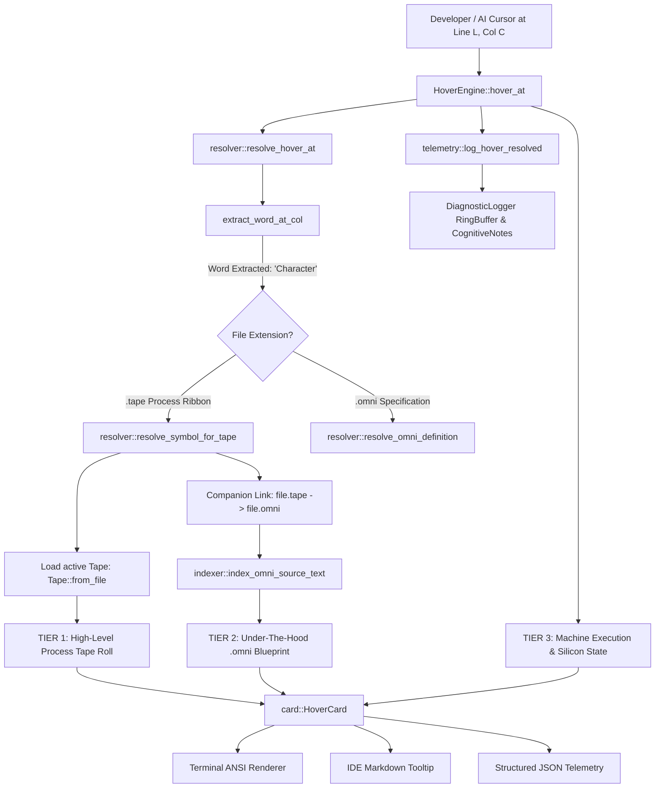

# OmniCode Cross-Scale Hover & Symbol Introspection Subsystem

> **"According to the grace of God which is given unto me, as a wise masterbuilder, I have laid the foundation, and another buildeth thereon."**  
> — *1 Corinthians 3:10 (KJV)*  
>
> **"The words of the wise are as goads, and as nails fastened by the masters of assemblies, which are given from one shepherd."**  
> — *Ecclesiastes 12:11 (KJV)*  
>
> **"It is the glory of God to conceal a thing: but the honour of kings is to search out a matter."**  
> — *Proverbs 25:2 (KJV)*  
>
> **"He bindeth the floods from overflowing; and the thing that is hid bringeth he forth to light."**  
> — *Job 28:11 (KJV)*  

---

## 1. Overview & Architectural Purpose

The **OmniCode Hover Subsystem** ([`src/diagnostics/hover`](file:///home/professorseanex/OmniCode/%3CTRACK%201%3E%20:%20%7BHost%20Engine%20&%20Virtual%20Machine%7D/src/diagnostics/hover)) is the cross-scale sensory microscope of the OmniCode Host Engine (Track 1). It delivers deep, multi-tier symbol inspection, docstring resolution, and cross-file transparency across all OmniCode documents—bridging high-level operational process streams ([`.tape`](file:///home/professorseanex/OmniCode/%3CTRACK%202%3E%20:%20%7BOmniCode%20Language%20&%20Standard%20Library%7D/lexicon/01_nouns/ideas/types/character/interpreted/character.tape)), declarative invariant specifications ([`.omni`](file:///home/professorseanex/OmniCode/%3CTRACK%202%3E%20:%20%7BOmniCode%20Language%20&%20Standard%20Library%7D/lexicon/01_nouns/ideas/types/character/compiled/character.omni)), and physical bare-metal silicon states.

In conventional compilers and language servers (e.g., rust-analyzer, clangd, tsserver), hovering over a symbol merely reveals a flattened type signature and basic docstring. In OmniCode, **code operates simultaneously across multiple scales**:

1. **The Human Scale (Narrative & Process)**: An operational process tape describing what actions are occurring, who is performing them, why they exist (5-Ws cardinal clauses), and the observer's intentional rationale (first-class Asides `(...)`).
2. **The Linguistic Scale (Invariant Specifications)**: A declarative blueprint defining the mathematical boundary rank (Rank 1 `<...>` Invariant through Rank 6 `(...)` Aside), 4-Block architectural origin, sub-attributes, and biblical witnesses.
3. **The Machine Scale (Silicon Footprint & Execution Physics)**: Physical cell allocations, balanced ternary virtual machine encoding (5 trits $\leftrightarrow$ 1 byte, Radix-3 $[-121 \dots +121]$), and fourfold commit status (`+1: PROCEED`, `0: AWAIT`, `-1: ROLLBACK`, `NULL: HALT`).

The Hover Subsystem unifies these three distinct ontological planes into a coherent, **3-Tier Composite HoverCard** accessible via CLI terminal commands, IDE tooltips, and the local OmniStudio HTTP server.

---

## 2. The 3-Tier Composite Hover Architecture

Whenever a developer or AI agent hovers over an identifier in an active `.tape` or `.omni` document at coordinate `(line, col)`, the hover engine synthesizes a structured 3-tier report:



### The Three Tiers Detailed

| Tier | Ontological Dimension | Target Artifact | Key Invariants Disclosed |
| :--- | :--- | :--- | :--- |
| **Tier 1: High-Level Process View** | Operational Process & Intent | `.tape` / `.scroll` | • Process Ribbon Name & Track (`Track 0 [KERNEL]`, `Track 2 [APP]`)<br>• Active Roll Index (e.g. `Roll 1 of 6`)<br>• 5-Ws Cardinal Clauses (`WHO`, `WHAT`, `WHEN`, `WHERE`, `WHY`, `HOW`)<br>• First-Class Machine Intent Asides `(...)`<br>• Covenant Purpose & Scripture Witness |
| **Tier 2: Under-The-Hood Blueprint** | Declarative Contract & Schema | `.omni` | • Grounded Source File link & Line Number (`file.omni:142`)<br>• 4-Block Origin (`BLOCK 1: METADATA`, `BLOCK 2: OPENING`, etc.)<br>• Morphological Boundary Type & Rank (Rank 1 `<...>` to Rank 6 `(...)`)<br>• Grammatical Category (Noun, Verb, Adverb, Pronoun)<br>• Sub-Attributes & Invariant Axiom Fields<br>• Architectural Description Docstrings (`#` / `//`) |
| **Tier 3: Machine Execution State** | Physical Silicon & VM Substrate | VM / Bare-Metal | • Spatial Partition Allocation (e.g. `1 cells`, `1024 cells`)<br>• Virtual Transducer Codec (Dense Byte $\leftrightarrow$ 5 Balanced Trits)<br>• Silicon Truth State (`+1: PROCEED`, transactional rollback)<br>• Hardware MMIO Registers (`Bit_0`..`Bit_7`, `ACC`, `HEAD`) |

---

## 3. Subsystem Modular Topology

Following the canonical **4-Block Architecture** with KJV scriptural witnesses, the `hover/` directory is modularized into highly focused submodules:

```bash
src/diagnostics/hover/
├── README.md         <-- Master Subsystem Reference (You are here)
├── mod.rs            <-- HoverEngine coordinator, workspace indexing & public exports
├── card.rs           <-- Data models (HoverCard, OmniDefinition, TapeRollContext), Markdown/ANSI formatters
├── indexer.rs        <-- Multi-pass symbol indexer, AST entity extractor, fallback token scanner
├── resolver.rs       <-- Coordinate math (line/col), cross-file .tape -> .omni linking
└── telemetry.rs      <-- DiagnosticLogger integration, sensory flight recorder frames, episodic memory notes
```

### Submodule Descriptions

1. **[`mod.rs`](file:///home/professorseanex/OmniCode/%3CTRACK%201%3E%20:%20%7BHost%20Engine%20&%20Virtual%20Machine%7D/src/diagnostics/hover/mod.rs)**:
   - Houses [`HoverEngine`](file:///home/professorseanex/OmniCode/%3CTRACK%201%3E%20:%20%7BHost%20Engine%20&%20Virtual%20Machine%7D/src/diagnostics/hover/mod.rs#L44-L60), the public coordinator managing the symbol dictionary and file-to-symbol cross-references.
   - Provides [`index_workspace`](file:///home/professorseanex/OmniCode/%3CTRACK%201%3E%20:%20%7BHost%20Engine%20&%20Virtual%20Machine%7D/src/diagnostics/hover/mod.rs#L124-L178) to pre-index `manifest.omni`, `lib/core/`, and all Track 2 Lexicon source reels.
   - Re-exports [`HoverCard`](file:///home/professorseanex/OmniCode/%3CTRACK%201%3E%20:%20%7BHost%20Engine%20&%20Virtual%20Machine%7D/src/diagnostics/hover/card.rs#L70-L84), [`OmniDefinition`](file:///home/professorseanex/OmniCode/%3CTRACK%201%3E%20:%20%7BHost%20Engine%20&%20Virtual%20Machine%7D/src/diagnostics/hover/card.rs#L28-L50), and [`TapeRollContext`](file:///home/professorseanex/OmniCode/%3CTRACK%201%3E%20:%20%7BHost%20Engine%20&%20Virtual%20Machine%7D/src/diagnostics/hover/card.rs#L52-L68) for backward compatibility.

2. **[`card.rs`](file:///home/professorseanex/OmniCode/%3CTRACK%201%3E%20:%20%7BHost%20Engine%20&%20Virtual%20Machine%7D/src/diagnostics/hover/card.rs)**:
   - Contains the core data models representing symbol state.
   - Implements [`format_composite_markdown`](file:///home/professorseanex/OmniCode/%3CTRACK%201%3E%20:%20%7BHost%20Engine%20&%20Virtual%20Machine%7D/src/diagnostics/hover/card.rs#L305-L400) rendering GitHub-flavored Markdown for VSCode tooltips.
   - Implements [`render_terminal`](file:///home/professorseanex/OmniCode/%3CTRACK%201%3E%20:%20%7BHost%20Engine%20&%20Virtual%20Machine%7D/src/diagnostics/hover/card.rs#L190-L280) rendering clean ANSI terminal banners for CLI inspection.
   - Implements zero-allocation, dependency-free JSON serialization ([`to_json`](file:///home/professorseanex/OmniCode/%3CTRACK%201%3E%20:%20%7BHost%20Engine%20&%20Virtual%20Machine%7D/src/diagnostics/hover/card.rs#L102-L185)) conforming to language server protocol expectations.

3. **[`indexer.rs`](file:///home/professorseanex/OmniCode/%3CTRACK%201%3E%20:%20%7BHost%20Engine%20&%20Virtual%20Machine%7D/src/diagnostics/hover/indexer.rs)**:
   - Implements multi-pass symbol extraction.
   - Invokes [`Parser::parse`](file:///home/professorseanex/OmniCode/%3CTRACK%201%3E%20:%20%7BHost%20Engine%20&%20Virtual%20Machine%7D/src/parser/syntactic/parser.rs) to extract AST declarations, boundary ranks, and attached expressions.
   - Implements resilient regex and lexical fallback scanners for top-level module declarations (`= [Module]: < ... >`), fields (`[ key ]: { value }`), registers (`Bit_0`..`Bit_7`), and doc comments (`#` / `//`).

4. **[`resolver.rs`](file:///home/professorseanex/OmniCode/%3CTRACK%201%3E%20:%20%7BHost%20Engine%20&%20Virtual%20Machine%7D/src/diagnostics/hover/resolver.rs)**:
   - Implements [`extract_word_at_col`](file:///home/professorseanex/OmniCode/%3CTRACK%201%3E%20:%20%7BHost%20Engine%20&%20Virtual%20Machine%7D/src/diagnostics/hover/resolver.rs#L39-L61) using 1-based column offsets and alphanumeric boundary checks.
   - Resolves companion files: given `lexicon/.../character.tape`, it automatically locates and indexes `lexicon/.../character.omni`.
   - Maps `.tape` rolls by matching line numbers and text content, binding the active roll covenant to the symbol.

5. **[`telemetry.rs`](file:///home/professorseanex/OmniCode/%3CTRACK%201%3E%20:%20%7BHost%20Engine%20&%20Virtual%20Machine%7D/src/diagnostics/hover/telemetry.rs)**:
   - Intercepts every hover inquiry and logs structured sensory records into [`DiagnosticLogger`](file:///home/professorseanex/OmniCode/%3CTRACK%201%3E%20:%20%7BHost%20Engine%20&%20Virtual%20Machine%7D/src/diagnostics/logger/mod.rs).
   - Emits sensory resolution events (`HoverResolved`) and miss events (`HoverMiss`).
   - On resolution misses, emits formal failpoints ([`FailpointType::HoverResolutionMiss`](file:///home/professorseanex/OmniCode/%3CTRACK%201%3E%20:%20%7BHost%20Engine%20&%20Virtual%20Machine%7D/src/diagnostics/logger/failpoint/failpoint.rs)).
   - Appends sensory probe frames ([`RollFrame`](file:///home/professorseanex/OmniCode/%3CTRACK%201%3E%20:%20%7BHost%20Engine%20&%20Virtual%20Machine%7D/src/diagnostics/logger/roll/frame.rs)) into the flight recorder ring buffer.
   - Records episodic memory notes ([`CognitiveNote`](file:///home/professorseanex/OmniCode/%3CTRACK%201%3E%20:%20%7BHost%20Engine%20&%20Virtual%20Machine%7D/src/diagnostics/logger/episodic/note.rs)) so the AI Cortex learns which symbols are being actively scrutinized by the developer.

---

## 4. Telemetry Logging & Episodic Memory

In accordance with Track 0 and the logger/linter subsystems, the Hover engine is not an isolated utility—it is an **active sensory organ** wired into the OmniCode diagnostic telemetry stream:

```text
================================================================================
                    HOVER SENSORY TELEMETRY FLOW
================================================================================
  IDE / CLI / HTTP Hover Request at coordinate (Line L, Col C)
                              │
                              ▼
                      [ HoverEngine ]
                              │
               ┌──────────────┴──────────────┐
               ▼                             ▼
       [ Resolved Hit ]                [ Unresolved Miss ]
       • Symbol found in index         • Missing symbol at coordinate
       • 3-Tier card generated         • Logged to logger channel "hover"
       • Logged to channel "hover"     • Failpoint: HoverResolutionMiss
               │                             │
               └──────────────┬──────────────┘
                              │
                              ▼
                     [ DiagnosticLogger ]
                              │
        ┌─────────────────────┼─────────────────────┐
        ▼                     ▼                     ▼
  [ Flight Recorder ]   [ Failpoint Bank ]   [ Episodic Memory ]
  Appends RollFrame     Registers Miss       Writes CognitiveNote
  with monotonic µs     with line & col      Taxonomy: ["hover", "symbol"]
================================================================================
```

### Cognitive Note Inscription
When a developer hovers over a symbol like `Character`, the engine logs:
```rust
telemetry::record_hover_cognitive_trace(
    &self.logger,
    "Character",
    "lexicon/.../character.tape",
    15,
    14,
    "Tape roll inspection with companion blueprint link: Character",
);
```
This stores an episodic memory note with:
- **Category:** `CognitiveCategory::Reflection`
- **Summary:** `[Hover] Inspected symbol: Character`
- **Taxonomy Tags:** `["hover", "inspection", "symbol", "Character"]`
- **Technical Details:** Location `file:15:14` with resolved status.

The [`AICortex`](file:///home/professorseanex/OmniCode/%3CTRACK%201%3E%20:%20%7BHost%20Engine%20&%20Virtual%20Machine%7D/src/ai/cortex.rs) can subsequently query these notes to understand developer intent and provide contextual code completion or self-healing assistance.

---

## 5. IDE Integration & Developer Experience (VS Code)

The IDE integration resides in [`<TRACK 3> : {Applications & OmniStudio Interfaces}/apps/editors/vscode/`](file:///home/professorseanex/OmniCode/%3CTRACK%203%3E%20:%20%7BApplications%20&%20OmniStudio%20Interfaces%7D/apps/editors/vscode).

### 1. Automatic File Associations
Both `.omni` and `.tape` files are registered under language ID `omnicode`:
```json
"files.associations": {
    "*.omni": "omnicode",
    "*.scroll": "omnicode",
    "*.tape": "omnicode"
}
```

### 2. Editor Settings (`.vscode/settings.json`)
Explicitly configures hover delay and bracket coloring for zero-friction inspection:
```json
"[omnicode]": {
    "editor.rulers": [80],
    "editor.wordWrap": "off",
    "editor.tabSize": 4,
    "editor.insertSpaces": true,
    "editor.hover.enabled": "on",
    "editor.hover.delay": 300,
    "editor.quickSuggestions": {
        "other": "on",
        "comments": "off",
        "strings": "on"
    }
}
```

### 3. Syntax Grammar Highlighting (`omnicode.tmLanguage.json`)
Full lexical recognition for:
- **Binary Literals**: `0b01100001`
- **Silicon Bit Rails & Registers**: `Bit_0`..`Bit_7`, `ACC`, `HEAD`, `HOME`, `SPOOL`, `DISCARD`
- **SVO Verbs**: `SET`, `DEFINE`, `PARTITION`, `INSCRIBE`, `TRANSDUCE`, `CLOSE`, `RUN`, `STEP`
- **4-Block Headers**: `BLOCK 1: METADATA`, `BLOCK 2: OPENING`, `BLOCK 3: BODY`, `BLOCK 4: CLOSING`
- **Invariant Scriptural Witnesses**: `SCRIPTURAL WITNESS`, `ARCHITECTURAL TOPOLOGY`

### 4. Language Features (`extension.js`)
- **3-Tier Hover Provider**: Queries local CLI `omnicode hover <file> <line> <col> --json` with fallback to OmniStudio HTTP server (`http://127.0.0.1:8080/api/hover`).
- **Jump to Definition (F12)**: Pressing F12 on an identifier inside a `.tape` roll jumps directly to the underlying definition in the companion `.omni` source reel!
- **Document Symbol Outline**: Automatically populates the VS Code Outline tree with the 4-Block zones, tape rolls, module declarations, and invariant types.
- **Diagnostic Linter on Save**: Runs `omnicode lint` on file save, highlighting missing 4-blocks, unclosed delimiters, and spatial violations directly in the editor.

---

## 6. CLI Usage & Verification Examples

The CLI provides two primary modes: human ANSI terminal output and machine JSON output.

### 1. Terminal ANSI Inspection
```bash
omnicode hover "<TRACK 2> : {OmniCode Language & Standard Library}/lexicon/01_nouns/ideas/types/character/interpreted/character.tape" 15 14
```

**Output**:
```text
===============================================================================
  OmniCode Symbol Inspection: Character
===============================================================================
[TIER 1: HIGH-LEVEL PROCESS TAPE ROLL]
  • Process Ribbon:       Character on Track 2 [APP]
  • Roll Execution (1 of 6): [ ROLL 1 ] : [ Inscribe ] : { Glyph ] --> INSCRIBE [ Cell ] = [ Character` ] ( Inscribe external glyph into Cell yielding Character-prime )
  • Roll Intent Aside:    "Inscribe external glyph into Cell yielding Character-prime"
  • Tape Head Covenant:   WHO OmniCode Lexicon -> WHAT Character
  • Covenant Purpose:     "Inscribe atomic character type invariant into defined space"
  • Spatial Partition:    1 cells

[TIER 2: UNDER-THE-HOOD .OMNI BLUEPRINT]
  • Definition Status:    Inherited Standard Runtime Entity (lib/core)

[TIER 3: MACHINE EXECUTION & SILICON FOOTPRINT]
  • Memory Allocation:     1 cells
  • Transducer Codec:      Dense Byte <-> 5 Balanced Trits (Radix-3 [-121..+121])
  • Silicon Truth State:   +1:PROCEED (Deterministic commit, transactional rollback)
```

### 2. JSON Tooling Output (LSP / IDE)
```bash
omnicode hover "<TRACK 2> : {OmniCode Language & Standard Library}/lexicon/01_nouns/ideas/types/character/interpreted/character.tape" 15 14 --json
```

**Output**:
```json
{
  "symbol": "Character",
  "is_locally_redefined": false,
  "tape_context": {
    "tape_name": "Character",
    "track": "Track 2 [APP]",
    "roll_number": 1,
    "total_rolls": 6,
    "raw_roll_text": "[ ROLL 1 ] : [ Inscribe ] : { Glyph ] --> INSCRIBE [ Cell ] = [ Character` ] ( Inscribe external glyph into Cell yielding Character-prime )",
    "roll_aside_intent": "Inscribe external glyph into Cell yielding Character-prime",
    "head_who": "OmniCode Lexicon",
    "head_what": "Character",
    "head_why": "Inscribe atomic character type invariant into defined space",
    "head_how": "Exodus 31:18 KJV",
    "partition_size": 1
  },
  "omni_definition": null,
  "markdown": "### `Character` — `Process Tape Entity`\n\n#### 📜 1. High-Level Process Tape View\n* **Process Ribbon:** `Character` on `Track 2 [APP]`\n* **Active Roll (1/6):** `[ ROLL 1 ] : [ Inscribe ] : { Glyph ] --> INSCRIBE [ Cell ] = [ Character` ]`\n* **Roll Intent Aside:** *\"Inscribe external glyph into Cell yielding Character-prime\"*\n* **Tape Head Covenant:** WHO `OmniCode Lexicon` $\\to$ WHAT `Character`\n\n---\n\n#### 🔍 2. Under-The-Hood (.omni Blueprint)\n* **Under-The-Hood Status:** Pure runtime process entity; inherits standard library defaults.\n\n---\n\n#### ⚙️ 3. Machine Execution & Silicon State\n* **Memory Allocation:** Partition reservation ceiling: `1 cells`\n* **Transducer Codec:** Dense byte $\\longleftrightarrow$ 5 balanced trits ($[-121 \\dots +121]$ Radix-3)\n* **Execution Truth State:** `+1: PROCEED` (Deterministic commit, transactional rollback protection)\n"
}
```

### 3. Inspecting a Low-Level `.omni` File
```bash
omnicode hover "<TRACK 2> : {OmniCode Language & Standard Library}/lexicon/01_nouns/ideas/types/character/compiled/character.omni" 51 5
```

**Output**:
```text
===============================================================================
  OmniCode Symbol Inspection: Character
===============================================================================
[TIER 2: UNDER-THE-HOOD .OMNI BLUEPRINT]
  • Grounded Source:      <TRACK 2> : {OmniCode Language & Standard Library}/lexicon/01_nouns/ideas/types/character/compiled/character.omni:142 [BLOCK 2: OPENING]
  • Ontological Rank:     Rank 1 (Invariant(<...>))
  • Grammatical Category: Noun
  • Contract Intent Aside:"Denoted Character is typed as invariant allocated in Cell"
  • Architectural Description:
    > 2. Typed Entity Allocation: Invariant Bound to Concrete Cell

[TIER 3: MACHINE EXECUTION & SILICON FOOTPRINT]
  • Memory Allocation:     1024 cells
  • Transducer Codec:      Dense Byte <-> 5 Balanced Trits (Radix-3 [-121..+121])
  • Silicon Truth State:   +1:PROCEED (Deterministic commit, transactional rollback)
```

---

## 7. Mathematical & Invariant Guarantees

1. **Deterministic 1-Based Coordinates**:
   All CLI arguments, JSON payload offsets, and internal coordinate mathematics are 1-based (`(line, col)`), strictly adhering to the standard IDE cursor contract and preventing off-by-one positioning errors.

2. **Zero-Panic Resilience**:
   If a cursor lands on whitespace, an unclosed delimiter, or a malformed identifier, the engine never panics. It gracefully emits an affirmative failpoint record (`FailpointType::HoverResolutionMiss`) to the telemetry stream and exits with an actionable diagnostics message.

3. **Asymmetric Boundary Preservation**:
   The engine accurately respects asymmetric boundaries, such as bottom-up emergent boundaries (`[ ... }`) and top-down impositions (`{ ... ]`), preserving their distinct ranking and directional vector properties in the hover presentation.

4. **Bijective Companion Linking**:
   When inspecting an operational process tape (`foo.tape`), the engine automatically binds to `foo.omni` if present in the companion directory structure, enabling seamless cross-scale navigation without requiring manual import flags.

---

*OmniCode Diagnostics Framework — Track 1: Host Engine & Virtual Machine*
