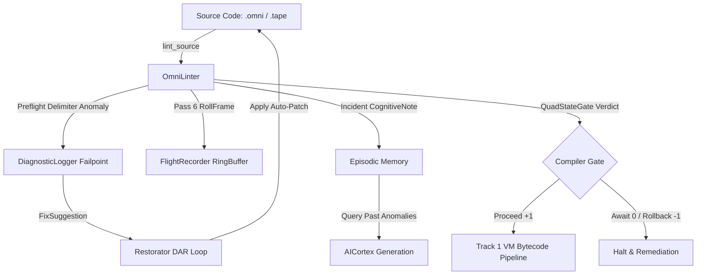

# OmniCode Diagnostic Linter Subsystem

> **"A false balance is abomination to the LORD: but a just weight is his delight."**
> — *Proverbs 11:1 (KJV)*

> **"Let all things be done decently and in order."**
> — *1 Corinthians 14:40 (KJV)*

---

## 1. Overview & Architectural Purpose

The **OmniCode Linter Subsystem** ([`src/diagnostics/linter`](file:///home/professorseanex/OmniCode/%3CTRACK%201%3E%20:%20%7BHost%20Engine%20&%20Virtual%20Machine%7D/src/diagnostics/linter)) is the foundational static analysis, syntax verification, structural gatekeeper, and automated remediation engine of the OmniCode Host Engine (Track 1).

Unlike legacy compiler linters that merely dump text warnings to `stderr`, the OmniCode Linter operates as an active **sensory and immune organ**. It verifies source files (`.omni` and `.tape`) against the canonical language specifications demonstrated in `character.omni`, `character.tape`, `number.omni`, and `number.tape`. It checks strict conformance to the **4-Block Architecture**, validates multi-tier syntactic boundaries (including asymmetric emergences `[ ... }` and impositions `{ ... ]`), computes a deterministic [0–100] health score, and transmits rich telemetry directly into the [`DiagnosticLogger`](file:///home/professorseanex/OmniCode/%3CTRACK%201%3E%20:%20%7BHost%20Engine%20&%20Virtual%20Machine%7D/src/diagnostics/logger/mod.rs).

### Core Responsibilities

1. **Multi-Pass Diagnostic Pipeline (Passes 1–6)**:
   - **Pass 1: Preflight Boundary & Line Length Audit** ([`preflight`](file:///home/professorseanex/OmniCode/%3CTRACK%201%3E%20:%20%7BHost%20Engine%20&%20Virtual%20Machine%7D/src/diagnostics/linter/preflight)): Ensures 120-column spatial ceilings, checks UTF-8 validity, scans delimiter stacks, and generates automated [`FixSuggestion`](file:///home/professorseanex/OmniCode/%3CTRACK%201%3E%20:%20%7BHost%20Engine%20&%20Virtual%20Machine%7D/src/diagnostics/logger/failpoint/remediation.rs) patches.
   - **Pass 2: 4-Block Structural Slicing** ([`structure`](file:///home/professorseanex/OmniCode/%3CTRACK%201%3E%20:%20%7BHost%20Engine%20&%20Virtual%20Machine%7D/src/diagnostics/linter/structure)): Detects whether a file is an `.omni` specification or `.tape` execution stream, extracting the 4 required block regions:
     - `BLOCK 1: METADATA` ([`metadata`](file:///home/professorseanex/OmniCode/%3CTRACK%201%3E%20:%20%7BHost%20Engine%20&%20Virtual%20Machine%7D/src/diagnostics/linter/metadata))
     - `BLOCK 2: OPENING` ([`opening`](file:///home/professorseanex/OmniCode/%3CTRACK%201%3E%20:%20%7BHost%20Engine%20&%20Virtual%20Machine%7D/src/diagnostics/linter/opening))
     - `BLOCK 3: BODY` ([`body`](file:///home/professorseanex/OmniCode/%3CTRACK%201%3E%20:%20%7BHost%20Engine%20&%20Virtual%20Machine%7D/src/diagnostics/linter/body))
     - `BLOCK 4: CLOSING` ([`closing`](file:///home/professorseanex/OmniCode/%3CTRACK%201%3E%20:%20%7BHost%20Engine%20&%20Virtual%20Machine%7D/src/diagnostics/linter/closing))
   - **Pass 3: Grammatical & Spatial Syntax Verification** ([`syntax`](file:///home/professorseanex/OmniCode/%3CTRACK%201%3E%20:%20%7BHost%20Engine%20&%20Virtual%20Machine%7D/src/diagnostics/linter/syntax)): Checks Subject-Verb-Object (SVO) alignment, bracket naming rules, whitespace discipline, bit rail identifier rules (`Bit_0`..`Bit_7`), and binary literal formatting (`0b`).
   - **Pass 4: Multi-Block Quality Scoring & Weight Balancing**: Computes an aggregate score from individual block metrics.
   - **Pass 5: Scaffold Generation & Alignment** ([`scaffold`](file:///home/professorseanex/OmniCode/%3CTRACK%201%3E%20:%20%7BHost%20Engine%20&%20Virtual%20Machine%7D/src/diagnostics/linter/scaffold)): Generates canonical templates for newly scaffolded `.omni` and `.tape` files.
   - **Pass 6: QuadState Gate Decision & Flight Recording** ([`audit`](file:///home/professorseanex/OmniCode/%3CTRACK%201%3E%20:%20%7BHost%20Engine%20&%20Virtual%20Machine%7D/src/diagnostics/linter/audit.rs)): Issues a formal `QuadStateGate` verdict (`Proceed`, `Await`, `Rollback`, or `Halt`) and logs telemetry to the in-memory flight recorder.

---

## 2. Directory Architecture

```bash
src/diagnostics/linter/
├── README.md                          <-- You are here (Subsystem Master Reference)
├── WHY_LINTER_LOGGING_IS_ESSENTIAL.md  <-- Deep treatise on telemetry, self-healing, & AI
├── mod.rs                             <-- OmniLinter facade & coordinator
├── audit.rs                           <-- LintAudit, QuadStateGate, and score balancing
├── structure/                         <-- Pass 2: 4-Block boundary detector & partitioner
│   ├── README.md                      <-- Structure guide (.omni and .tape slicing)
│   ├── mod.rs                         <-- Structure coordinator
│   ├── detector.rs                    <-- Slicing regex & header discovery
│   ├── omni.rs                        <-- Omni-specific block validator
│   └── tape.rs                        <-- Tape-specific block validator
├── metadata/                          <-- Block 1 linter (Authorship, Epoch, Scripture)
│   ├── README.md                      <-- Block 1 documentation
│   └── mod.rs                         <-- Metadata header, tag, & docstring auditor
├── opening/                           <-- Block 2 linter (Dependencies, Imports, Seeds)
│   ├── README.md                      <-- Block 2 documentation
│   └── mod.rs                         <-- Opening imports & environment setup auditor
├── body/                              <-- Block 3 linter (Types, State, SVO Grammars)
│   ├── README.md                      <-- Block 3 documentation
│   └── mod.rs                         <-- Core body structural & logic auditor
├── closing/                           <-- Block 4 linter (Teardown, Proofs, Witnesses)
│   ├── README.md                      <-- Block 4 documentation
│   └── mod.rs                         <-- Verification proofs & cleanup auditor
├── syntax/                            <-- Pass 3: Detailed grammatical & spatial syntax
│   ├── README.md                      <-- Syntax rules & boundary constraints
│   ├── mod.rs                         <-- Syntax coordinator
│   ├── grammar.rs                     <-- SVO verb rules, keyword validation
│   └── spatial.rs                     <-- 120-col limits, bracket identifiers, tabs vs spaces
├── preflight/                         <-- Pass 1: Raw line length & delimiter stack analysis
│   ├── README.md                      <-- Preflight assembly & delimiter repair guide
│   ├── mod.rs                         <-- Preflight coordinator
│   └── assembly.rs                    <-- Delimiter stack validator & FixSuggestion generator
└── scaffold/                          <-- Pass 5: Canonical 4-block boilerplate generation
    ├── README.md                      <-- Scaffold generator guide
    └── mod.rs                         <-- Scaffold generator for .omni and .tape files
```

---

## 3. Why Linter Logging is Essential: The Cognitive & Autonomic Feedback Loop

See the full treatise at [`WHY_LINTER_LOGGING_IS_ESSENTIAL.md`](file:///home/professorseanex/OmniCode/%3CTRACK%201%3E%20:%20%7BHost%20Engine%20&%20Virtual%20Machine%7D/src/diagnostics/linter/WHY_LINTER_LOGGING_IS_ESSENTIAL.md).

Now that the [`DiagnosticLogger`](file:///home/professorseanex/OmniCode/%3CTRACK%201%3E%20:%20%7BHost%20Engine%20&%20Virtual%20Machine%7D/src/diagnostics/logger/mod.rs) is fully operational with zero-allocation ring buffers, persistent inscribers, failpoint remediations, and episodic neural-symbolic memory, logging within the linter transforms it into a dynamic feedback control system:



1. **Autonomic DAR Loop (Detect, Assess, Remediate)**:
   The linter emits structured [`FixSuggestion`](file:///home/professorseanex/OmniCode/%3CTRACK%201%3E%20:%20%7BHost%20Engine%20&%20Virtual%20Machine%7D/src/diagnostics/logger/failpoint/remediation.rs) instances with exact line, column, target token, replacement token, and mathematical rationale. The [`Restorator`](file:///home/professorseanex/OmniCode/%3CTRACK%201%3E%20:%20%7BHost%20Engine%20&%20Virtual%20Machine%7D/src/diagnostics/restorator/mod.rs) can consume these logs and heal broken boundaries automatically.
2. **AI Reflection via Episodic Memory**:
   `AICortex` inspects prior linter `CognitiveNote` entries before code generation, eliminating repetitive hallucinations and ensuring new code strictly follows the 4-block layout and boundary grammar.
3. **Flight Recorder Post-Mortem Diagnostics**:
   Every lint pass appends a lightweight `RollFrame` into the ring buffer. If a compilation step halts unexpectedly downstream, the last anomalous frame can be queried instantly.

---

## 4. QuadState Audit Gate Mechanics

The linter scores files out of 100 points and assigns a `QuadStateGate` ([`audit.rs`](file:///home/professorseanex/OmniCode/%3CTRACK%201%3E%20:%20%7BHost%20Engine%20&%20Virtual%20Machine%7D/src/diagnostics/linter/audit.rs)):

| QuadState Verdict | Score Threshold | System Meaning | Compilation Gate Behavior |
| :--- | :---: | :--- | :--- |
| **`QuadStateGate::Proceed`** | `90.0 ..= 100.0` | Pristine code, zero structural errors. | Passes assembly gate; bytecode generation permitted. |
| **`QuadStateGate::Await`** | `75.0 .. < 90.0` | Minor formatting or style warnings. | Permitted with warnings; flagged for developer review. |
| **`QuadStateGate::Rollback`** | `50.0 .. < 75.0` | Missing required blocks or boundary mismatch. | Assembly blocked; trigger auto-remediation DAR loop. |
| **`QuadStateGate::Halt`** | `< 50.0` | Catastrophic structural corruption or fatal parse error. | Immediate abort; sound warning alarm in EventBus. |

---

## 5. Parity with Canonical Specifications (`character` & `number`)

The linter is calibrated against the gold standard files:

- `lexicon/01_nouns/ideas/types/character.omni`
- `lexicon/01_nouns/ideas/types/character.tape`
- `lexicon/01_nouns/ideas/types/number.omni`
- `lexicon/01_nouns/ideas/types/number.tape`

### Key Syntactic & Structural Rules Enforced

1. **Four Explicit Blocks**: Must define Block 1 (Metadata), Block 2 (Opening), Block 3 (Body), and Block 4 (Closing).
2. **KJV Scripture Witness**: Metadata block must include an explicit Scripture witness citation (e.g. `Witness: Proverbs 11:1 (KJV)`).
3. **Asymmetric Boundary Support**:
   - `[ ... }` : `BottomUp` emergence boundary (Rank 4).
   - `{ ... ]` : `TopDown` imposition boundary (Rank 5).
4. **Identifier Exemptions**: Bit rail identifiers (`Bit_0` .. `Bit_7`) and binary numeric literals (`0b00000000`) are recognized and exempted from snake_case warnings.
5. **Canonical SVO Verbs**: Full support for verbs including `DEFINE`, `SET`, `EMIT`, `VERIFY`, `APPLY`, `PARTITION`, `CALCULATE`, and `CLOSE`.

---

## 6. Public API & Usage

```rust
use omnicode_host::diagnostics::linter::OmniLinter;
use omnicode_host::diagnostics::logger::DiagnosticLogger;

// 1. Create a logger with in-memory or terminal sink
let logger = DiagnosticLogger::new();

// 2. Instantiate OmniLinter with attached logger
let linter = OmniLinter::with_logger(logger.clone());

// 3. Lint an OmniCode source file
let report = linter.lint_source(source_text, "lexicon/01_nouns/ideas/types/number.omni");

// 4. Inspect report & QuadState audit gate
println!("Score: {}/100", report.score);
println!("Gate: {:?}", report.audit.gate);
if report.is_clean() {
    println!("Source verified and ready for bytecode assembly!");
} else {
    for err in &report.errors {
        eprintln!("Error: {}", err);
    }
}
```

---

## 7. Verification & Test Suite

The entire `linter` module contains 49 integrated unit tests verifying all passes:

```bash
cargo test --lib diagnostics::linter
```

All 49 unit tests pass with zero warnings, verifying full compatibility with both `.omni` and `.tape` specifications.
