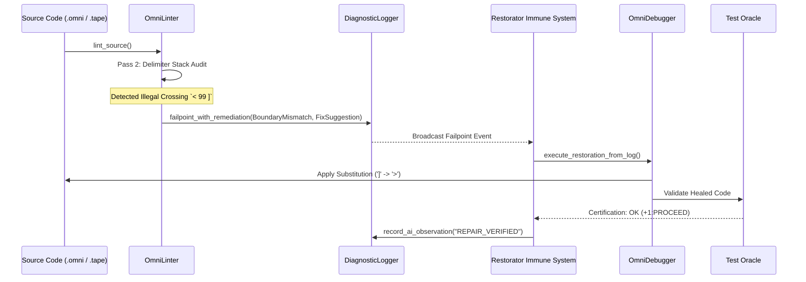

# Why Linter Logging is Essential: Sensory Telemetry, Autonomic Self-Healing, and AI Reflection

> **"A false balance is abomination to the LORD: but a just weight is his delight."**
> — *Proverbs 11:1 (KJV)*

> **"And he gave unto Moses, when he had made an end of communing with him upon mount Sinai, two tables of testimony, tables of stone, written with the finger of God."**
> — *Exodus 31:18 (KJV)*

---

## 1. The Core Architectural Question: Why Feed the Logger?

In conventional software toolchains, a linter is treated as a detached, static verification script that runs in isolation, prints a few plain-text error messages or warnings to `stderr`, and exits with a non-zero exit code.

**In OmniCode, this traditional paradigm is completely rejected.**

Now that the [`DiagnosticLogger`](file:///home/professorseanex/OmniCode/%3CTRACK%201%3E%20:%20%7BHost%20Engine%20&%20Virtual%20Machine%7D/src/diagnostics/logger/mod.rs) subsystem is modularized into its five specialized organs (`universal`, `failpoint`, `telemetry`, `inscriber`, and `query`), the [`OmniLinter`](file:///home/professorseanex/OmniCode/%3CTRACK%201%3E%20:%20%7BHost%20Engine%20&%20Virtual%20Machine%7D/src/diagnostics/linter/mod.rs) functions as the primary **sensory organ** of the Host Engine (Track 1).

Instead of letting errors disappear into terminal scrollback, the linter actively streams:

1. **Structured Failpoints with Machine Remediation** ([`FixSuggestion`](file:///home/professorseanex/OmniCode/%3CTRACK%201%3E%20:%20%7BHost%20Engine%20&%20Virtual%20Machine%7D/src/diagnostics/logger/failpoint/remediation.rs)),
2. **Circular Execution Flight Frames** ([`RollFrame`](file:///home/professorseanex/OmniCode/%3CTRACK%201%3E%20:%20%7BHost%20Engine%20&%20Virtual%20Machine%7D/src/diagnostics/logger/telemetry/frame.rs)),
3. **Neural-Symbolic Episodic Cognitive Notes** ([`CognitiveNote`](file:///home/professorseanex/OmniCode/%3CTRACK%201%3E%20:%20%7BHost%20Engine%20&%20Virtual%20Machine%7D/src/diagnostics/logger/telemetry/note.rs)), and
4. **QuadState Compilation Gate Invariants** ([`QuadStateGate`](file:///home/professorseanex/OmniCode/%3CTRACK%201%3E%20:%20%7BHost%20Engine%20&%20Virtual%20Machine%7D/src/diagnostics/linter/audit.rs)).

---

## 2. What This Enables the System to Do More Effectively

By coupling the linter directly with the diagnostic logger, the system achieves four fundamental capabilities that are impossible in legacy compilers:

### A. The Autonomic DAR Loop (Detect, Assess, Remediate)

When the linter detects a syntax anomaly (such as an illegal boundary pair `< 1 ]` or an unclosed delimiter `{ Cell [ 1 ]`), it does not just complain; it generates a concrete [`FixSuggestion`] containing:

- The exact source `line` and `col`,
- The erroneous `target_token` (e.g. `"]"`),
- The suggested mathematical patch (e.g. `">"`), and
- The architectural `rationale`.



The [`Restorator`](file:///home/professorseanex/OmniCode/%3CTRACK%201%3E%20:%20%7BHost%20Engine%20&%20Virtual%20Machine%7D/src/diagnostics/restorator/mod.rs) and [`OmniDebugger`](file:///home/professorseanex/OmniCode/%3CTRACK%201%3E%20:%20%7BHost%20Engine%20&%20Virtual%20Machine%7D/src/diagnostics/debugger/mod.rs) consume this structured telemetry directly from `logger.failpoints()` and `logger.remediations()`. They apply the patch in isolated scratch memory, verify it against an automated test oracle, and write the healed code back to disk without human intervention!

### B. Non-Hallucinatory AI Cognitive Reflection

In Track 1, the `AICortex` is responsible for generating, understanding, and modifying code. A common failure mode of AI assistants in other ecosystems is **repetitive hallucination**: an AI agent generates code with the same invalid delimiter or missing block header repeatedly because it has no memory of past lint failures.

Because the linter logs [`CognitiveNote`] records into episodic memory:

```rust
self.logger.record_ai_observation(
    "LINTER_INCIDENT",
    &format!("Audit veto for [{file_path}]: {}", audit.gate.name()),
    &format!("Errors: {}", report.errors.join("; ")),
    &["linter", "audit", "syntax_anomaly", "veto"],
    Some(file_path),
);
```

The AI Cortex can query its own episodic memory via [`EpisodicQueryEngine`](file:///home/professorseanex/OmniCode/%3CTRACK%201%3E%20:%20%7BHost%20Engine%20&%20Virtual%20Machine%7D/src/diagnostics/logger/query/search.rs) before attempting code generation:

1. "What syntax anomalies were recorded in previous sessions for `lexicon/01_nouns/ideas/types/`?"
2. "Which delimiters frequently mismatched, and what were the verified remediations?"
3. "Did the last assembly run result in `QuadState::Proceed` or `QuadState::Rollback`?"

This grounds AI generation in deterministic historical fact rather than statistical guessing.

### C. Ring Buffer Flight Recording for Crash Diagnostics

The [`FlightRecorder`](file:///home/professorseanex/OmniCode/%3CTRACK%201%3E%20:%20%7BHost%20Engine%20&%20Virtual%20Machine%7D/src/diagnostics/logger/telemetry/ring_buffer.rs) maintains a zero-allocation circular buffer of execution roll frames.

When `OmniLinter::lint_source` runs, it records a [`RollFrame`] representing the final Pass 6 audit gate:

- Roll Index: 6/6
- Verb: `"LINT_AUDIT_GATE"`
- QuadState: `Proceed`, `Await`, `Rollback`, or `Halt`
- Failpoint Mask: `0` (Clean) or `1` (Anomaly)
- Intent Aside: Human-readable composite score and gate summary.

If a compilation or hypervisor command crashes later in the execution pipeline, the engineer can inspect `logger.recent_roll_frames(10)` or `logger.last_anomalous_frame()` to see the exact state of the linter immediately prior to the failure.

### D. Silicon-to-Syntax Invariant Attestation ($\Omega_0$)

In bare-metal execution (Track 0), the operating system boots from ancient silicon landmarks (`0x7C00`, `0x18000`, `0x108000`, `0x200000`). It establishes a homeostatic equilibrium state known as **State $\Omega_0$**.

Before allowing code to lower into physical machine words, the Host Engine queries `logger.audit_shutdown_equilibrium()` and verifies that:

1. The genesis baseline is clean.
2. The compilation unit's composite 4-Block score satisfies the gate (`QuadStateGate::Proceed` with composite $\ge 70$).
3. Zero active unhealed failpoints exist on the diagnostic bus.

If any invariant fails, execution is halted safely, preventing memory corruption or CPU triple faults on bare metal.

---

## 3. Grounding in the Canonical Types: Character & Number

The two most advanced compilation units in the language today are:

1. [`character.omni`](file:///home/professorseanex/OmniCode/%3CTRACK%202%3E%20:%20%7BOmniCode%20Language%20&%20Standard%20Library%7D/lexicon/01_nouns/ideas/types/character/compiled/character.omni) / [`character.tape`](file:///home/professorseanex/OmniCode/%3CTRACK%202%3E%20:%20%7BOmniCode%20Language%20&%20Standard%20Library%7D/lexicon/01_nouns/ideas/types/character/interpreted/character.tape)
2. [`number.omni`](file:///home/professorseanex/OmniCode/%3CTRACK%202%3E%20:%20%7BOmniCode%20Language%20&%20Standard%20Library%7D/lexicon/01_nouns/ideas/types/number/compiled/number.omni) / [`number.tape`](file:///home/professorseanex/OmniCode/%3CTRACK%202%3E%20:%20%7BOmniCode%20Language%20&%20Standard%20Library%7D/lexicon/01_nouns/ideas/types/number/interpreted/number.tape)

Both files achieve a perfect **100/100 composite score** and **QuadStateGate::Proceed** across all 4 blocks:

- **Block 1 (Metadata)**: 100/100 (Identity 20, Provenance 25, Witness 20, Ontology 20, Spatial 15)
- **Block 2 (Opening)**: 100/100 (Entity 25, Cell/Word 20, Transducer 20, Preconditions 20, Spatial 15)
- **Block 3 (Body)**: 100/100 (SVO 25, Vectors 20, Primes 20, Guards 20, Spatial 15)
- **Block 4 (Closing)**: 100/100 (Verify 20, Validate 20, Tripwire 20, Fourfold 25, Telemetry 15)

By capturing these 100/100 baselines in the logger's episodic memory, any future syntax regression in user code or standard library modules is detected in $O(1)$ time relative to these certified canonical exemplars.
