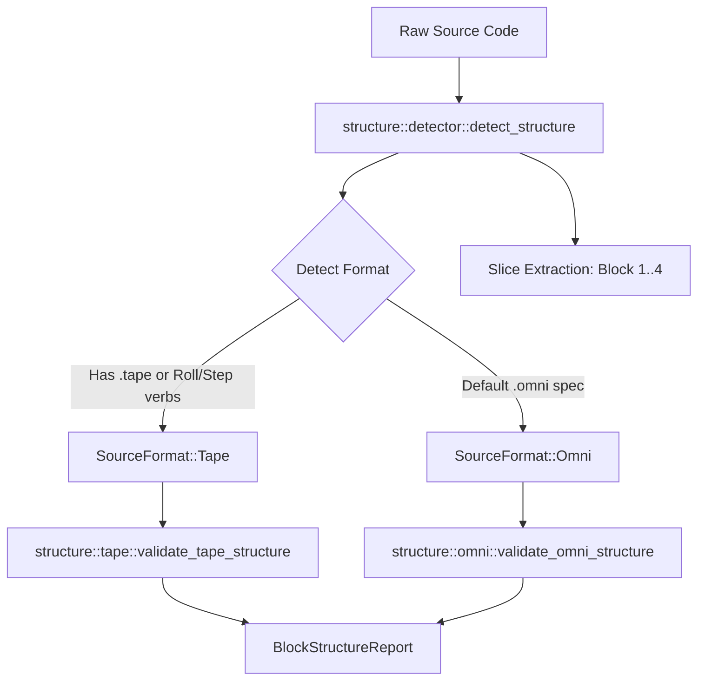

# Linter Structure Subsystem (`diagnostics::linter::structure`)

> **"According to the grace of God which is given unto me, as a wise masterbuilder, I have laid the foundation, and another buildeth thereon. But let every man take heed how he buildeth thereupon."**
> — *1 Corinthians 3:10 (KJV)*

> **"Who hath laid the measures thereof, if thou knowest? or who hath stretched the line upon it?"**
> — *Job 38:5 (KJV)*

---

## 1. Overview & Purpose

The **Structure Subsystem** ([`src/diagnostics/linter/structure`](file:///home/professorseanex/OmniCode/%3CTRACK%201%3E%20:%20%7BHost%20Engine%20&%20Virtual%20Machine%7D/src/diagnostics/linter/structure)) constitutes Pass 2 of the OmniCode linting pipeline. Its responsibility is to inspect raw source code, automatically detect the format (`.omni` declaration spec vs. `.tape` execution stream), carve the source text into canonical **4-Block** slices, and verify structural integrity.

In OmniCode, every source file must rigorously adhere to the 4-block architectural model:

1. `BLOCK 1: METADATA` — Identity, authorship, license, and Scripture witness.
2. `BLOCK 2: OPENING` — Namespace bindings, external tape imports, environment initialization.
3. `BLOCK 3: BODY` — Core definitions, types, state machines, and operational logic.
4. `BLOCK 4: CLOSING` — Integrity proofs, teardown verification, witnesses, and invariants.

---

## 2. Component Architecture

```
structure/
├── README.md        <-- This document
├── mod.rs           <-- Structural coordinator & format dispatcher
├── detector.rs      <-- Regex slicing engine, line number resolution, BlockSlice extraction
├── omni.rs          <-- Omni specification block-level rules & score evaluator
└── tape.rs          <-- Tape instruction stream block-level rules & score evaluator
```

### Module Roles

- **[`detector.rs`](file:///home/professorseanex/OmniCode/%3CTRACK%201%3E%20:%20%7BHost%20Engine%20&%20Virtual%20Machine%7D/src/diagnostics/linter/structure/detector.rs)**:
  Uses regular expressions matching both bracketed and standard comment headers:
  - `(?i)(?:^|[\r\n])\s*(?:#|//|;|--)?\s*\[?\s*BLOCK\s*1\s*:\s*METADATA\s*\]?`
  - Resolves exact start and end line ranges (`1-indexed`) for each block slice.
  - Returns a structured `SourceStructure` containing individual `BlockSlice` items.
- **[`omni.rs`](file:///home/professorseanex/OmniCode/%3CTRACK%201%3E%20:%20%7BHost%20Engine%20&%20Virtual%20Machine%7D/src/diagnostics/linter/structure/omni.rs)**:
  Audits `.omni` specification files (like `character.omni` and `number.omni`), ensuring definitions, type signatures, and documentation blocks follow the canonical 4-block convention.
- **[`tape.rs`](file:///home/professorseanex/OmniCode/%3CTRACK%201%3E%20:%20%7BHost%20Engine%20&%20Virtual%20Machine%7D/src/diagnostics/linter/structure/tape.rs)**:
  Audits `.tape` execution files (like `character.tape` and `number.tape`), ensuring execution steps, roll frames, and register bindings are properly anchored within their corresponding blocks.

---

## 3. 4-Block Slicing & Detection Flow



---

## 4. Diagnostic Logger Telemetry Integration

When structural slicing encounters missing blocks or out-of-order blocks:

1. **Failpoint Emission**: Dispatches `StructureMissingBlock` or `StructureOrderViolation` with failpoint telemetry.
2. **QuadState Penalty**: Missing a block docks 25.0 points from the structural score, dropping the audit gate from `Proceed` into `Rollback` or `Halt`.
3. **Machine Remediation**: Generates a scaffold injection hint guiding the [`Restorator`](file:///home/professorseanex/OmniCode/%3CTRACK%201%3E%20:%20%7BHost%20Engine%20&%20Virtual%20Machine%7D/src/diagnostics/restorator/mod.rs) to synthesize the missing block skeleton.

---

## 5. Verification & Tests

The `structure` module contains 6 targeted unit tests:

- Slicing detection on canonical `number.omni` and `number.tape`.
- Rejection of files missing Block 1, Block 2, Block 3, or Block 4.
- Out-of-order block sequence detection.

Run module tests:

```bash
cargo test --lib diagnostics::linter::structure
```
