# The Failpoint Organ: Sensory Detection in the DAR Cybernetic Loop

```text
================================================================================
  OMNICODE DIAGNOSTICS SUBSYSTEM : TACTILE SENSORY RECEPTOR SPECIFICATION
  Subsystem:      Detect, Assess, Restore (DAR) Immune Architecture
  Module:         src/diagnostics/logger/failpoint/
  Document:       DAR_SENSORY_DETECTION_AND_TRIPWIRES.md
  Classification: Canonical Architectural Foundation (Rank 1 Invariant)
  Status:         Active / Verified under Test Oracles & QEMU
================================================================================
```

> *"He that hath no rule over his own spirit is like a city that is broken down, and without walls."*
> — **Proverbs 25:28 (KJV)**
>
> *"A prudent man foreseeth the evil, and hideth himself: but the simple pass on, and are punished."*
> — **Proverbs 22:3 (KJV)**
>
> *"Prepare thy work without, and make it fit for thyself in the field; and afterwards build thine house."*
> — **Proverbs 24:27 (KJV)**

---

## 1. Executive Summary & The Tripartite DAR Loop

In traditional computing, diagnostics are reactive and post-mortem. Software
runs blindly until it crashes; a fatal signal (`SIGSEGV`, `panic!`, `#GP`) is
fired, memory is abandoned, and an unformatted error string is dumped into a
log file. For an autonomous operating system engineered for millennial longevity
(**MilleniumOS**), this approach is catastrophic.

OmniCode replaces reactive panics with an autonomic cybernetic loop:
**DAR (Detect, Assess, Restore)**:

$$\mathbf{DAR} = \langle \text{Detect}, \text{Assess}, \text{Restore} \rangle$$

```mermaid
flowchart TD
    subgraph ExecutionSubstrate ["Active Runtime Execution"]
        Exec["Silicon / Process Tape / Cognitive AI Cortex"]
        Collision{"Boundary Collision Encountered"}
        Exec --> Collision
    end

    subgraph Phase1 ["1. DETECT (Sensory Nerve Receptor)"]
        Sensory["Failpoint Subsystem & DiagnosticLogger"]
        Tripwire["Tripwire Fires at Microsecond of Collision"]
        Telemetry["Captures Dual-Rail State & Inscribes DiagnosticPacket"]
        Suggestion["Pre-computes Actionable FixSuggestion with 1-based Coordinates"]
        Collision -->|"Boundary Collision Intercepted"| Sensory
        Sensory --> Tripwire --> Telemetry --> Suggestion
    end

    subgraph Phase2 ["2. ASSESS (Cognitive Eye)"]
        Debugger["OmniDebugger & OmniLinter"]
        Inspect["Inspects Frozen Frame (Zero Panic)"]
        Classify{"Anomaly Classification"}
        Suggestion -->|"Baton Pass: DiagnosticPacket"| Debugger
        Debugger --> Inspect --> Classify
        Classify -->|"Linguistic / Soft Breach"| Rollback["Set State to -1:ROLLBACK"]
        Classify -->|"Physical Silicon Trap"| HaltState["Set State to NULL:HALT"]
    end

    subgraph Phase3 ["3. RESTORE (Immune Healer)"]
        Restorator["Restorator Engine & Re-Inception"]
        ApplyPatch["Apply Certified AST Patch on Active Tape"]
        Oracle["Verify Invariant via Executable Test Oracle"]
        Deescalate["Discharge Rails (1,1) -> (0,0) & Reset to 0x7C00"]
        Rollback -->|"Remediation Plan"| Restorator
        HaltState -->|"Hardware Reboot Plan"| Restorator
        Restorator --> ApplyPatch --> Oracle
        Restorator --> Deescalate
    end

    subgraph HomeostasisState ["Restored Equilibrium"]
        Homeostasis["QuadState Homeostasis Restored (+1:PROCEED or 0:AWAIT)"]
        Oracle -->|"Verification Passes"| Homeostasis
        Deescalate -->|"Re-Inception Completed"| Homeostasis
        Homeostasis -->|"Resume Safe Computation"| Exec
    end

    style ExecutionSubstrate fill:#1a1d24,stroke:#4a5568,stroke-width:1px
    style Phase1 fill:#1c2833,stroke:#3498db,stroke-width:2px
    style Phase2 fill:#2c1b33,stroke:#9b59b6,stroke-width:2px
    style Phase3 fill:#1b3325,stroke:#2ecc71,stroke-width:2px
    style HomeostasisState fill:#222f3e,stroke:#f39c12,stroke-width:2px
```



Within this triad, the **`failpoint`** subsystem is the **tactile sensory nerve
receptor of the Detect organ**:

* **Without Failpoints, Detection is Blind:** A logging engine without failpoints
  only records background ticks, timestamps, and passive text. When an anomaly
  strikes, a passive logger can only record that "something broke."
* **With Failpoints, Detection is Active:** The moment an instruction vector or
  cognitive token touches an illegal boundary, the failpoint tripwire fires an
  instant collision interrupt. It records the exact dual-rail physical state,
  identifies the landmark address or source coordinate, and pre-computes an
  actionable remedy before the thread can destabilize.

---

## 2. Why Traditional Logging Fails Modern Cognition

To understand why the failpoint subsystem is structured this way, we must examine
the three fatal flaws of traditional logging libraries (`log4j`, `tracing`, `spdlog`):

| Traditional Flaw | Conventional Consequence | Why It Fails Autonomous AI & MilleniumOS |
| :--- | :--- | :--- |
| **1. Unstructured Text** | Messages are arbitrary strings (`"Error: token 42"`). | Machines cannot parse or reason over text without fragile heuristics. |
| **2. Zero Mechanical Consequence** | Emitting a log entry has zero runtime effect. | The program continues careening into state corruption and unhandled panics. |
| **3. Passive Post-Mortem Only** | Logs are written after the crash occurred. | Memory and in-flight transactions are permanently lost; demands manual restart. |

### The Failpoint Antidote: Structured, Mechanical, In-Flight

The OmniCode `failpoint` architecture establishes three counter-invariants:

1. **Strong Ontological Typing:** Every failpoint belongs to an immutable domain
   group (`FailpointGroup`) and functional subgroup (`FailpointSubgroup`).
2. **Immediate Mechanical Coupling:** Tripping a failpoint immediately changes
   the machine's physical state: either invoking a causal rewind (`-1:ROLLBACK`)
   or capturing Track 0 silicon registers and executing an orderly restart
   (`NULL:HALT`).
3. **Pre-Computed Remediation:** Every linguistic failpoint embeds a ready-to-apply
   [`FixSuggestion`](remediation.rs) containing exact 1-based source coordinates,
   the offending token, and the certified patch string. The detection organ
   synthesizes the cure at the exact microsecond of diagnosis.

---

## 3. The 6-Domain Ontological Taxonomy Matrix

Failpoints are categorized into a 2-tier ontological hierarchy: **6 Groups**
and **14 Subgroups**:

| Domain Group | Functional Subgroup | Primary Failpoints | Mechanical Action | Physical / Logical Boundary |
| :--- | :--- | :--- | :---: | :--- |
| **`HardwareSilicon`** | `CpuTrap` | `FP_CPU_HALT_TRAP` | **`NULL:HALT`** | CPU hardware traps (`#GP`, `#PF`, `#DF`, `#MC`) |
| | `FirmwareBus` | `FP_HARDWARE_FAULT`, `WATCHDOG` | **`NULL:HALT`** | Firmware bus stalls and watchdog sentinel timeouts |
| | `AluSanity` | `FP_ALU_EQUILIBRIUM_BREACH` | **`NULL:HALT`** | Balanced ALU ternary parity: `(+1) + (-1) != 0` |
| **`MemoryBoundary`** | `LandmarkBounds` | `FP_MEMORY_LANDMARK_BREACH` | **`NULL:HALT`** | Violations of `0x7C00`, `0x18000`, `0x108000`, `0x200000` |
| | `SegmentationPaging` | MMIO / Stack Underflow | **`NULL:HALT`** | Paging tables (`CR3`), GDT descriptors, stack collisions |
| **`TernarySaturation`** | `DualRailCollision` | `FP_DUAL_RAIL_SATURATION` | **`NULL:HALT`** | Both rails high `(1, 1)`; zero free data capacity |
| | `StateCollapse` | `FP_NULL_TRAP` ($\bot$) | **`NULL:HALT`** | Evaluation attempted unhandled bottom/void type |
| **`LinguisticSyntax`** | `DelimiterHierarchy` | `FP_BOUNDARY_MISMATCH`, `LEAK` | **`-1:ROLLBACK`** | Mismatched or unclosed delimiters (`<...>`, `[...]`, `{...}`) |
| | `StructuralScaffold` | `FP_SYNTAX_ANOMALY` | **`-1:ROLLBACK`** | Missing 4-Block scaffolding headers and grammar drift |
| | `TypeSemantic` | `FP_IMMUTABLE_MUTATION` | **`-1:ROLLBACK`** | Illegal attempt to mutate Rank 1 immutable axioms |
| **`RuntimeTransaction`** | `Retroaction` | `FP_ROLLBACK_TRIGGERED`, `CYCLIC` | **`-1:ROLLBACK`** | Causal tape rewinds and cyclic recursion limits |
| | `ConcurrencyBus` | `FP_CAVEAT_VETO` | **`-1:ROLLBACK`** | Adversative caveat expressions (`! [...]`) vetoing state |
| **`HomeostasisLifecycle`** | `EquilibriumDrift` | `FP_EQUILIBRIUM_DRIFT_VETO` | **`-1:ROLLBACK`** | System state drifted from $\Omega_0$ baseline balance |
| | `ShutdownVeto` | Dirty State / Memory Leak | **`-1:ROLLBACK`** | Unreleased resources or dirty frames vetoing shutdown |

---

## 4. The Baton-Pass: How Detect Hands Off to Assess and Restore

The failpoint organ does not act in isolation. It serves as the intake valve
for the entire self-healing pipeline:

```mermaid
sequenceDiagram
    autonumber
    participant Parser as Tape Parser / Runtime
    participant Detect as Detect Organ (Failpoint)
    participant Assess as Assess Organ (OmniDebugger)
    participant Restore as Restore Organ (Restorator)
    participant Tape as Active Process Tape

    Parser->>Detect: Encounters Delimiter Mismatch at line 148:47: '{' closed by ']'
    Note over Detect: Substrate is healthy (10 or 01).<br/>Identifies soft linguistic boundary collision.
    Detect->>Detect: Construct FailpointType::BoundaryMismatch
    Detect->>Detect: Embed FixSuggestion (Target: 148:47, Offending: ']', Certified: '}')
    Detect->>Assess: Transmit DiagnosticPacket
    Note over Assess: Freezes active execution frame without panic.<br/>Unwinds delimiter stack: verifies opening '{'.
    Assess->>Assess: Confirm soft linguistic slip; assign QuadState::-1 (ROLLBACK)
    Assess->>Restore: Transmit RemediationPlan
    Note over Restore: Rewinds tape head to landmark.<br/>Substitutes ']' with '}' on active AST.
    Restore->>Restore: Execute Verification Test Oracle (Delimiter equilibrium check)
    Note over Restore: Oracle passes (+1:PROCEED).
    Restore->>Tape: Commit healed AST to tape ribbon
    Restore->>Parser: Resume forward execution seamlessly
```

### Concrete Architectural Exemplar: The Boundary Repair Cycle

Here is the exact lifecycle of a linguistic boundary collision on the active
process ribbon:

#### Phase 1: Detect (Location: `src/diagnostics/logger/failpoint/`)

The parser processes an opening block modeled on canonical `character.omni`:

```omni
# Offending source parsed on active tape ribbon:
Opening {
    [ Cell ]: [ 1 ] & { 5 Trits :: 1 Byte ]
}
```

* **Collision Intercepted:** Line 148, column 47 encountered `]` while delimiter
  stack expected `}` according to morphological rank.
* **Failpoint Created:** `FailpointType::BoundaryMismatch`.
* **Remediation Inscribed:** Embeds [`FixSuggestion`](remediation.rs):
  * Coordinate: `line: 148, column: 47`
  * Offending token: `"]"`
  * Certified replacement: `"}"`
* **Buffer Entry:** Inscribes event into the deterministic zero-allocation ring buffer ($O(1)$).

#### Phase 2: Assess (Location: `src/diagnostics/debugger/` & `linter/`)

* The `OmniDebugger` intercepts the `DiagnosticPacket`.
* Execution frame is frozen without stack unwinding or panic.
* The delimiter analyzer traverses backward to find the matching opening delimiter
  `{` at line 148, column 23.
* The analyzer confirms the anomaly is a soft linguistic typing slip, not a
  silicon collapse.
* The cognitive state transition is set to **`-1:ROLLBACK`**.

#### Phase 3: Restore (Location: `src/diagnostics/restorator/`)

* The `Restorator` ingests the `RemediationPlan`.
* It applies the certified patch string, transforming `]` into `}` on the AST:

  ```omni
  # Healed code committed to active tape ribbon:
  Opening {
      [ Cell ]: [ 1 ] & { 5 Trits :: 1 Byte }  ( Restored matching delimiter )
  }
  ```

* An executable test oracle evaluates bracket equilibrium:
  $$\sum \text{Brackets}_{\text{open}} - \sum \text{Brackets}_{\text{close}} = 0$$
* The oracle passes: the healed AST is committed to the tape ribbon.
* The tape head rolls forward seamlessly in **`+1:PROCEED`**.

### The Non-Human Feedback Loop

Because every failpoint produces a clean, machine-actionable record, the DAR
system operates autonomously. A developer does not need to sit at a terminal to
fix typos, balance brackets, or re-incept crashed hardware.

The **offline quantized cognitive core (CPI-SI)** running in Track 0/Track 1
reads the diagnostic stream, executes the remediation pipeline, and preserves
continuous execution indefinitely.

---

## 5. Architectural Invariants

> [!IMPORTANT]
> The DAR sensory architecture is bound by four inviolable Rank 1 Invariants:
>
> 1. **INV-DAR-01 (Zero Unstructured Faults):** No system component may crash or
>    panic with a raw string. All boundary collisions must emit a typed `FailpointType`.
> 2. **INV-DAR-02 (Pre-Computed Remediation):** Every recoverable failpoint must
>    attach a non-null `FixSuggestion` indicating exact target coordinates and patch.
> 3. **INV-DAR-03 (Substrate Separation):** Linguistic anomalies must never trigger
>    hardware halts; hardware collapses must never be treated as soft rollbacks.
> 4. **INV-DAR-04 (Restoration Verification):** No patch emitted by a failpoint may
>    be committed to disk or tape without verification by an executable test oracle.
