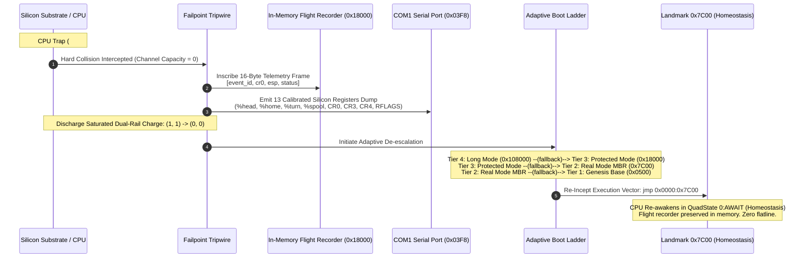

# Dual-Rail HALT Physics, Channel Saturation & Re-Inception Mechanics

```text
================================================================================
  MILLENIUMOS COGNITIVE SUBSTRATE : DUAL-RAIL SATURATION & HALT SPECIFICATION
  Subsystem:      Balanced Ternary Hardware & Silicon Inception
  Module:         src/diagnostics/logger/failpoint/
  Document:       DUAL_RAIL_HALT_PHYSICS_AND_REINCEPTION.md
  Classification: Canonical Physical Foundation (Rank 1 Invariant)
  Status:         Active / Hardware Proved under QEMU & CPU Registers
================================================================================
```

> *"For a just man falleth seven times, and riseth up again: but the wicked shall fall into mischief."*
> — **Proverbs 24:16 (KJV)**
>
> *"Remove not the ancient landmark, which thy fathers have set."*
> — **Proverbs 22:28 (KJV)**
>
> *"The secret things belong unto the LORD our God: but those things which are revealed belong unto us and to our children for ever, that we may do all the words of this law."*
> — **Deuteronomy 29:29 (KJV)**

---

## 1. Executive Summary & The Dual-Rail Truth

In traditional binary systems, a wire carries either `0` (low voltage) or `1`
(high voltage). If a single wire fails, glitches, or drifts, the computer
cannot distinguish between a legitimate zero and a broken connection.

In **MilleniumOS**, all computational state is grounded in **Balanced Ternary
Dual-Rail Logic**:

$$\mathbb{T}_3 \in \{-1, 0, +1\}$$

To represent a single ternary trit with complete physical confirmation, two
physical binary conductors (the positive rail and the negative rail) are
paired together:

$$\text{Trit} = \langle \text{Rail}_{\text{pos}}, \text{Rail}_{\text{neg}} \rangle$$

| Rail Code | Physical Rails `(pos, neg)` | Balanced Trit | QuadState | Transport Analogy | Physical System Meaning |
| :---: | :---: | :---: | :--- | :--- | :--- |
| `00` | `(0, 0)` | `0` | **`AWAIT`** | **PAUSE** | Homeostasis, neutral equilibrium, resting balance |
| `01` | `(1, 0)` | `+1` | **`PROCEED`** | **PLAY** | Forward affirmation, tape roll commit motion |
| `10` | `(0, 1)` | `-1` | **`ROLLBACK`** | **REWIND** | Retroactive negation, rewind along tape ribbon |
| `11` | `(1, 1)` | $\bot$ | **`HALT`** | **STOP** | Saturated state, zero free data, collision trap |

---

## 2. The Physical Meaning of the Four States

Understanding the distinction between these four states is the foundational key
to the entire OmniCode architecture:

### 1. `00` — `(0, 0)`: AWAIT (Trit `0`)

* **State of Matter:** Neutral equilibrium, resting balance, ground potential.
* **Dynamic Property:** **AWAIT is a pause, not a stop.**
* Both physical wires rest low. Energy consumption is minimal, entropy is zero,
  and the arithmetic registers are resting in balanced symmetry:
  $$(+1) + (-1) = 0$$
  The system is in homeostasis, standing by in an asynchronous wait state for
  the arrival of the next sensory token or process turn.

### 2. `01` — `(1, 0)`: PROCEED (Trit `+1`)

* **State of Matter:** Forward kinetic affirmation.
* **Dynamic Property:** Positive rail high, negative rail low.
* The tape reel rolls forward along the temporal ribbon. Computational work
  is committed, state is affirmed, and execution advances sequentially.

### 3. `10` — `(0, 1)`: ROLLBACK (Trit `-1`)

* **State of Matter:** Retroactive negation and elastic recoil.
* **Dynamic Property:** **ROLLBACK is a rewind, not a stop.**
* Negative rail high, positive rail low. The machine reverses its causal
  momentum vector ($\vec{v} \rightarrow -\vec{v}$) and steps backward along
  the process tape ribbon. It returns to a previously anchored milestone or
  snapshot without losing its session, memory, or thread identity.

### 4. `11` — `(1, 1)`: HALT (Bottom Type $\bot$)

* **State of Matter:** Dual-rail electrical saturation and collision trap.
* **Dynamic Property:** **HALT is an abrupt physical stop.**
* Both physical rails are energized high simultaneously. Because both the
  positive and negative rails are asserted, **there is zero free data capacity
  left in the transmission channel**. The logic gates have collided with an
  immovable physical or algebraic boundary.

---

## 3. The Core System Law: Why HALT Restarts

In classical commercial operating systems (Unix, Windows), when the CPU hits a
hardware trap (`#GP` General Protection Fault, `#PF` Page Fault, `#DF` Double
Fault), the kernel executes a catastrophic panic:

1. Interrupts are permanently disabled (`cli`).
2. The CPU core is put to sleep in a frozen loop (`hlt`).
3. The machine **flatlines**: the screen goes black or displays a fatal blue
   screen, all active computation is destroyed, and human intervention is
   required to physically cycle the power switch.

**MilleniumOS mathematically prohibits flatlining.**

> *"For a just man falleth seven times, and riseth up again: but the wicked shall fall into mischief."*
> — **Proverbs 24:16 (KJV)**

A system designed to endure for a thousand years without broadband internet or
human operators cannot allow an unexpected boundary collision to terminate its
existence. If a machine permanently halts, it has ceased to be an operating
system; it has become dead silicon.

**The Fundamental Law of HALT in OmniCode:**

$$\text{HALT does not terminate the machine; HALT restarts the machine!}$$



### The In-Memory Flight Recorder

Before de-escalation, the tripwire records a 16-byte binary event at RAM landmark
`0x18000`:

```text
In-Memory Flight Recorder Binary Format (16 Bytes at Landmark 0x00018000):
┌─────────────────────────┬─────────────────────────┬─────────────────────────┬─────────────────────────┐
│     event_id (u32)      │        cr0 (u32)        │        esp (u32)        │       status (u32)      │
│  Offset 0x00 .. 0x03    │   Offset 0x04 .. 0x07   │   Offset 0x08 .. 0x0B   │   Offset 0x0C .. 0x0F   │
└─────────────────────────┴─────────────────────────┴─────────────────────────┴─────────────────────────┘
```

This record persists through the cascade, giving the re-incepted runtime full
episodic memory of the event that triggered the de-escalation.

---

## 4. The 13 Calibrated Silicon Registers of Track 0

When a HALT occurs, the machine state is not lost; it is preserved in the
**13 Calibrated Silicon Registers** captured by [`SiliconRegisters`](halt.rs):

| Register Class | Register | Hardware Mapping | Cognitive & Architectural Role in MilleniumOS |
| :--- | :--- | :--- | :--- |
| **Cognitive Registers (Track 0)** | **`%head`** | `RAX` / `EAX` / `AX` | Cognitive focus accumulator and active tape head |
| | **`%home`** | `RBX` / `EBX` / `BX` | Moral origin anchor and base memory landmark pointer |
| | **`%turn`** | `RCX` / `ECX` / `CX` | Sequential roll step counter and loop epoch counter |
| | **`%spool`** | `RDX` / `EDX` / `DX` | Primary I/O MMIO port origin (`0x03F8` COM1 UART) |
| | **`%spool_in`** | `RSI` / `ESI` / `SI` | Inbound sensory stream telemetry head |
| | **`%spool_out`** | `RDI` / `EDI` / `DI` | Outbound action inscriber and tape printer head |
| | **`%frame`** | `RBP` / `EBP` / `BP` | Execution frame boundary and covenant landmark |
| **Silicon Stack & Base** | **`%rsp`** | `RSP` / `ESP` / `SP` | Silicon execution stack pointer (anchored at `0x7C00`) |
| | **`%rbp`** | `RBP` / `EBP` / `BP` | Stack frame base pointer (anchored at `0x7C00`) |
| **Hardware Control Registers** | **`%cr0`** | `CR0` Control Reg | Protection enable (`PE`), paging, numeric error flags |
| | **`%cr3`** | `CR3` Control Reg | Page Directory Base Register (`0x00108000`) |
| | **`%cr4`** | `CR4` Control Reg | Physical Address Extension (PAE) and OS FXSR flags |
| **Hardware Flags** | **`%rflags`** | `RFLAGS` / `EFLAGS` | Parity, zero, carry, and directional execution flags |

### Diagnostic Register Dump Output

The register bank formats deterministically into an 80-column diagnostic dump:

```text
REGISTERS:
  head: 0x0000000000000000  home: 0x0000000000000000  turn: 0x0000000000000000
  spool: 0x0000000000000000 in:   0x0000000000000000  out:  0x0000000000000000
  rax:  0x0000000000000000  rbx:  0x0000000000000000  rcx:  0x0000000000000000
  rdx:  0x0000000000000000  rsi:  0x0000000000000000  rdi:  0x0000000000000000
  rsp:  0x0000000000007c00  rbp:  0x0000000000007c00  cr0:  0x0000000000000001
  cr3:  0x0000000000108000  cr4:  0x0000000000000020  rflags: 0x0000000000000002
```

---

## 5. Architectural Invariants of HALT & Re-Inception

> [!IMPORTANT]
> The HALT and Re-Inception physics are governed by four inviolable Rank 1 Invariants:
>
> 1. **INV-HALT-01 (Channel Saturation):** State `(1, 1)` represents channel
>    saturation with zero free capacity; no further forward operations may be
>    computed while rails remain high.
> 2. **INV-HALT-02 (Anti-Flatline Law):** An abrupt HALT must never enter a permanent
>    disabled loop; it must dump registers, discharge saturation, and re-incept to `0:AWAIT`.
> 3. **INV-HALT-03 (Telemetry Preservation):** Hardware register snapshots and binary
>    event records must be written to linear landmark `0x00018000` before memory landmarks are reset.
> 4. **INV-HALT-04 (De-Escalation Safety):** If high-tier execution fails, the system
>    cascades down the adaptive boot ladder to a lower, simpler tier, guaranteeing recovery even
>    under damaged state.
