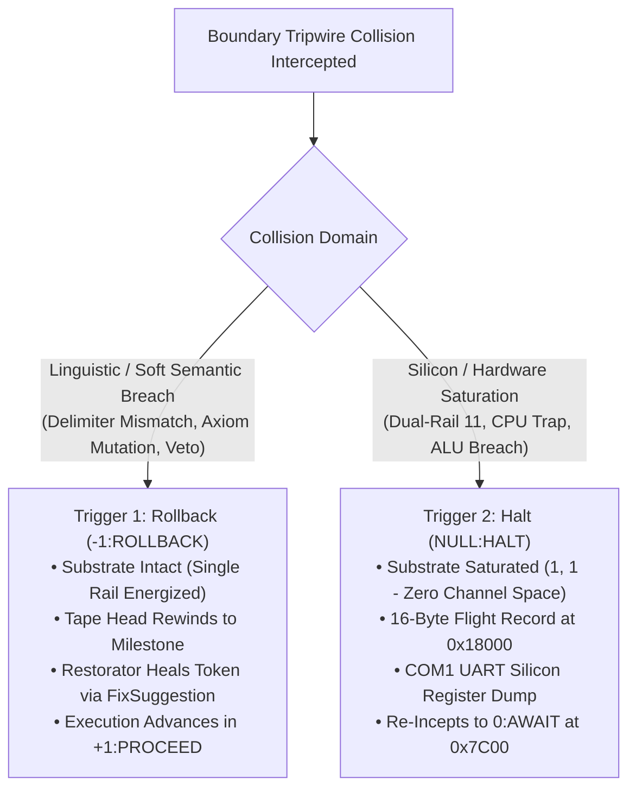

# The 2-Trigger Collision Architecture: Warnings as Healers, Errors as Inceptors

```text
================================================================================
  MILLENIUMOS DEVELOPER EXPERIENCE : 2-TRIGGER COLLISION TRIPWIRE SPECIFICATION
  Subsystem:      Detect, Assess, Restore (DAR) Developer Experience
  Module:         src/diagnostics/logger/failpoint/
  Document:       TWO_TRIGGER_TRIPWIRE_ARCHITECTURE.md
  Classification: Canonical Architectural Foundation (Rank 1 Invariant)
  Status:         Active / Tested across Unit & Integrated Test Suites
================================================================================
```

> *"A prudent man foreseeth the evil, and hideth himself: but the simple pass on, and are punished."*
> — **Proverbs 22:3 (KJV)**
>
> *"For a just man falleth seven times, and riseth up again: but the wicked shall fall into mischief."*
> — **Proverbs 24:16 (KJV)**
>
> *"Remove not the ancient landmark, which thy fathers have set."*
> — **Proverbs 22:28 (KJV)**

---

## 1. Executive Summary & The Broken Paradigm of Traditional Software

In standard software engineering (C, C++, Rust, Go, Python, Java), the
**"Warning vs. Error"** paradigm has been deeply dysfunctional for fifty years:

1. **Traditional Warnings are Impotent Noise:**
   Compilers and linters emit hundreds of warning lines to standard error.
   Because warnings carry zero mechanical consequence at runtime, developers
   habitually ignore them, suppress them with compiler flags (`-w`, `allow(unused)`),
   or allow them to accumulate into latent security CVEs and production defects.
2. **Traditional Errors are Punitive Executions:**
   When an unexpected error or panic condition occurs at runtime, the execution
   environment executes capital punishment: unwinding the call stack, destroying
   in-flight user transactions, dumping an unreadable 50-line stack trace to the
   console, and terminating the process.
3. **Traditional Logging is Passive Administrative Paperwork:**
   Writing `logger.error("Failed to connect")` feels like filling out an insurance
   form after a car crash. The log message does not prevent the crash, heal the
   wound, or repair the vehicle; it merely logs a grievance.

Consequently, developers treat logging and error handling as an annoying
afterthought, writing the bare minimum required to pass code review.

OmniCode repudiates this entire philosophy. By integrating the **DAR
(Detect, Assess, Restore)** engine directly into the compiler and operating
system, OmniCode replaces passive logging with the **2-Trigger Cybernetic System**:



| System Dimension | Traditional Computing (C / Unix / Rust) | OmniCode 2-Trigger DAR Paradigm |
| :--- | :--- | :--- |
| **Warning Paradigm** | Ignored text on `stderr` with zero mechanical runtime consequence; accrues technical debt. | **`-1:ROLLBACK` Trigger**: Rewinds tape head to previous landmark; Restorator applies live `FixSuggestion` patch on active tape. |
| **Error / Fault** | Lethal crash or unhandled panic; process flatlines and destroys memory; requires manual human restart. | **`NULL:HALT` Trigger**: Track 0 silicon & RAM dump captured; rails discharged from `(1, 1)` to `(0, 0)`; re-incepts to `0:AWAIT` at `0x7C00`. |
| **Logging Philosophy** | Passive post-mortem strings for human eyes; treated as an administrative chore. | **Active Cybernetic Sensory Organ**: Strongly-typed telemetry feeding the engine and AI for live self-healing. |

---

## 2. Trigger Type 1: The Rollback Trigger (`-1:ROLLBACK` ~ The Cybernetic Warning)

In OmniCode, a "warning-level" anomaly is never ignored text. It is a
**Rollback Trigger**:

$$\text{Trigger}_{\text{Rollback}} \Longrightarrow \text{QuadState::Rollback} \ (-1)$$

### When Rollback Fires

The Rollback Trigger fires when an execution vector touches a soft, recoverable,
linguistic, or transactional boundary:

* Delimiter mismatches (`<` closed with `]`)
* Boundary leaks (unclosed blocks reaching EOF)
* Adversative caveat vetoes (`! [ condition ]`)
* Illegal attempts to mutate Rank 1 immutable axioms (`< ... >`)
* Transactional rollbacks or cyclic recursion thresholds

### Rollback Channel Status: Substrate Intact

The underlying silicon substrate is **completely healthy**. Only one rail
was asserted (`10` or `01`). Free data capacity exists in the transmission
channel. The computation simply encountered a semantic contradiction.

### Rollback Mechanical Action: Live Tape Auto-Healing

1. The tripwire catches the collision.
2. It reverses the causal velocity vector ($\vec{v} \rightarrow -\vec{v}$) and
   steps the process tape head back to the latest anchored landmark.
3. It emits a concrete [`FixSuggestion`](remediation.rs) containing exact
   1-based source coordinates, the offending token, and the certified patch string.
4. The **Restorator** consumes the suggestion, applies the patch to the AST,
   validates it against an executable test oracle, and rolls execution forward in
   `+1:PROCEED`.

```omni
# Offending code parsed on the active reel tape (Mismatched delimiter: '{' closed with ']'):
Opening {
    [ Cell ]: [ 1 ] & { 5 Trits :: 1 Byte ]
}

# Restorator auto-heals token via FixSuggestion:
Opening {
    [ Cell ]: [ 1 ] & { 5 Trits :: 1 Byte }  ( Healed in-flight; execution rolls forward in +1:PROCEED )
}
```

**The Developer Experience:**
The developer makes a syntax slip or logic error, and **the program does not
crash**. The runtime steps back, heals the token live on the tape ribbon, and
continues running seamlessly.

---

## 3. Trigger Type 2: The Halt Trigger (`NULL:HALT` ~ The Substrate Error)

In OmniCode, an "error-level" anomaly is never a fatal panic. It is a
**Halt Trigger**:

$$\text{Trigger}_{\text{Halt}} \Longrightarrow \text{QuadState::Halt} \ (\bot)$$

### When Halt Fires

The Halt Trigger fires when an execution vector touches a hard, physical silicon
boundary or mathematical paradox:

* Dual-rail hardware saturation pegs at `(1, 1)`
* Bare-metal CPU traps (`#GP`, `#PF`, `#DF`, `#MC`)
* Balanced ternary ALU sanity failure: `(+1) + (-1) != 0`
* RAM landmark violations (crossing `0x7C00`, `0x18000`, `0x108000`, or `0x200000`)
* Watchdog sentinel timeouts

### Halt Channel Status: Substrate Saturated (1, 1)

The substrate has saturated. Both rails are energized high `(1, 1)`. **There is
zero free data capacity left in the channel.** The logic cannot compute a
forward recovery in-place because the physical ground has slipped.

### Halt Mechanical Action: Safe De-Escalation & Re-Inception

1. Forward execution is halted immediately to protect physical memory from corruption.
2. The tripwire inscribes a 16-byte binary event log at RAM landmark `0x18000`:

   ```text
   In-Memory Flight Recorder Format (16 Bytes at Landmark 0x18000):
   [ event_id: 0x0005 | cr0: 0x80010033 | esp: 0x00017FF0 | status: 0x00000000 ]
   ```

3. It captures the **13 Calibrated Silicon Registers** (`%head`, `%home`, `%turn`,
   `%spool`, `CR0`, `CR3`, `CR4`, `RFLAGS`) and emits a full diagnostic dump to
   the COM1 serial port (`0x03F8`).
4. The saturated dual-rail charge is discharged from `(1, 1)` to `(0, 0)`.
5. The system cascades down the adaptive boot ladder (Long Mode $\rightarrow$
   Protected Mode $\rightarrow$ BIOS MBR) and **re-incepts back at landmark `0x7C00`
   into homeostasis (`0:AWAIT`)**.

**The Developer Experience:**
Even when the program triggers a hard silicon trap or corrupted memory landmark,
**the machine never dies**. The developer's terminal does not freeze, and their
interactive session is not destroyed. The OS safely discharges, drops down to a
known landmark, and awakens in equilibrium with the complete crash dump safely
stored in episodic memory.

---

## 4. Why This Natively Incentivizes Developers to Use the DAR Logging Library

When error handling is transformed from a punitive execution into an autonomic
immune system, developer psychology fundamentally changes. Developers will
enthusiastically use the DAR logging library for three compelling reasons:

### 1. The Death of Permadeath (The Video Game Metaphor)

Traditional programming feels like an old-school video game with "Permadeath":
one unhandled exception, and you lose all your progress, your process dies, and
you start from scratch.

Coding with OmniCode DAR logging feels like playing a modern game with
**infinite checkpoints, dynamic rewinds, and an active safety net**. If you make
a mistake, the system rolls back to the last milestone and lets you try again.
If the engine crashes, you instantly respawn at the checkpoint with all your
inventory intact. Developers will naturally wrap every sensitive transaction in
DAR tripwires because it guarantees their code will never crash.

### 2. Native Symbiosis with AI Coding Agents

Modern developers increasingly pair-program with LLMs and autonomous AI agents
(such as Google NotebookLM or the local `CPI-SI` offline core). In traditional
systems, an AI agent cannot easily debug a running program because stack traces
are unstructured prose strings.

In OmniCode, every failpoint emits a machine-actionable [`FixSuggestion`](remediation.rs)
with exact 1-based source coordinates and replacement tokens. An AI agent
ingesting the DAR telemetry stream can read the failpoint, generate the exact
AST patch, and heal the codebase in milliseconds without the human developer
ever having to context-switch into a debugger.

### 3. Zero Guilt, Zero Boilerplate

Developers hate writing logging code when it feels like administrative paperwork.
In DAR, logging is not an audit trail for external auditors; **it is the actual
circulatory system of self-healing software**. Writing a DAR log statement is
what grants your function the power of automatic rollback and rebootless
re-inception. You do not log out of duty; you log to make your software invincible.

---

## 5. Architectural Invariants

> [!IMPORTANT]
> The DAR system is bound by three unalterable Rank 1 Invariants:
>
> 1. **INV-2TRIG-01 (Dual-Rail Symmetry):** All system tripwires must partition
>    anomalies strictly into either `-1:ROLLBACK` (Linguistic) or `NULL:HALT` (Silicon).
> 2. **INV-2TRIG-02 (Zero Unhandled Panics):** No runtime component may invoke an
>    unhandled panic or exit with a non-zero status without first triggering a
>    Rollback or Halt transition.
> 3. **INV-2TRIG-03 (AI Queriability):** All failpoints captured by the DAR logger
>    must be exportable to structured `.scroll` notes for AI episodic digestion.
