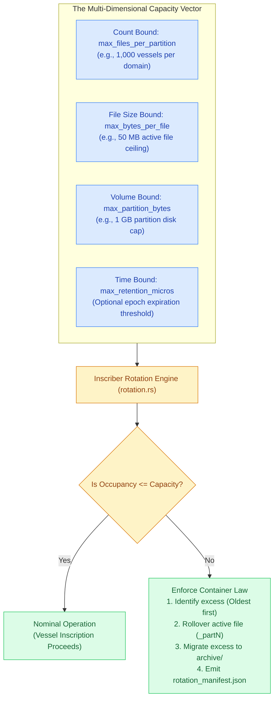
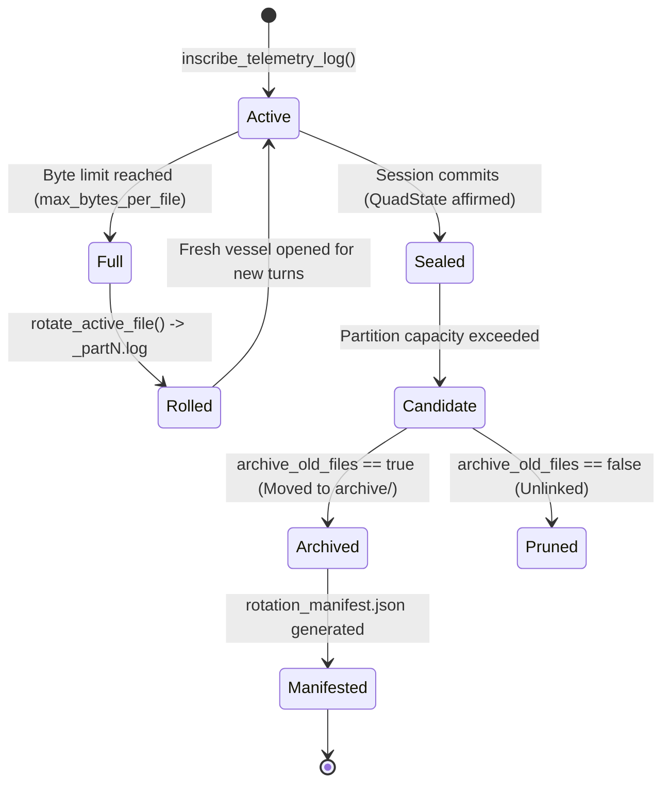
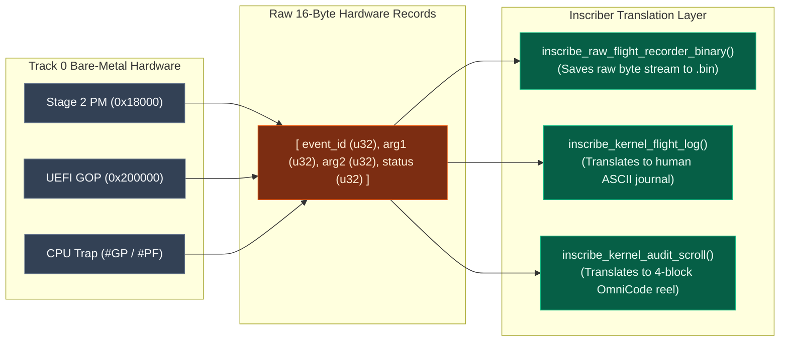
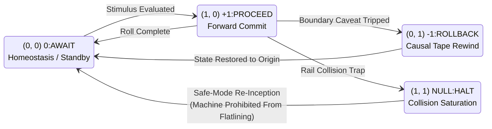

# Inscriber Design: Container Physics, Capacity Bounds & Millennial Rotation

## The Architectural Idea Behind the Inscriber Design & Finite Storehouse Law

> [!NOTE]
> **The Container Invariant of the Storehouse (2 Kings 4:4)**
> *"And when thou art come in, thou shalt shut the door upon thee and upon thy sons, and shalt pour out into all those vessels, and thou shalt set aside that which is full."*
>
> In the physics of the physical universe, a vessel cannot hold more than its volume permits. When a vessel is full, pouring more oil into it does not magically expand the vessel; it spills upon the floor. The Inscriber is founded upon this immutable truth: $\text{Occupancy} \le \text{Capacity}$. When a vessel reaches its defined boundary, it is sealed, set aside, rotated, and archived.

---

## 1. The Core Philosophy: Why "Inscriber"?

In modern computing, operating systems and application runtimes treat diagnostic recording as a disposable side effect: files are named `debug.log`, `stdout.log`, or `systemd.journal`, continuously appended to without bounds until a disk fills up or an external daemon like `logrotate` aggressively purges them.

In OmniCode and MilleniumOS, this paradigm is rejected as mathematically reckless. The subsystem is deliberately named the **Inscriber** rather than a "Logger" for profound reasons:

```mermaid
flowchart TD
    subgraph CONVENTIONAL["Conventional Logging Paradigm"]
        C1["Volatile Execution"] --> C2["Unbounded Append-Only Text Stream"]
        C2 --> C3["Silent Disk Bloat & Server Exhaustion"]
        C3 --> C4["Panic, Data Corruption, & Crash"]
    end

    subgraph INSCRIBER["OmniCode Inscriber Paradigm"]
        I1["Deterministic Roll"] --> I2["Finite Vessel Allocation (Bounded Capacity)"]
        I2 --> I3["Physical Inscription (2 Kings 4:4 Container Law)"]
        I3 --> I4["When Full: Seal, Set Aside, & Rotate to Archive"]
        I4 --> I5["Continuous Homeostasis (Zero Disk Outages Across Centuries)"]
    end

    classDef red fill:#fee2e2,stroke:#ef4444,color:#991b1b;
    classDef green fill:#dcfce7,stroke:#22c55e,color:#166534;

    class C1,C2,C3,C4 red;
    class I1,I2,I3,I4,I5 green;
```



### The Three Foundational Ideals of Inscription

1. **Inscription vs. Logging**:
   To "log" implies dropping unstructured scrapings into a heap. To **inscribe** implies carving deliberate, structured truth into enduring stone—echoing Exodus 31:18 (*"tables of stone, written with the finger of God"*). Every record inscribed into the storehouse has identity, provenance, invariant preconditions, and a covenant verification seal.
2. **The Millennial Horizon (MilleniumOS)**:
   An operating system intended to run autonomously across millennial operational horizons cannot tolerate unbounded state accumulation. Any system that leaks even one byte per day will eventually fail. The Inscriber guarantees mathematical boundedness: total disk occupancy across every partition is strictly constrained by finite capacity vectors.
3. **Hardware Truth Grounding**:
   The Inscriber does not invent synthetic metrics. It captures the physical reality of the machine: physical RAM landmarks (`0x0500`, `0x7C00`, `0x18000`, `0x108000`, `0x200000`), the 13 calibrated silicon registers, dual-rail saturation states `(1, 1)`, and CPU hardware traps (`#GP`, `#PF`).

---

## 2. Container Physics: $\text{Occupancy} \le \text{Capacity}$

The core mathematical law governing all storehouse partitions is the **Container Invariant**:

$$\forall \text{Partition } P, \quad \text{Occupancy}(P) \le \text{Capacity}(P)$$

In practical operating system terms, capacity is not a single number; it is a multi-dimensional vector:

$$\mathbf{C} = \langle N_{\text{max\_files}}, \; B_{\text{max\_file\_bytes}}, \; V_{\text{max\_partition\_bytes}}, \; T_{\text{retention\_micros}} \rangle$$



### 1. Count Bounds (`max_files_per_partition`)

Each domain partition (e.g. `log/character/`, `scroll/number/`, `log/kernel/`) is allotted a finite vessel count ceiling. When the partition contains more than `max_files_per_partition` active vessels, the oldest excess vessels are sealed and migrated.

### 2. File Size Bounds (`max_bytes_per_file`)

Individual active log files cannot expand infinitely. If a long-running interactive terminal session or high-frequency game engine telemetry stream produces an active `.log` exceeding `max_bytes_per_file`, the rotation engine executes an **active rollover**:

$$\text{session.log} \longrightarrow \text{session\_part1.log} \quad (\text{New writes open fresh session.log})$$

### 3. Partition Volume Bounds (`max_partition_bytes`)

Even if vessel count is within limits, large dumps could threaten disk reserves. The engine computes the cumulative byte volume of all active files in the directory. If total volume exceeds `max_partition_bytes`, the oldest files are rotated out until total occupancy drops below capacity.

---

## 3. The Lifecycle of an Inscribed Vessel

Every telemetry vessel traverses a deterministic, state-machine lifecycle from creation to archival:



### 1. Inception (`Active`)

The vessel is opened in its category directory (`storehouse/log/{category}/{timestamp}_{session_id}.log`). Incoming telemetry events, microsecond stamps, and failpoints are formatted and written.

### 2. Sealing Gate (`Sealed`)

Upon completion of the episode, the 4th block (`Closing`) asserts the fourfold commit state (`+1:PROCEED`, `0:AWAIT`, `NULL:HALT`, `-1:ROLLBACK`). The file is physically flushed and closed. It is now an immutable historic record.

### 3. Rotation Enforcement (`Candidate`)

During periodic background maintenance or after each session commit, `InscriberEngine::enforce_partition_capacity()` audits the directory. If count or byte capacity is breached, the oldest sealed vessels are selected for rotation.

### 4. Archival or Pruning (`Archived` / `Pruned`)

* If `archive_old_files` is `true` (standard policy), files are atomically renamed into the `archive/` subfolder.
* If `archive_old_files` is `false` (restricted edge environments), files are unlinked permanently.

### 5. Manifest Recording (`Manifested`)

An atomic `rotation_manifest.json` is generated in the archive directory, recording:

* Exact unix microsecond timestamp of the rotation cycle.
* Total files rotated, archived, and pruned.
* Cumulative byte volume reclaimed from the active partition.
* Array of vessel filenames moved.

---

## 4. Deterministic Vessel Naming as a Zero-Allocation B-Tree Index

Traditional logging systems require complex database engines (Elasticsearch, SQLite, or Loki) just to find logs by date or session. The Inscriber achieves $O(1)$ search performance directly on standard POSIX filesystems through **Deterministic Vessel Naming**:

```text
Standard Session Vessel:
  1792000000000000_sess_alpha_99.scroll
  |              | |           | |    |
  +-- Timestamp -+ +- Session -+ + Ext+

Kernel Landmark Vessel:
  1792000000100000_0x00018000_STAGE2-PM_kernel_flight.log
  |              | |        | |       | |           | |  |
  +-- Timestamp -+ +Landmark+ +- Tier -+ +- Session -+ +Ext+

Rotated Part Vessel:
  1792000000200000_sess_omega_part3.log
  |              | |        | |   | |  |
  +-- Timestamp -+ +-Session+ +Part+ +Ext+
```

### Strict Prohibition of Middle Dots

Notice that filenames strictly use underscores (`_`) or hyphens (`-`), never internal dots:

* **Invalid**: `session.part1.log` (Ambiguous file extensions, breaks MIME parsers, confuses language tooling).
* **Valid**: `session_part1.log` (Clean, unambiguous single dot representing the file extension).

### The Filesystem as an Instant Range Index

Because ISO-aligned numeric timestamps (`timestamp_micros`) are placed at the very beginning of each filename, standard directory listing commands (`readdir`, `ls`) return files in strict chronological order:

* **Range Scans (`range_scan(t1, t2)`)**: Evaluated via simple lexicographical slice comparison on file stems without opening the file.
* **Session Lookups (`find_by_session(id)`)**: Evaluated via hash map index over `parts[1..]` in $O(1)$ time.

---

## 5. Bridging Track 0 Silicon to Track 1 Storehouses

A unique strength of the Inscriber is its direct integration with the **Track 0 Bare-Metal Kernel** (`<TRACK 0> : {Silicon & Bare-Metal Kernel}/`):



### The 16-Byte Atomic Memory Entry

Bare-metal assembly cannot allocate strings or JSON objects. At landmarks `0x00018000` (Stage 2 PM) and `0x00200000` (Native UEFI), the kernel writes fixed 16-byte structs:

```c
typedef struct {
    UINT32 event_id;  // Milestone (e.g. 0x0004 = EVT_ALU_VERIFIED)
    UINT32 arg1;      // Primary argument (CR0 value or landmark address)
    UINT32 arg2;      // Secondary argument (Stack landmark or size)
    UINT32 status;    // Hardware status (0 = OK, non-zero = failpoint)
} UefiLogEntry;
```

The Inscriber's `log_writer.rs` decodes these 16-byte atomic entries into canonical event names (`EVT_ALU_VERIFIED`, `EVT_REGS_ARMED`, `EVT_SAFE_MODE`) and produces both human-readable tables and raw `.bin` files for hardware emulator validation.

---

## 6. The 13 Calibrated Silicon Registers

When a kernel event or crash occurs, the Inscriber dumps all **13 Calibrated Silicon Registers** established in Track 0 and Track 1:

| Register | Architectural Designation | Symbolic Meaning in Inscriber |
| :--- | :--- | :--- |
| `%head` | Cognitive Focus Landmark | Memory location of active cognitive attention |
| `%home` | Moral Origin Anchor | Root landmark of origin (Track 0 root: `0x0500`) |
| `%turn` | Monotonic Step Counter | Current execution turn or tick count |
| `%spool` | I/O Communication Port | Base hardware port (e.g. COM1 UART `0x03F8`) |
| `%spool_in` | Inbound Stream Head | Read pointer for incoming character runes |
| `%spool_out` | Outbound Stream Head | Write pointer for outgoing terminal projections |
| `%frame` | Execution Frame | Active stack or partition call frame boundary |
| `%rsp` | Stack Pointer | Physical machine stack top |
| `%cr0` | Control Register 0 | CPU protection, paging, and math coprocessor flags |
| `%cr3` | Page Directory Base | Physical base address of paging translation tables |
| `%cr4` | Control Register 4 | Architectural extensions (PAE, OS support) |
| `%rflags` | CPU Processor Flags | Hardware interrupts, parity, and direction flags |
| `%rax`..`%rbp` | General CPU Registers | Computational operand registers |

---

## 7. Dual-Rail Saturation Physics & Re-Inception

In balanced ternary computing, two physical binary rails represent one ternary trit:

* `(0, 0)` = **0:AWAIT**: Homeostasis, neutral equilibrium, standby, pause.
* `(0, 1)` = **-1:ROLLBACK**: Negative rail high. Rewind causal tape, invert time.
* `(1, 0)` = **+1:PROCEED**: Positive rail high. Forward commit motion.
* `(1, 1)` = **NULL:HALT**: Both rails saturated high! Zero free data capacity.



> [!CAUTION]
> **Why HALT Restarts Instead of Flatlining**
> A dead, flatlined machine violates the core mission of MilleniumOS. When both rails saturate at `(1, 1)`, zero free data capacity remains. The collision sensor tripwire catches the saturation, freezes the 13 silicon registers, writes the crash frame to disk, and **re-incepts the machine back to homeostasis (`0:AWAIT`)** at a verified safe landmark (`0x00018000` or `0x00007C00`). The machine continues operating without human reboot.

---

## 8. Summary

The Inscriber design transforms telemetry from an uncontrolled, volatile exhaust pipe into a structured, bounded, and sacred physical storehouse:

1. **Container Law is Absolute**: Bounded file counts, bounded byte sizes, and bounded partition capacities guarantee millennial survivability.
2. **Deterministic Naming is Zero-Cost Indexing**: Formatted paths enable instant $O(1)$ lookup and temporal scans without database overhead.
3. **Dual Streams Serve Dual Minds**: Human engineers receive beautiful, readable ASCII journals; autonomous AI models receive pure, executable 4-block cognitive scrolls.
4. **Silicon is Grounded**: Raw 16-byte hardware records from Track 0 are preserved, decoded, and unified with higher-level machine cognition.
