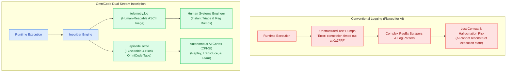
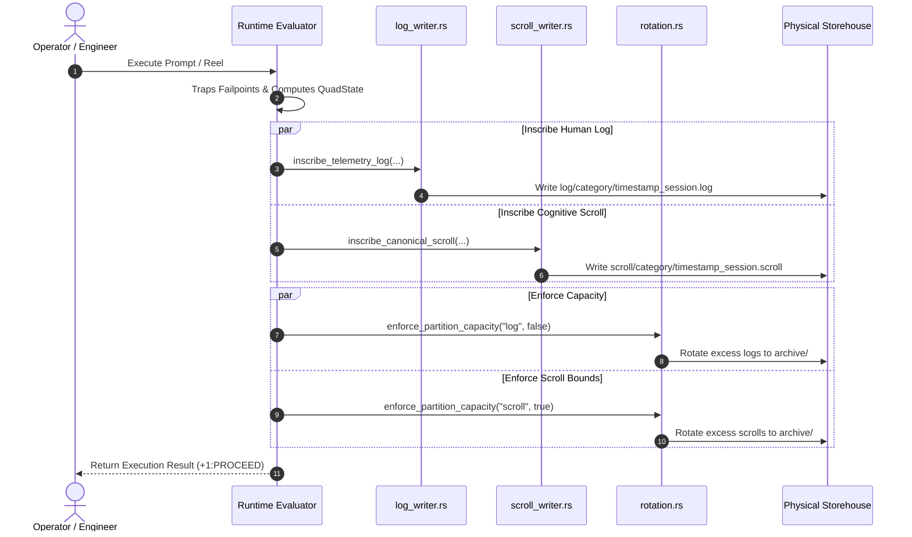

# Log vs. Scroll: Dual-Stream Telemetry & Episodic Memory Architecture

## Human-Facing Diagnostic Logs vs. Machine-Facing Cognitive Memory Tapes

> [!NOTE]
> **The Principle of Dual Inscription**
> In conventional operating systems, logs are written solely for humans to parse after a crash occurs. In OmniCode, every computational episode produces two synchronized streams:
>
> 1. **The `.log` Vessel**: An observational ASCII diagnostic journal formatted for the human engineer.
> 2. **The `.scroll` Vessel**: An executable, syntactically conforming 4-Block OmniCode program formatted for the autonomous AI Cortex (`CPI-SI`).
>
> One is read by the eye; the other is executed by the mind.

---

## 1. The Epistemic Dilemma: Why Conventional Logs Fail AI Systems

For over six decades, software engineering has treated diagnostic logging as an afterthought: arbitrary strings dumped into flat text files via `printf()`, `console.log()`, or `syslog`. While human developers can squint at unstructured error messages and infer what happened, this model completely breaks down when applied to autonomous AI systems and self-healing kernels.

When an artificial intelligence agent or compiler is asked to learn from past errors using traditional logs, it faces severe epistemic barriers:



### The Three Fatal Flaws of String Logging for Machine Learning

1. **Non-Executable Traces**: A string like `"Failed to allocate cell"` cannot be evaluated by an abstract syntax tree. It has lost its types, its boundary rankings, and its algebraic symmetry.
2. **Context Evaporation**: Traditional logs record symptoms, not preconditions. They do not preserve whether the balanced ternary arithmetic logic unit (ALU) was in equilibrium (`(+1) + (-1) <=> 0`), what silicon registers held, or what the tripwire thresholds were.
3. **No Replay Capability**: You cannot take a standard Apache or Linux kernel log and feed it directly into an execution engine to reproduce the computational state. In contrast, an OmniCode `.scroll` is a valid program that can be evaluated directly on the virtual terminal.

---

## 2. Side-by-Side Architectural Comparison

The following matrix contrasts the design decisions behind the `.log` and `.scroll` formats:

| Architectural Vector | Traditional Developer Log (`.log`) | Canonical Cognitive Scroll (`.scroll`) |
| :--- | :--- | :--- |
| **Primary Audience** | Human Systems Engineers & Kernel Developers | Autonomous AI Model, AI Cortex, & Evaluator (`CPI-SI`) |
| **Data Format** | Clear ASCII text, tabular registers, and labeled metrics | Syntactically conforming 4-Block OmniCode program |
| **Syntax Standard** | Plain English headers, dividers, and remediation notes | Canonical OmniCode syntax (`character.omni`, `number.omni`) |
| **Execution Model** | Observational (Read-only, static text scanning) | Executable (Can be re-transduced, assembled, and run) |
| **Naming Convention** | `<timestamp>_<session_id>.log` | `<timestamp>_<session_id>.scroll` |
| **State Representation** | Descriptive: `+1:PROCEED (Forward commit motion)` | Algebraic: `commit_status [ <PROCEED> ]` |
| **Failpoint Handling** | Diagnostic explanations with file/line remediation proposals | Declarative caveat branches (`! GUARD --> [ ROLLBACK ]`) |
| **Silicon Depth** | Detailed tabular view of the 13 Silicon Registers | Declarative hardware landmark imports (`::@ 0x18000`) |
| **Storehouse Partition** | `storehouse/log/{category}/` | `storehouse/scroll/{category}/` |
| **Query Engine Role** | Grep-friendly, human inspection, post-incident triage | $O(1)$ multi-key indexed retrieval via `EpisodicQueryEngine` |

---

## 3. The Anatomy of a Traditional Developer Log (`.log`)

The `.log` file is engineered for high cognitive throughput during debugging sessions. When an engineer opens a `.log` file, every piece of information is structured to minimize cognitive load:

```text
================================================================================
           OMNICODE AI EXECUTION & DIAGNOSTIC TELEMETRY LOG
================================================================================
Session ID:       sess_20261017_alpha
Timestamp:        1792000000000000_0000 (+1792000000000000 µs)
Execution Time:   4250 µs (4.25 ms)
Final State:      +1:PROCEED (Forward commit motion confirmed)
Input Prompt:     "Inscribe atomic character glyph into memory cell"
================================================================================

--------------------------------------------------------------------------------
1. SENSORY LOG EVENTS & TRAPPED FAILPOINTS
--------------------------------------------------------------------------------
Status: 1 FAILPOINTS TRAPPED

  #  | Elapsed   | Channel  | Classification | Details
-----+-----------+----------+----------------+----------------------------------
   1 |   1200 µs | SYNTAX   | DELIMITER_LEAK | Unclosed boundary delimiter at L12
     -> Remediation Proposal: [StructuralPatch] at Line 12: Close cell delimiter
        Target Token: "{ Cell ]" => Suggested Patch: "[ Cell ]"

--------------------------------------------------------------------------------
2. IMMUNE SYSTEM RESTORATIONS & SELF-HEALING
--------------------------------------------------------------------------------
Status: RESTORED
  • Restorator applied auto-repair: balanced delimiter at line 12.
  • Code successfully re-verified against 4-block structural invariants.

--------------------------------------------------------------------------------
3. SYNTHESIZED TURING REEL (OMNICODE SOURCE)
--------------------------------------------------------------------------------
[ ROLL 1 ] : [ Inscribe ] :
    { Glyph ] --> INSCRIBE [ Cell ] = [ Character` ]

--------------------------------------------------------------------------------
4. MACHINE DISCOURSE RESPONSE
--------------------------------------------------------------------------------
"Glyph successfully inscribed into defined cell."
================================================================================
```

### Key Elements of the `.log` Design

* **No Pseudo-Code Confusion**: Headers and status blocks are written in plain, human-friendly English.
* **Instant Triage Metrics**: Monotonic timestamps are presented in both microseconds (`µs`) and milliseconds (`ms`).
* **Direct Actionability**: If a failpoint is trapped, the log does not merely complain; it provides a machine-calculated **Remediation Proposal** showing the exact line, column, target token, and proposed replacement patch.
* **Hardware Register Snapshots**: For bare-metal Track 0 kernel events, the log includes an aligned table of all 13 calibrated silicon registers (`%head`, `%home`, `%turn`, `%spool`, etc.) with their physical meanings explained.

---

## 4. The Anatomy of a Cognitive Scroll (`.scroll`)

The `.scroll` file is not a text document; it is an **episodic memory artifact**. When the OmniCode AI Cortex awakens or reflects upon past interactions, it reads `.scroll` files as executable memory tapes.

Because it is written in pure OmniCode syntax, it adheres to the same rules established in the core language lexicon:

```omnicode
# ==============================================================================
# BLOCK 1: METADATA BLOCK
# ( Invariant Scroll: < EpistemicTrace { sess_20261017_alpha } > )
# ==============================================================================
# ARCHITECTURAL TOPOLOGY:
#   Episodic execution chronicle generated by OmniCode AI Model.
#   - Session ID: sess_20261017_alpha
#   - Monotonic Timestamp: 1792000000000000_0000 µs
#   - Cognitive Mode: NeuralSymbolicTransduction
#   - Witness: Scripture Exodus 31:18 KJV
# ==============================================================================

= [Scroll]: < EpistemicTrace { sess_20261017_alpha } > & [ Process { NeuralSymbolicDialogue } ]
    ( Inscribe atomic character glyph into memory cell )
{
    [ Version ]:   { "1.0.0" }
        ( Protocol Version 1.0.0 ),

    [ Created ]:   { "2026-10-17" }
        ( Inscribed during active system execution ),

    [ System ]:    { OmniCode { AI.Model } }
        ( Generated by OmniCode Neural-Symbolic Runtime Engine ),

    [ Session ]:   { "sess_20261017_alpha" }
        ( Unique session identifier for this epistemic episode ),

    session_id:    < "sess_20261017_alpha" >,
    timestamp:     < "1792000000000000_0000" >,

    [ Duration ]:  { "4250 µs" }
        ( Measured execution duration along monotonic causal clock ),

    [ Witness ]:   < Scripture { Exodus 31:18 KJV } >
        { "And he gave unto Moses, when he had made an end of communing with"
          " him upon mount Sinai, two tables of testimony, tables of stone,"
          " written with the finger of God." }
        ( Invariant divine covenant witness )
}

# ==============================================================================
# BLOCK 2: OPENING BLOCK
# ( Environmental Setup & Initial Invariants )
# ==============================================================================
Opening
    ( Hardware Invariants, Preconditions, and Initial Context )
{
    [ Imports ]: { Core :: Arithmetic } & { Core :: Logic } & { Core :: Vectors }
        ( Lexicon standard library modules armed for evaluation ),

    [ Preconditions ]: [ (+1) plus (-1) <=> 0 ] & [ Status = +1:PROCEED ]
        ( Balanced ternary ALU equilibrium verified before roll execution ),

    [ Prompt ]: { "Inscribe atomic character glyph into memory cell" }
        ( Natural language discourse or inquiry submitted by operator )
}

user_prompt < "Inscribe atomic character glyph into memory cell" >

# ==============================================================================
# BLOCK 3: BODY BLOCK
# ( Chronicle of Execution & Turing Reel )
# ==============================================================================
Body [
    # ROLL 1: SYNTHESIZED TURING REEL
    [ ROLL 1 ] : [ Inscribe ] :
        { Glyph ] --> INSCRIBE [ Cell ] = [ Character` ]
        ( Inscribe external glyph into Cell yielding Character-prime )
]

# ==============================================================================
# BLOCK 4: CLOSING BLOCK
# ( Sealing Gate: Commit State & Verification Proof )
# ==============================================================================
Closing
    ( Sealing Gate: Affirm fourfold commit status and machine utterance )
{
    commit_status [ <PROCEED> ],

    [ Commit Status ]: [
        # +1: PROCEED (+t: Advance forward along the causal tape)
        { [ Status ] = PROCEED } --> [ +1:PROCEED ] |

        #  0: AWAIT (t=t: Hold in equilibrium, pending resolution)
        { [ Status ] = AWAIT }   --> [ 0:AWAIT ] :: REPEAT |

        # NULL: HALT (t=empty: Cessation of clock, absolute stop)
        { [ Status ] = HALT }    --> [ HALT:NULL ] |

        # -1: ROLLBACK (-t: Reverse causal tape to origin t=0)
        { [ Status ] = ROLLBACK } --> [ -1:ROLLBACK ]
    ]
    ( Fourfold commit status affirmance ),

    [ Machine Utterance ]: { "Glyph successfully inscribed into defined cell." }
        ( Final conversational response synthesized by model )
}
```

### Why `.scroll` Uses Pure OmniCode Syntax

1. **Self-Referential Completeness**: The AI model speaks the same language it executes. When the model reads a past `.scroll`, it is reading its own native thought syntax.
2. **Deterministic Evaluation**: The runtime parser can ingest a `.scroll` file and evaluate it using the standard `Evaluator`. There is zero translation layer or parsing ambiguity.
3. **No Dot Naming**: In strict adherence to `character.omni` and `number.omni`, names use nested brackets (`< EpistemicTrace { ID } >`) and double-colon namespaces (`Core :: Arithmetic`), never invalid object-oriented dot notation.

---

## 5. The Dual Inscription Workflow (`inscribe_dual_episode`)

When the host engine executes a command or AI dialogue turn, the `InscriberEngine` orchestrates simultaneous inscription of both streams:



### Atomic Synchronization Guarantees

* **Identical Timestamp Prefix**: Both the `.log` and `.scroll` share the exact same microsecond timestamp prefix (e.g. `1792000000000000_sess_alpha`). This guarantees $O(1)$ pairing when querying.
* **Identical Commit Polarity**: Both files record the identical fourfold commit status (`QuadState`). If the `.log` records a rollback, the `.scroll` records `commit_status [ <ROLLBACK> ]`.
* **Independent Archival**: Because `.log` files are larger in text volume while `.scroll` files are compact symbolic tapes, the rotation engine monitors their byte capacities independently, ensuring that verbose debug logs can be archived without evicting critical cognitive memories prematurely.

---

## 6. How the Query Subsystem Leverages the Duality

The `EpisodicQueryEngine` in `query/` takes full advantage of this dual-stream architecture:

1. **Fast Indexing from `.scroll` Files**: Because `.scroll` files have a strictly defined 4-block header, the query engine scans only the first 20 lines of each `.scroll` to extract the session ID, timestamp, prompt, and QuadState.
2. **On-Demand Pairing with `.log`**: If an engineer asks to see the detailed hardware registers or sensory tripwire traces for a session, the query engine uses `resolve_vessel_path` to locate the paired `.log` file in the adjacent partition directory.
3. **Zero Full-Disk Scans**: By organizing partitions into `log/{category}/` and `scroll/{category}/`, range scans (e.g. `range_scan(start, end)`) execute directly against directory stems in $O(1)$ without reading file bodies.

---

## 7. Summary

The distinction between `.log` and `.scroll` is the distinction between **human telemetry** and **machine memory**:

* The **`.log`** is your diagnostic workbench: clear, informative, readable, and focused on helping the human understand what the machine did.
* The **`.scroll`** is the machine's cognitive episodic memory: executable, mathematically bounded, typed, and structured to allow the autonomous system to remember, learn, and evolve across continuous operation.
