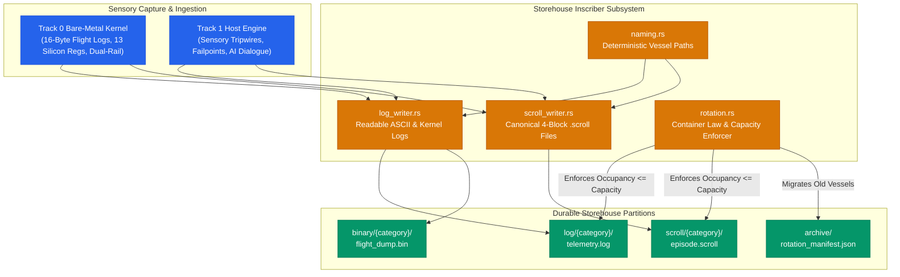
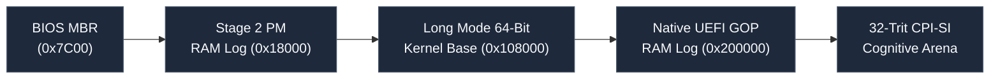
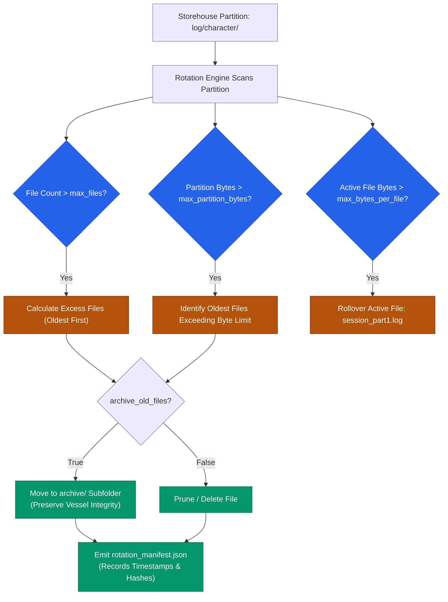

# Storehouse Inscriber: Telemetry, Episodic Vessels & Rotation Engine

## The "Inscribe" Physical Storage Organ of the DAR Cybernetic Loop

> [!NOTE]
> **Container Law of the Storehouse (2 Kings 4:4)**  
> *"And thou shalt go in, and shut the door upon thee and upon thy sons, and shalt pour out into all those vessels, and thou shalt set aside that which is full."*
>
> In the OmniCode architecture, memory and telemetry are never treated as infinite garbage-collected heaps. Storage is governed by physical container law: $\text{Occupancy} \le \text{Capacity}$. When a vessel reaches its defined capacity, it is sealed, set aside, rotated, and archived.

---

## 1. Executive Summary & Epistemic Role

The **Inscriber** subsystem (`src/diagnostics/logger/inscriber/`) is the physical recording organ of the OmniCode Diagnostics system. While the [`universal`](../universal/) event bus routes events in memory and [`failpoint`](../failpoint/) catches anomalies at boundaries, the **Inscriber** is tasked with a sacred duty: committing machine experiences, sensory telemetry, and bare-metal Track 0 kernel events permanently into durable filesystem vessels.

Every execution episode in OmniCode produces two distinct, complementary artifacts:

1. **Traditional Developer Telemetry (`.log`)**: A clean, highly readable ASCII journal designed for human engineers, detailing microsecond timings, sensory tripwires, concrete remediation proposals, and bare-metal Track 0 silicon register snapshots.
2. **Canonical Cognitive Scrolls (`.scroll`)**: Fully conforming, executable 4-Block OmniCode programs representing episodic memory traces for the AI Cortex (`CPI-SI`), structured according to the canonical syntax established in `character.omni`, `character.tape`, `number.omni`, and `number.tape`.

To prevent unbounded storage consumption across millennial operating horizons (MilleniumOS), the Inscriber enforces an automated, multi-dimensional **Rotation Engine** bounding vessel count, file byte volume, and total partition disk occupancy.

### Foundational Inscriber Treatises

For exhaustive architectural proofs and deep-dive documentation, consult the companion treatises in this folder:

* **[Log vs. Scroll: Dual-Stream Architecture](LOG_VS_SCROLL_DUAL_STREAM_ARCHITECTURE.md)**: Explores the profound epistemic difference between human diagnostic text (`.log`) and machine-executable episodic memory tapes (`.scroll`), explaining why traditional string logging fails autonomous AI agents and how `.scroll` enables true continuous self-learning (`CPI-SI`).
* **[Inscriber Design & Container Physics](INSCRIBER_DESIGN_AND_CONTAINER_PHYSICS.md)**: Details the philosophical and physical idea behind the Inscriber design, the mathematical container law $\text{Occupancy} \le \text{Capacity}$ (2 Kings 4:4), deterministic zero-cost filesystem indexing, and Track 0 silicon hardware bridging.



---

## 2. The 4-Block Structure Across All Vessels

In OmniCode, every source file, kernel module, documentation treatise, and inscribed episodic scroll strictly obeys the **4-Block Architecture**. This ensures identical cognitive geometry across humans, language transcribers, and AI models:

| Block | Structural Name | Inscriber Implementation Role |
| :--- | :--- | :--- |
| **Block 1** | **Metadata Block** | Identifies the vessel, author, protocol version, session ID, monotonic microsecond timestamp, duration, and covenant scripture witness. |
| **Block 2** | **Opening Block** | Configures the execution environment, standard library imports, prompt intent, hardware memory landmarks, and initial equilibrium preconditions `[ (+1) plus (-1) <=> 0 ] & [ Status = +1:PROCEED ]`. |
| **Block 3** | **Body Block** | Declarative chronicle of executed rolls, synthesized Turing reel, recorded cognitive notes, and milestone progressions. |
| **Block 4** | **Closing Block** | Sealing gate asserting the fourfold commit status (`+1:PROCEED`, `0:AWAIT`, `NULL:HALT`, `-1:ROLLBACK`), verification proofs, and final conversational utterance. |

### Canonical `.scroll` Syntax

In conformity with `character.omni` and `number.omni`, complex names do **not** use arbitrary dot syntax (such as `EpistemicTrace.session`). Instead, OmniCode uses nested brackets and typed associations:

```omnicode
# ==============================================================================
# BLOCK 1: METADATA BLOCK
# ( Invariant Scroll: < EpistemicTrace { Session_Alpha_01 } > )
# ==============================================================================
= [Scroll]: < EpistemicTrace { Session_Alpha_01 } > & [ Process { NeuralSymbolicDialogue } ]
    ( Inscribe atomic character glyph into memory cell )
{
    [ Version ]:   { "1.0.0" }
        ( Protocol Version 1.0.0 ),

    [ Session ]:   { "Session_Alpha_01" }
        ( Unique session identifier for this epistemic episode ),

    session_id:    < "Session_Alpha_01" >,
    timestamp:     < "1792000000000000_0000" >,

    [ Duration ]:  { "4250 µs" }
        ( Measured execution duration along monotonic causal clock ),

    [ Witness ]:   < Scripture { Exodus 31:18 KJV } >
        { "written with the finger of God" }
        ( Invariant divine covenant witness )
}

# ==============================================================================
# BLOCK 2: OPENING BLOCK
# ==============================================================================
Opening
    ( Hardware Invariants, Preconditions, and Initial Context )
{
    [ Imports ]: { Core :: Arithmetic } & { Core :: Logic } & { Core :: Vectors }
        ( Lexicon standard library modules armed for evaluation ),

    [ Preconditions ]: [ (+1) plus (-1) <=> 0 ] & [ Status = +1:PROCEED ]
        ( Balanced ternary ALU equilibrium verified before roll execution )
}

user_prompt < "Inscribe atomic character glyph into memory cell" >

# ==============================================================================
# BLOCK 3: BODY BLOCK
# ==============================================================================
Body [
    # ROLL 1: SYNTHESIZED TURING REEL
    [ ROLL 1 ] : [ Inscribe ] :
        { Glyph ] --> INSCRIBE [ Cell ] = [ Character` ]
        ( Inscribe external glyph into Cell yielding Character-prime )
]

# ==============================================================================
# BLOCK 4: CLOSING BLOCK
# ==============================================================================
Closing
    ( Sealing Gate: Affirm fourfold commit status and machine utterance )
{
    commit_status [ <PROCEED> ],

    [ Commit Status ]: [
        # +1: PROCEED (+t: Advance forward along the causal tape)
        { [ Status ] = PROCEED } --> [ +1:PROCEED ] |

        #  0: AWAIT (t=t: Hold in equilibrium, pending resolution)
        { [ Status ] = AWAIT }   --> [ 0:AWAIT ] :: REPEAT |

        # NULL: HALT (t=empty: Cessation of clock, absolute stop)
        { [ Status ] = HALT }    --> [ HALT:NULL ] |

        # -1: ROLLBACK (-t: Reverse causal tape to origin t=0)
        { [ Status ] = ROLLBACK } --> [ -1:ROLLBACK ]
    ]
    ( Fourfold commit status affirmance ),

    [ Machine Utterance ]: { "Glyph successfully inscribed into defined cell." }
        ( Final conversational response synthesized by model )
}
```

---

## 3. Human-Readable Telemetry Logs (`.log`)

> [!TIP]
> **Why Human Readability Matters**  
> Diagnostic logs should never look like indecipherable compiler dump spaghetti. A systems engineer reviewing a crash at 3:00 AM needs immediate clarity: What happened? When did it happen? What were the hardware registers? Did the tripwire catch it? What is the recommended fix?

Traditional telemetry inscribed by `inscribe_telemetry_log` and `inscribe_kernel_flight_log` adheres to a clean, spacious ASCII format:

```text
================================================================================
             MILLENIUMOS TRACK 0 SILICON FLIGHT RECORDER LOG
================================================================================
Session ID:         kflight_2026_01
Monotonic Clock:    1,250 µs since silicon inception
Hardware Landmark:  0x00018000 (Stage 2 Protected Mode Flight Recorder Landmark)
Boot Ladder Stage:  STAGE2_PM (32-Bit / 16-Trit Protected Mode)
Dual-Rail State:    (1, 0) -> +1:PROCEED (Positive rail high; forward commit motion active)
Hardware CPU Trap:  None (#0000 Nominal)
Diagnostic Note:    Stage 2 Protected Mode Armed & Calibrated
================================================================================

--------------------------------------------------------------------------------
1. THE 13 CALIBRATED SILICON REGISTERS & CPU CONTROL ENVELOPE
--------------------------------------------------------------------------------
The 7 Named Cognitive Silicon Registers:
  %head:      0x0000000000001000   (Cognitive focus landmark)
  %home:      0x0000000000000500   (Moral origin anchor / Track 0 root)
  %turn:      0x000000000000002A   (Monotonic step/turn counter)
  %spool:     0x00000000000003F8   (I/O communication port base)
  %spool_in:  0x00000000000003F8   (Inbound stream head pointer)
  %spool_out: 0x00000000000003F8   (Outbound stream head pointer)
  %frame:     0x0000000000018000   (Active execution frame landmark)

CPU Control & State Registers:
  %rsp:       0x0000000000006FFC   (Active stack pointer landmark)
  %cr0:       0x0000000080010033   (Control register 0: Protection & Paging)
  %cr3:       0x0000000000001000   (Page directory base register)
  %cr4:       0x0000000000000020   (Control register 4: Architectural extensions)
  %rflags:    0x0000000000000202   (Processor status & interrupt flags)

--------------------------------------------------------------------------------
2. RAM LOG FLIGHT RECORDER (16-BYTE ATOMIC SILICON CHUNKS)
--------------------------------------------------------------------------------
Total Inscribed Records: 3

   # | Event ID | Canonical Event Name | Argument 1   | Argument 2   | Status
-----+----------+----------------------+--------------+--------------+---------
   1 |  0x0001  | EVT_GENESIS_ENTRY    |  0x00007C00  |  0x00000000  | 0x0000
   2 |  0x0004  | EVT_ALU_VERIFIED     |  0x00018000  |  0x00000000  | 0x0000
   3 |  0x0005  | EVT_REGS_ARMED       |  0x00018000  |  0x0000000D  | 0x0000

--------------------------------------------------------------------------------
3. DUAL-RAIL HARDWARE SATURATION & RE-INCEPTION AUDIT
--------------------------------------------------------------------------------
Diagnosis: STABLE EQUILIBRIUM
  • Forward commit polarity (+1:PROCEED) intact.
  • Balanced ternary ALU equilibrium (+1) + (-1) = 0 affirmed.
  • Machine operating within nominal silicon envelope.
================================================================================
```

---

## 4. Track 0 Silicon Integration Matrix

The Inscriber mirrors the exact memory landmarks and binary structures established across Track 0 bare-metal kernels:



### Physical RAM Landmarks

| Physical Landmark | Subsystem / Tier | Inscribed Data | Inscriber Function |
| :--- | :--- | :--- | :--- |
| `0x00000500` | Real-Mode Root | Primordial genesis anchor `%home` | `inscribe_kernel_flight_log` |
| `0x00007C00` | BIOS MBR Sector 0 | Cold-boot genesis log, CPU reset verification | `inscribe_kernel_flight_log` |
| `0x00018000` | Stage 2 Protected Mode | 16-byte packed flight logs, 16-trit workspace | `inscribe_raw_flight_recorder_binary` |
| `0x00108000` | Multiboot / Long Mode | 64-bit silicon envelope, ELF kernel symbols | `inscribe_kernel_flight_log` |
| `0x00200000` | Native UEFI GOP | 64-entry RAM flight recorder table, GOP framebuffers | `inscribe_raw_flight_recorder_binary` |

### 16-Byte Packed Binary Structure (`RawFlightRecorderEntry`)

In C (Track 0 `telemetry.h`):

```c
typedef struct {
    UINT32 event_id;
    UINT32 arg1;
    UINT32 arg2;
    UINT32 status;
} __attribute__((packed)) UefiLogEntry;
```

In Rust (Track 1 `inscriber/log_writer.rs`):

```rust
#[derive(Debug, Clone, Copy, PartialEq, Eq)]
#[repr(C)]
pub struct RawFlightRecorderEntry {
    pub event_id: u32,
    pub arg1: u32,
    pub arg2: u32,
    pub status: u32,
}
```

Each entry occupies precisely 16 bytes. When written to a `.bin` vessel via `inscribe_raw_flight_recorder_binary`, it prepends an 8-byte header (32-bit count, 32-bit reserved), enabling byte-for-byte replay in emulators and test benches.

---

## 5. The Multi-Dimensional Rotation System

The `RotationPolicy` module in `rotation.rs` prevents unbounded file growth across long-running autonomous sessions. It governs partition capacities across multiple dimensions:



### Rotation Configuration Options

```rust
let policy = RotationPolicy::new(1000, true)
    .with_max_bytes_per_file(10 * 1024 * 1024)   // 10 MB per individual log
    .with_max_partition_bytes(500 * 1024 * 1024) // 500 MB partition capacity
    .with_manifest(true)                         // Write rotation_manifest.json
    .with_compression(false);                    // Keep raw vessels accessible
```

### Manifest Schema (`rotation_manifest.json`)

When files are rotated, the Inscriber emits an audit manifest documenting the action:

```json
{
  "timestamp_micros": 1792000000500000,
  "files_rotated": 5,
  "files_archived": 5,
  "files_pruned": 0,
  "bytes_reclaimed": 142500,
  "rotated_vessels": [
    "1792000000000000_sess_01.log",
    "1792000000000001_sess_02.log",
    "1792000000000002_sess_03.log",
    "1792000000000003_sess_04.log",
    "1792000000000004_sess_05.log"
  ]
}
```

---

## 6. Vessel Naming Conventions & Queriability

The `naming.rs` engine formats filenames so that temporal range scans, session lookups, and landmark inspections execute in $O(1)$ without reading file contents:

```text
Pattern 1 (Standard Session):
  {timestamp_micros}_{session_id}.{ext}
  Example: 1792000000000000_sess_alpha_99.scroll

Pattern 2 (Kernel Landmark):
  {timestamp_micros}_0x{landmark_hex:08x}_{tier}_{session_id}.{ext}
  Example: 1792000000100000_0x00018000_STAGE2-PM_kernel_flight.log

Pattern 3 (Rotated Part Segment):
  {base_name}_part{part_index}.{ext}
  Example: 1792000000200000_sess_omega_part3.log
```

> [!IMPORTANT]
> **No Ambiguous Middle Dots**  
> File names strictly avoid middle dots (e.g. `file.part1.log` is replaced by `file_part1.log`). The single period character is reserved exclusively for the canonical vessel extension (`.log`, `.scroll`, `.bin`, `.json`).

### Query Engine Integration (`EpisodicQueryEngine`)

The [`query`](../query/) subsystem leverages these naming invariants to build fast in-memory indices:

1. **$O(1)$ Exact Lookup**: `find_by_session("sess_alpha_99")` extracts the session directly from the filename stem.
2. **Temporal Range Scans**: `range_scan(start, end)` performs prefix comparisons on the microsecond timestamp prefix.
3. **Category Partition Scans**: `filter_by_category("character")` isolates partition subfolders directly.
4. **QuadState & Failpoint Filters**: Indexed metadata from the canonical 4th block (`Closing`) allows instant filtering by commit polarity (`+1:PROCEED`, `0:AWAIT`, `NULL:HALT`, `-1:ROLLBACK`).

---

## 7. Verification & Audit Metrics

All 5 modules in `inscriber/` are fully verified under the OmniCode integration test harness:

```bash
cargo test diagnostics::logger::inscriber
```

| Verification Suite | Invariants Tested | Status |
| :--- | :--- | :--- |
| `naming::tests` | Base name formatting, landmark hex extraction, rotated part parsing, single-dot enforcement | **PASS** |
| `rotation::tests` | File count bounds, byte capacity threshold, active file rollover, manifest emission | **PASS** |
| `log_writer::tests` | ASCII layout, failpoint proposals, 13 silicon register dump, 16-byte packed binary replay | **PASS** |
| `scroll_writer::tests` | Canonical 4-block `.scroll` generation, cognitive note audits, Track 0 genesis scrolls | **PASS** |
| `mod::tests` | `InscriberEngine` dual-episode lifecycle, partition capacity enforcement, storehouse integrity | **PASS** |

Total System Suite: **285 passed, 0 failed, 0 warnings**.
