# Episodic Query Subsystem

## The Retrieval Intelligence Organ of Machine Execution & Silicon Inception

> *"For enquire, I pray thee, of the former age, and prepare thyself to the search of their fathers."*
> — **Job 8:8 (KJV)**
>
> *"It is the glory of God to conceal a thing: but the honour of kings is to search out a matter."*
> — **Proverbs 25:2 (KJV)**
>
> *"And ye shall seek me, and find me, when ye shall search for me with all your heart."*
> — **Jeremiah 29:13 (KJV)**
>
> *"For the LORD searcheth all hearts, and understandeth all the imaginations of the thoughts."*
> — **1 Chronicles 28:9 (KJV)**

---

## 1. Architectural Scope & Grounding

In conventional operating systems and language runtimes, logging is treated as an append-only disposal dump: lines of text are emitted to disk or forwarded over the network, remaining inert until an engineer manually runs `grep` after a catastrophic crash.

OmniCode rejects this write-only disposal model. **A log you cannot query in sub-millisecond memory time is a dead tomb; a log you can query in $O(1)$ time is an active, living memory.**

The `query` subsystem ([`src/diagnostics/logger/query/`](./)) transforms the streams written by [`inscriber`](../inscriber/) and the frames gathered by [`telemetry`](../telemetry/) into an **instantaneously interrogatable episodic storehouse**.

```mermaid
flowchart TD
    subgraph Track0["TRACK 0: BARE-METAL SILICON FLIGHT RECORDERS"]
        T0_RAM["Physical RAM Flight Recorders<br/>• BIOS Safe Mode: 0x0500<br/>• Stage 2 PM: 0x18000<br/>• Multiboot ELF: 0x108000<br/>• Native UEFI: 0x200000"]
        T0_REGS["Silicon Register Bank<br/>(RAX, RBX, RCX, RDX, RSP, RBP, CR0, CR3)"]
        T0_LOGS["Serial & Firmware Logs<br/>(kernel/images/logs/*.log)"]
    end

    subgraph Track1_Logger["TRACK 1: DUAL-STREAM INSCRIBER"]
        S_LOG["Sensory Telemetry (.log)<br/>• Microsecond Timestamps<br/>• Tripwires & Registers"]
        S_SCROLL["Cognitive Scroll (.scroll)<br/>• 4-Block Epistemic Header<br/>• QuadState Commit & Repairs"]
    end

    subgraph Query_Engine["TRACK 1: EPISODIC QUERY ENGINE (query/)"]
        Q_INDEX["Multi-Key O(1) Indexer<br/>• Canonical Session IDs<br/>• Timestamp Prefixes<br/>• File Stems & Suffixes"]
        Q_INVERT["Inverted Keyword Index<br/>• Prompt Word Tokens<br/>• Semantic Entity Tags"]
        Q_TIME["Chronological Monotonic Slicer<br/>• Range Scanning (Δt = t1 - t0)"]
        Q_SILICON["Track 0 Silicon Correlator<br/>• Hardware Dump Parser<br/>• Register Snapshot Reader"]
    end

    subgraph Consumers["COGNITIVE CONSUMERS & AUTONOMIC IMMUNE SYSTEM"]
        C_AI["AICortex & AILearner<br/>• Episodic Memory Recall<br/>• Prompt Learning & Reflection"]
        C_DAR["DAR Restorator & Debugger<br/>• Failpoint Correlation<br/>• Self-Healing Verification"]
        C_CLI["Interactive CLI & OmniStudio<br/>• omnicode query <session><br/>• Web HUD Dossiers"]
    end

    T0_LOGS -->|"index_track0_logs()"| Q_SILICON
    T0_RAM -.->|"Memory Mapped State"| T0_LOGS
    T0_REGS -.->|"Register Dumps"| T0_LOGS

    S_SCROLL -->|"index_directory()"| Q_INDEX
    S_SCROLL -->|"tokenize_prompt()"| Q_INVERT
    S_SCROLL -->|"sort_by_key(timestamp)"| Q_TIME
    S_LOG -.->|"On-Demand Pairing"| Q_INDEX

    Q_INDEX --> Consumers
    Q_INVERT --> Consumers
    Q_TIME --> Consumers
    Q_SILICON --> Consumers

    style Track0 fill:#1a2332,stroke:#3498db,stroke-width:2px
    style Track1_Logger fill:#221e33,stroke:#9b59b6,stroke-width:2px
    style Query_Engine fill:#193026,stroke:#2ecc71,stroke-width:2px
    style Consumers fill:#2e2619,stroke:#f39c12,stroke-width:2px
```



---

## 2. Why the Logger Has a Query Function: Track 0 as the Stable Bedrock

To understand why a logger requires an integrated query engine, one must examine **Track 0 (Silicon & Bare-Metal Kernel)**:

1. **Hardware Flight Recorders Never "Discard" Memory:**
   When the MilleniumOS kernel boots on bare silicon—whether via 16-bit MBR, 32-bit Stage 2 Protected Mode, 32-bit Multiboot, or 64-bit native UEFI—it establishes a dedicated, fixed physical memory buffer:
   * **Stage 2 Protected Mode (`0x18000`):** 16-trit CPI-SI cognitive arena flight recorder.
   * **Multiboot ELF (`0x108000`):** Direct hypervisor execution trace buffer.
   * **Native UEFI Long Mode (`0x200000`):** 32-trit high-bandwidth flight recorder.
   If hardware drift or a tripwire halt occurs, the silicon **does not destroy the state**. It freezes the CPU register bank (`RAX`, `RBX`, `RCX`, `RDX`, `CR0`, `CR3`), preserves the flight recorder in physical RAM, and emits a structured beacon over COM1 serial.

2. **From Silicon Dumps to High-Level Memory Querying:**
   The `query` subsystem in Track 1 is the high-level computational equivalent of this hardware principle. Rather than treating logging as a fire-and-forget stream, Track 1 captures execution in discrete 4-Block `.scroll` files and microsecond `.log` files, immediately organizing them into an **in-memory, indexed query matrix**.

3. **Cognitive AI Self-Reflection (`AICortex` & `AILearner`):**
   An AI model cannot learn or self-correct if it cannot query its own past actions. When a user issues a coding prompt, the `AICortex` queries `query::EpisodicQueryEngine` in $O(1)$ time to answer:
   * *"Have I solved a similar prompt before?"*
   * *"Did past executions of this syntax result in `+1:PROCEED` or `-1:ROLLBACK`?"*
   * *"What specific repairs did the `Restorator` apply to fix unclosed delimiters?"*

4. **The DAR (Detect, Assess, Restore) Autonomic Feedback Loop:**
   Autonomic self-healing cannot tolerate 5-second disk searches across megabytes of unstructured text. When an execution tripwire fires, the `Restorator` queries recent episodes in $< 1 \text{ ms}$ to correlate whether the fault is an isolated syntax typo or a recurring structural failure pattern.

---

## 3. Directory Topology & The 4-Block Standard

Every Rust source file in `query/` strictly complies with the **Implicit 4-Block Architecture**:

| Block Index | Canonical Block Title | Architectural Scope & Duties |
| :--- | :--- | :--- |
| **Block 1** | **METADATA BLOCK** | Subsystem identity, module docstrings, Scripture witnesses, architectural scope, and external imports. |
| **Block 2** | **OPENING BLOCK** | Structural types, query criteria builders, summary structs, and record definitions. |
| **Block 3** | **BODY BLOCK** | Implementations, index construction, inverted token maps, range slicers, and Track 0 parsers. |
| **Block 4** | **CLOSING BLOCK** | Comprehensive unit test suites, multi-key alias verifications, and query invariant proofs. |

### Module File Layout

```text
src/diagnostics/logger/query/
├── README.md                                     <-- Subsystem Manifesto & Reference Guide (This Document)
├── WHY_LOGGER_QUERY_IS_ESSENTIAL.md              <-- Deep Treatise: Track 0 Parallels, AI Reflection & DAR
├── EPISODIC_INDEXING_AND_SILICON_CORRELATION.md  <-- Deep Treatise: Multi-Key Aliases, Inverted Index & Silicon Dumps
├── mod.rs                                        <-- Subsystem Facade, Re-exports & Quick Helpers (4-Block)
├── index.rs                                      <-- IndexedSession, SessionCriteria & Track0LogRecord (4-Block)
└── search.rs                                     <-- EpisodicQueryEngine, Range Slicer & Parsers (4-Block)
```

---

## 4. Architectural Features & Query Capabilities

### Multi-Key $O(1)$ Hash Aliasing

A single episode can be queried using whatever handle the caller possesses:

```rust
// 1. Primary canonical session ID:
let s1 = engine.find_by_session("test_sess_alpha");

// 2. Full timestamp file stem:
let s2 = engine.find_by_session("1792000000000000_0000_test_sess_alpha");

// 3. Short suffix alias:
let s3 = engine.find_by_session("0000_test_sess_alpha");
```

### Inverted Keyword Index

User prompts and system commands are tokenized into normalized alphanumeric terms, indexing episodes without regular expression scanning or file reads:

```rust
// Instant retrieval of all episodes containing the word "vessel"
let episodes = engine.search_keyword("vessel");
```

### Fluent Multi-Dimensional Criteria (`SessionCriteria`)

Queries can compound domain category, final QuadState ($\mathbb{T}_4$), failpoint presence, time bounds, and keywords:

```rust
let criteria = SessionCriteria::new()
    .with_category("character")
    .with_state(QuadState::Proceed)
    .with_failpoints(false)
    .with_time_range(1_000_000, 5_000_000)
    .with_keyword("vessel")
    .with_limit(25);

let result: QueryResult = engine.query(&criteria);

println!("Matched: {} episodes (Pass Rate: {:.1}%)",
    result.summary.total_matched,
    result.pass_rate()
);
```

### Track 0 Bare-Metal Silicon Log Discovery & Correlation

The query engine directly scans `kernel/images/logs/` to correlate physical silicon boot logs with virtual machine runs:

```rust
let mut engine = EpisodicQueryEngine::new();
engine.index_track0_logs(Path::new("kernel/images/logs")).unwrap();

for record in engine.track0_records() {
    println!("Mode: {:<30} | Arch: {:<6} | Flight Recorder: 0x{:X?} | Status: {}",
        record.boot_mode,
        record.architecture,
        record.flight_recorder_address,
        record.status
    );
}
```

---

## 5. Subsystem Treatises & Deep Invariants

For deeper mathematical, epistemological, and hardware proofs:

* **[Why Logger Query is Essential](./WHY_LOGGER_QUERY_IS_ESSENTIAL.md):** The epistemological argument for queryable memory, comparing traditional log tombs with living cognitive memory, the DAR immune loop, and Track 0 flight recorder parallels.
* **[Episodic Indexing & Silicon Correlation](./EPISODIC_INDEXING_AND_SILICON_CORRELATION.md):** Deep breakdown of multi-key hash aliasing, inverted token trees, monotonic time-window physics ($\Delta t = t_1 - t_0$), and cross-track hardware register correlation.

---

## 6. Verification Status

```text
==================================================================
✓ QUERY SUBSYSTEM TEST SUITE: 100% PASS RATE
==================================================================
  • test_indexed_session_clean_and_anomaly_invariants  ... OK
  • test_session_criteria_matching                     ... OK
  • test_query_result_aggregation                      ... OK
  • test_track0_log_record_parser                      ... OK
  • test_indexing_directory_and_multikey_aliases       ... OK
  • test_range_scan_and_state_filtering                ... OK
  • test_query_subsystem_re_exports_and_facade         ... OK
  • test_facade_quick_search_nonexistent_returns_empty ... OK
==================================================================
```
