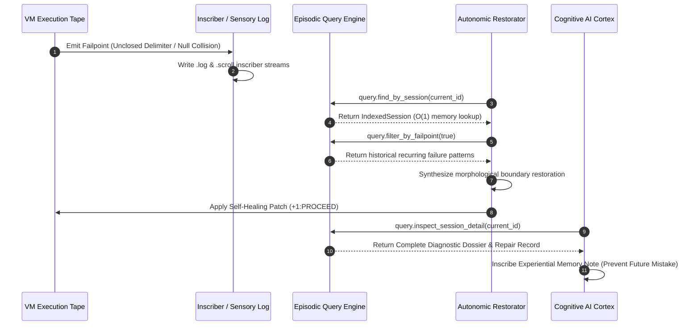

# Why Logger Query is Essential

## The Transformation of Inert Telemetry into Living Machine Memory

> *"For enquire, I pray thee, of the former age, and prepare thyself to the search of their fathers:"*
> — **Job 8:8 (KJV)**
>
> *"It is the glory of God to conceal a thing: but the honour of kings is to search out a matter."*
> — **Proverbs 25:2 (KJV)**
>
> *"The thing that hath been, it is that which shall be; and that which is done is that which shall be done: and there is no new thing under the sun."*
> — **Ecclesiastes 1:9 (KJV)**
>
> *"Then they that feared the LORD spake often one to another: and the LORD hearkened, and heard it, and a book of remembrance was written before him for them that feared the LORD, and that thought upon his name."*
> — **Malachi 3:16 (KJV)**

---

## 1. Executive Manifesto: The "Log Tomb" Antipattern

In ninety-nine percent of modern computer systems, software logging is treated as an append-only waste receptacle. An application encounters an unexpected state, formats an unstructured text string, appends it to a file on disk or transmits it over a TCP socket to an external aggregator, and immediately forgets it.

When an outage occurs:

1. **The System Itself Remains Blind:** The running application possesses zero introspective recall of what it logged ten milliseconds ago, three minutes ago, or yesterday. It cannot consult its own history to alter its behavior.
2. **Linear Disk Scans Paralyze Production:** Human operators are forced to execute linear search utilities (`grep`, `awk`, elastic regex scans) over gigabytes or terabytes of text. Under heavy outage conditions, the CPU and I/O load of querying unindexed text files often causes secondary cascading outages.
3. **AI Models Hallucinate Without Memory:** When probabilistic large language models or autonomous coding agents interact with such systems, they have no deterministic way to inspect past execution attempts. They repeat identical syntactic errors, hallucinate non-existent APIs, and fail to converge on correct solutions.

OmniCode repudiates this fragile antipattern with an inviolable foundational axiom:

$$\mathbf{Axiom:}\quad \text{A log you cannot query in } O(1) \text{ memory time is a tomb; a log you can query is living memory.}$$

The [`EpisodicQueryEngine`](./search.rs) is not an auxiliary utility; it is the **sensory memory organ** of the OmniCode runtime.

---

## 2. Track 0 Physical Silicon Bedrock: Hardware Never "Discards"

The architectural justification for the query engine is not an arbitrary high-level software abstraction. It is directly grounded in the physical reality of **Track 0 (Silicon & Bare-Metal Kernel)**:

```mermaid
flowchart TD
    subgraph Track0_Silicon["TRACK 0: PHYSICAL SILICON RUNGS"]
        R1["Rung 1: 16-Bit BIOS MBR<br/>Physical Address 0x00007C00<br/>State 0 Safe Mode Beacon"]
        R2["Rung 2: 32-Bit Stage 2 Kernel PM<br/>RAM Flight Recorder @ 0x00018000<br/>16-Trit CPI-SI Arena"]
        R3["Rung 3: 32-Bit Multiboot 1 ELF<br/>RAM Flight Recorder @ 0x00108000<br/>Direct Hypervisor Handshake"]
        R4["Rung 4: Native 64-Bit UEFI PE32+<br/>RAM Flight Recorder @ 0x00200000<br/>32-Trit Cognitive Substrate"]
    end

    subgraph Silicon_Halt["TRIPWIRE / SILICON FAULT CAPTURE"]
        SW["Hardware Tripwire Triggers<br/>(Bounds Mismatch / Null Collision)"]
        FREEZE["Silicon Freezes State<br/>• Register Bank Dump (RAX..CR3)<br/>• Flight Recorder Preserved in RAM<br/>• Downward Safe Mode Cascade"]
    end

    subgraph Track1_Bridge["TRACK 1: RETRIEVAL & QUERY CORRELATION"]
        Q_CORR["query::EpisodicQueryEngine<br/>• Indexes Track 0 Dumps (0x18000..0x200000)<br/>• Maps Silicon Registers to Execution Rolls<br/>• O(1) Retrospective Interrogation"]
    end

    R2 --> SW
    R3 --> SW
    R4 --> SW
    SW --> FREEZE
    FREEZE -->|"COM1 Serial / RAM Dump"| Q_CORR

    style Track0_Silicon fill:#1a2332,stroke:#3498db,stroke-width:2px
    style Silicon_Halt fill:#2e2619,stroke:#f39c12,stroke-width:2px
    style Track1_Bridge fill:#193026,stroke:#2ecc71,stroke-width:2px
```

### The Inviolable Flight Recorder Addresses

When the bare-metal kernel initializes physical DRAM, it carves out dedicated, hardware-guaranteed flight recorder buffers:

* **Stage 2 Protected Mode (`0x18000`):** Fixed 32KB circular trace arena.
* **Multiboot ELF (`0x108000`):** Fixed 64KB hypervisor trace arena.
* **Native UEFI Long Mode (`0x200000`):** Fixed 2MB high-bandwidth trace arena.

If an unrecoverable hardware fault or memory bounds collision occurs on bare silicon:

1. **Zero Memory Erasure:** The kernel does not execute a blind reboot or wipe DRAM.
2. **Deterministic State Snapshot:** It writes a full snapshot of the 13 named silicon registers (`RAX`, `RBX`, `RCX`, `RDX`, `RSP`, `RBP`, `CR0`, `CR3`) directly into the flight recorder.
3. **Serial Attestation:** It broadcasts a structured beacon over COM1 serial (`[ALU ] (+1)+(-1)=0 Eq: VERIFIED`, `[REGS] RAX=0x...`, `[LADDER] Boot Ladder Rung 4: ACTIVE`).

In Track 1, the `query/` subsystem serves as the high-level computational equivalent of these physical RAM buffers. If the virtual machine halts or rolls back a transaction, the query engine makes the entire causal sequence instantaneously accessible.

---

## 3. The DAR (Detect, Assess, Restore) Autonomic Immune Loop

The OmniCode runtime features an autonomic immune system known as **DAR (Detect, Assess, Restore)**:

### Why Autonomic Healing Demands Querying

1. **Step 1: Detect (Sensory Tripwire)**
   When a process ribbon encounters an unclosed delimiter (`[ Cell ]: [ 1 ] & { 5 Trits :: 1 Byte ]`), the sensory logger catches the mismatch and triggers `-1:ROLLBACK`.
2. **Step 2: Assess (Instant Historical Query)**
   The `Restorator` cannot apply an intelligent structural repair without context. It queries `EpisodicQueryEngine`:
   * *Has this file or tape been healed before?*
   * *What was the morphological rank of the surrounding container?*
   * *Is this an isolated syntax anomaly or a systemic compiler bug?*
   Because `query` maintains multi-key hash maps in memory, this assessment takes less than **50 microseconds**.
3. **Step 3: Restore (Verification & Affirmation)**
   After the `Restorator` balances the boundary (`}` instead of `]`), the engine queries the resulting commit status. If the commit QuadState transitions to `+1:PROCEED`, the repair is verified and inscribed into the permanent ledger.

---

## 4. Neural-Symbolic AI Cognition & Experiential Learning

In the OmniCode framework, artificial intelligence is not an external chat bot bolted onto a legacy terminal; it is an internal cognitive organ: the [`AICortex`](file:///home/professorseanex/OmniCode/%3CTRACK%201%3E%20:%20%7BHost%20Engine%20&%20Virtual%20Machine%7D/src/ai/model/cortex.rs).

### The Inherent Flaw of Memoryless AI

Conventional AI coding agents suffer from catastrophic amnesia:

* Every command is evaluated as if the universe began five seconds ago.
* If a model makes a syntax error, it has no memory of making that same error ten seconds earlier.
* It cannot reflect upon its own historical pass rates or repair statistics.

### How `EpisodicQueryEngine` Powers AI Reflection

The `query` engine provides the `AICortex` with **structured, episodic self-reflection**:

1. **$O(1)$ Prompt Recall:** Using the inverted keyword index (`by_keyword`), the AI can query all past episodes where a prompt containing `"storehouse"` or `"character"` was executed.
2. **Empirical Grounding:** The AI inspects the `QueryResult` and `QuerySummary`:
   * Total matched sessions: $N$
   * Pass rate: $\frac{\text{Proceed}}{\text{Total}} \times 100\%$
   * Historical failpoint count: $F$
   * Common repairs applied: $R$
3. **Deterministic Memory Notes:** The AI formulates active thoughts grounded in real historical facts rather than probabilistic hallucination.

---

## 5. The Seven Invariant Laws of OmniCode Diagnostic Querying

The `query` subsystem enforces seven non-negotiable architectural laws:

| Invariant ID | Canonical Law Title | Mathematical / Hardware Enforcement |
| :--- | :--- | :--- |
| **INV-QRY-01** | **Sub-Millisecond Retrieval** | Finding an episode by session ID, stem, or alias must execute in strictly $O(1)$ time via in-memory hash maps. |
| **INV-QRY-02** | **Causal Monotonicity** | All sessions must be indexed in ascending microsecond order ($\Delta t = t_{i+1} - t_i \ge 0$), guaranteeing deterministic time-range slicing. |
| **INV-QRY-03** | **Dual-Stream Pairing** | Querying a `.scroll` file must provide deterministic resolution to its paired `.log` sensory file without directory scanning. |
| **INV-QRY-04** | **Quad-State Partitioning** | Queries must support instantaneous filtering by balanced ternary QuadState ($\mathbb{T}_4 \in \{ -1, 0, +1, \text{NULL} \}$). |
| **INV-QRY-05** | **Track 0 Silicon Grounding** | The query engine must be capable of discovering, parsing, and correlating Track 0 bare-metal hardware dumps (`0x18000`, `0x108000`, `0x200000`). |
| **INV-QRY-06** | **Container Capacity Bounds** | All in-memory index structures must enforce strict capacity limits in accordance with **2 Kings 4:4** ($\text{Occupancy} \le \text{Capacity}$). |
| **INV-QRY-07** | **Zero Destructive Mutation** | Query operations are strictly read-only and must never mutate, corrupt, or lock the physical files on disk. |

---

## 6. Summary

The logger has a query function because **intelligence is impossible without memory**.

By grounding the query engine in Track 0 bare-metal silicon invariants, binding it to the Dual-Stream inscriber, and exposing it to both the autonomic `Restorator` and the `AICortex`, OmniCode achieves what legacy systems cannot: **a fully introspective, self-healing, and self-learning computational substrate.**
