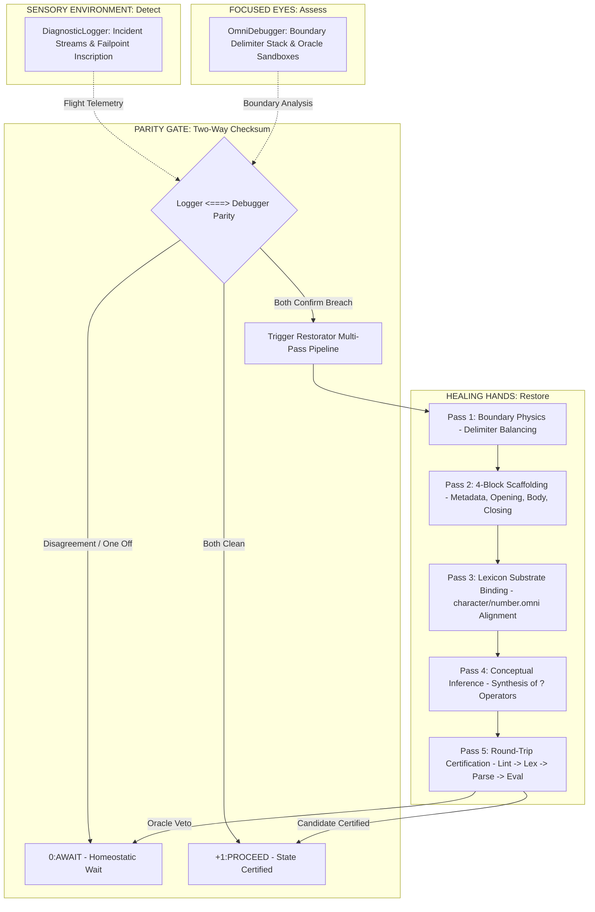

# OmniCode Diagnostic Restorator Subsystem

## The "Restore" Organ: The Healing Hands of the DAR Cybernetic Loop

> **"He healeth the broken in heart, and bindeth up their wounds."**
> — *Psalm 147:3 (KJV)*
>
> **"In the mouth of two or three witnesses shall every word be established."**
> — *2 Corinthians 13:1 (KJV)*
>
> **"Brethren, if a man be overtaken in a fault, ye which are spiritual, restore such an one in the spirit of meekness; considering thyself, lest thou also be tempted."**
> — *Galatians 6:1 (KJV)*
>
> **"According to the grace of God which is given unto me, as a wise masterbuilder, I have laid the foundation, and another buildeth thereon. But let every man take heed how he buildeth thereupon."**
> — *1 Corinthians 3:10 (KJV)*
>
> **"Supply that which is lacking in your faith."**
> — *1 Thessalonians 3:10 (KJV)*
>
> **"Call unto me, and I will answer thee, and shew thee great and mighty things, which thou knowest not."**
> — *Jeremiah 33:3 (KJV)*

---

## 1. Architectural Philosophy: The Healing Hands of DAR

In classical software systems, a syntax error, unclosed delimiter, or missing declaration causes compilation or execution to fail with an abrasive exit code (`exit(1)`). The machine abandons execution, shifting the entire cognitive burden onto the human operator to manually diagnose and repair the fault.

In the **OmniCode Host Engine (Track 1)**, self-healing is not an afterthought or an optional utility script—it is an intrinsic autonomic reflex within the **DAR Cybernetic Loop** ($\mathbf{DAR} = \langle \text{Detect}, \text{Assess}, \text{Restore} \rangle$):

$$\mathbf{Logger} \equiv \text{Ambient Sensory Environment (Detect)} \quad\longleftrightarrow\quad \mathbf{Debugger} \equiv \text{The Focused Eyes (Assess)} \quad\longleftrightarrow\quad \mathbf{Restorator} \equiv \text{The Healing Hands (Restore)}$$



When an anomaly or structural flaw is detected, the **Restorator** synthesizes surgical, non-destructive candidate repairs. It restores structural order, balances morphological boundaries, injects canonical 4-Block scaffolding, binds missing Lexicon substrate entities, resolves inferred conceptual nouns, and certifies the candidate through round-trip execution sandboxes.

---

## 2. The Two-Way Checksum: Eliminating False Positives and False Negatives

The Restorator operates under strict cybernetic jurisprudence: **autonomous code mutation is high-risk**. Mutating source code based on faulty or incomplete telemetry can corrupt healthy invariants or introduce subtle vulnerabilities.

To guarantee zero false positives and zero false negatives, the Restorator enforces the **Two-Way Checksum Parity Gate** (*2 Corinthians 13:1*):

$$\mathbf{Witness}_1 (\text{DiagnosticLogger}) \quad\boldsymbol{\Longleftrightarrow}\quad \mathbf{Witness}_2 (\text{OmniDebugger})$$

### The Jurisprudential Matrix

| Logger Senses Fault? | Debugger Senses Fault? | Two-Way Status | Restorator Action | Rationale |
| :---: | :---: | :---: | :---: | :--- |
| **NO** | **NO** | `TwoWayAgreement::Certified` | **`+1:PROCEED`** | Both witnesses agree: source is completely sound. No mutation permitted. |
| **YES** | **NO** | `TwoWayAgreement::AwaitDisagreement` | **`0:AWAIT`** | **Eliminates False Positives:** Logger caught transient noise, but Debugger sees clean physical boundaries. Mutating code now would alter healthy syntax. System holds in equilibrium. |
| **NO** | **YES** | `TwoWayAgreement::AwaitDisagreement` | **`0:AWAIT`** | **Eliminates False Negatives:** Debugger flags boundary corruption, but Logger has not formally inscribed incident custody. The Restorator pauses until incident telemetry is synchronized. |
| **YES** | **YES** | `TwoWayAgreement::BothConfirmedBreach` | **`Self-Healing Active`** | **Mutual Affirmation:** Both independent witnesses certify a genuine structural breach. The Restorator initiates the 5-pass healing pipeline. |

---

## 3. Canonical Syntax Alignment: The Banishment of `Core.`

Early prototypes of the host engine experimented with a legacy `Core.` namespace (e.g., `Core.Arithmetic`, `Core.Logic`, `Core.Vectors`, `OmniCode.Core`). **In modern OmniCode, `Core.` is completely invalid syntax.**

The Restorator is strictly grounded upon the canonical source reels and process ribbons of the standard library:

* **Compiled Source Reels:** [`character.omni`](file:///home/professorseanex/OmniCode/<TRACK%202>%20:%20{OmniCode%20Language%20&%20Standard%20Library}/lexicon/01_nouns/ideas/types/character/compiled/character.omni) & [`number.omni`](file:///home/professorseanex/OmniCode/<TRACK%202>%20:%20{OmniCode%20Language%20&%20Standard%20Library}/lexicon/01_nouns/ideas/types/number/compiled/number.omni)
* **Process Ribbons:** [`character.tape`](file:///home/professorseanex/OmniCode/<TRACK%202>%20:%20{OmniCode%20Language%20&%20Standard%20Library}/lexicon/01_nouns/ideas/types/character/interpreted/character.tape) & [`number.tape`](file:///home/professorseanex/OmniCode/<TRACK%202>%20:%20{OmniCode%20Language%20&%20Standard%20Library}/lexicon/01_nouns/ideas/types/number/interpreted/number.tape)

### Canonical Language Primitives vs. Erroneous Imports

1. **Arithmetic is Intrinsic:** In OmniCode, operators such as `plus`, `minus`, `times`, and `div` are native language primitives and hardware ALU invariants (`(+1) plus (-1) <=> 0`), NOT imported macros from `Core.Arithmetic`.
2. **Logic is Polar Ternary:** The balanced ternary states (`+1:PROCEED`, `0:AWAIT`, `-1:ROLLBACK`, `HALT:NULL`) are native polar realities of the virtual machine, NOT imported structures from `Core.Logic`.
3. **Vectors are Kinematic:** Transitions like `-->`, `<--`, `<=>`, and `==>` are directional causal arrows, NOT module imports from `Core.Vectors`.
4. **Lexicon Substrate Binding:** When source code interacts with fundamental types, it binds them directly in `BLOCK 2: OPENING` using exact Lexicon allocations:

   ```omni
   # Character Allocation:
   [ Character ]: < Character > & [ Cell ]
       ( Denoted Character is typed as invariant allocated in Cell ),
   [ Cell ]: [ 1 ] & { 5 Trits :: 1 Byte }
       ( Concrete 1-cell container in context of 5 Trits and 1 Byte ),

   # Number Allocation:
   [ Number ]: < Number > & [ Memory Word ]
       ( Denoted Number is typed as invariant Number allocated in Word ),
   [ Memory Word ]: [ 1 Memory Word ] & { 32 Trits <=> 64 Bits }
       ( Concrete 1-word container in context of 32 Trits and 64 Bits ),
   [ ALU ]: { (+1) plus (-1) <=> [ 0 ] } & { 64 Bits <=> 32 Trits }
       ( ALU enforces ternary zero-sum balance and bridges 64 bits to trits )
   ```

5. **Purging Legacy `Core.`:** Pass 3 (`ImportHealer`) actively sanitizes input code, stripping obsolete `import: [ Core.* ]` statements and rewriting `OmniCode.Core` into `OmniCode { Lexicon }`.

---

## 4. The 5-Pass Self-Healing Pipeline

The Restorator executes a deterministic 5-pass pipeline, transforming non-operational or corrupted code into an oracle-verified operational state:

```text
================================================================================
                    THE 5-PASS AUTONOMOUS HEALING PIPELINE
================================================================================
Input Source Code
       │
       ▼
 [ Pass 1: Boundary Physics ]        ──> Closes leaks, balances (), [], {}, <>
       │
       ▼
 [ Pass 2: 4-Block Scaffolding ]     ──> Injects canonical Metadata, Opening, Body, Closing
       │
       ▼
 [ Pass 3: Lexicon Substrate ]       ──> Purges `Core.` and binds Character/Number/Cell/ALU
       │
       ▼
 [ Pass 4: Conceptual Inference ]    ──> Resolves undeclared ? nouns (Ball?, Group?)
       │
       ▼
 [ Pass 5: Round-Trip Verification ] ──> Evaluates candidate via Lint -> Lex -> Parse -> Eval
       │
       ▼
 Restored & Certified Output (+1:PROCEED)
================================================================================
```

### Pass 1: Delimiter & Boundary Healing (`boundary.rs`)

* **Witness:** Proverbs 22:28 (*"Remove not the ancient landmark..."*)
* **Physics:** Traverses lexical tokens, tracks open delimiter frames on the `OmniDebugger` boundary stack, and balances unclosed or mismatched pairs:
  * Angle Invariant: `< ... >`
  * Denotational Context: `[ ... ]`
  * Connotational Scope: `{ ... }`
  * Asymmetric Input/Output: `{ ... ]` (Outside-in) and `[ ... }` (Inside-out)
  * Intent Aside: `( ... )`

### Pass 2: Canonical 4-Block Scaffolding (`scaffold.rs`)

* **Witness:** 1 Corinthians 3:10 (*"...as a wise masterbuilder, I have laid the foundation..."*)
* **Structure:** Ensures the universal 4-Block sequence defined in `character.omni` and `number.omni`:
  1. **BLOCK 1: METADATA BLOCK:** Module provenance, version (`1.0.0`), system (`OmniCode { Lexicon }`), Scriptural witness (*Psalm 147:3 KJV*), and semantics.
  2. **BLOCK 2: OPENING BLOCK:** ALU equilibrium preflight (`[ Preconditions ]: [ (+1) plus (-1) <=> 0 ] & [ Status = +1:PROCEED ]`).
  3. **BLOCK 3: BODY BLOCK:** Wraps loose or unstructured operations within operational rolls (`[ ROLL 1 ] : [ Inscribe ] : { ... }`).
  4. **BLOCK 4: CLOSING BLOCK:** Injects the fourfold commit status sealing loop (`[ Commit Status ]: [ { [ Verify ] = PROCEED } & { [ Tripwire ] = ARMED } --> [ +1:PROCEED ] | +1:PROCEED ]`).

### Pass 3: Lexicon Substrate Binding & Sanitization (`imports.rs`)

* **Witness:** 1 Thessalonians 3:10 (*"Supply that which is lacking in your faith."*)
* **Sanitization:** Detects and deletes obsolete `Core.` imports. Injects missing Lexicon container and hardware transducer definitions into `Opening { ... }`.

### Pass 4: Inferred Conceptual Entity Healing (`inferred.rs`)

* **Witness:** Jeremiah 33:3 (*"Call unto me, and I will answer thee..."*)
* **Inference:** Detects conceptual nouns marked with the infer operator `?` (e.g., `Ball?`, `Group?`) and synthesizes typed declarations immediately following the module manifest.

### Pass 5: Round-Trip Verification & Test Oracle Sandbox (`certifier.rs`)

* **Witness:** 2 Corinthians 13:1 (*"In the mouth of two or three witnesses..."*)
* **Validation:** Submits the candidate source to complete round-trip execution:
  1. `OmniLinter`: Audits 4-Block sequence, line geometry, and metadata completeness.
  2. `Lexer`: Tokenizes source verifying zero unclosed literal or escape leaks.
  3. `Parser`: Builds complete AST verifying grammar rules and boundary balance.
  4. `Evaluator`: Executes AST in an isolated sandbox, confirming the terminal value seals in `+1:PROCEED` without failpoints.
  5. `Test Oracle`: Evaluates custom closures asserting domain-specific invariants.

---

## 5. Subsystem Directory Topology

Following the modular 4-Block architecture of Track 1, the `restorator` subsystem is partitioned into dedicated domain files:

```text
src/diagnostics/restorator/
├── README.md         <-- Master Subsystem Reference (You are here)
├── mod.rs            <-- Restorator coordinator, RestorationReport & public facade
├── boundary.rs       <-- Pass 1: Delimiter auto-balancing & boundary leak repair
├── scaffold.rs       <-- Pass 2: 4-Block architectural scaffolding generator
├── imports.rs        <-- Pass 3: Lexicon substrate binding & Core. sanitization
├── inferred.rs       <-- Pass 4: Inferred conceptual entity synthesis (?)
├── certifier.rs      <-- Pass 5: Two-Way Checksum gatekeeper & test oracle sandbox
└── telemetry.rs      <-- Cognitive note inscriber & incident-driven fix logger
```

---

## 6. Integration Test Coverage & Empirical Invariants

The Restorator is validated across the integrated and functional test suites of Track 1:

* **Boundary & Delimiter Healing (`test_restorator_boundary_and_structural_auto_heal`):** Proves that source code with illegal boundary crossings (`< 42 ]`) and unclosed brackets (`[ 10 20`) is healed into valid 4-Block OmniCode and evaluated to `+1:PROCEED`.
* **Two-Way Checksum Parity (`test_two_way_checksum_both_clean_certified`):** Proves that clean environments return `TwoWayAgreement::Certified`.
* **Disagreement Protection (`test_two_way_checksum_disagreement_waits`):** Proves that if Logger senses a failpoint but Debugger has clean boundaries, the Restorator holds in `0:AWAIT` to prevent false positive code mutation.
* **Test Oracle Verification (`test_restorator_with_oracle_verification`):** Confirms that external test predicates can certify or reject candidate code repairs prior to state commitment.
* **In-Place File Restoration (`test_e2e_file_self_healing_lifecycle`):** Proves end-to-end reading from disk, autonomic multi-pass repair, and in-place writeback.
