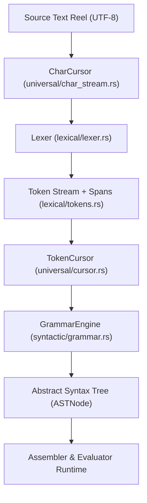

# OmniCode Parser Subsystem & Ingestion Library

> *"And he gave unto Moses, when he had made an end of communing with him upon mount Sinai, two tables of testimony, tables of stone, written with the finger of God."*  
> — **Exodus 31:18**  
>
> *"Prepare thy work without, and make it fit for thyself in the field; and afterwards build thine house."*  
> — **Proverbs 24:27**  
>
> *"Remove not the ancient landmark, which thy fathers have set."*  
> — **Proverbs 22:28**

---

## 1. Architectural Philosophy: Why This Subsystem Is a Pure Library

The `parser` subsystem in **OmniCode Track 1 (Host Engine & Virtual Machine)** is not an executable application or monolithic script. It is an **autonomous, stateless, and mathematically pure software library**.

### Core Library Invariants

1. **Zero Side Effects**: The ingestion pipeline has no ambient state, initiates no hardware I/O, does not access disk or network directly, and runs identically on bare metal, hosted Linux/macOS/Windows, or embedded inside WebAssembly.
2. **Deterministic Transduction**: Given the identical UTF-8 source reel string, the pipeline is guaranteed to yield the exact same `Token` stream and typed Abstract Syntax Tree (`ASTNode`).
3. **Universal Consumption**: This library serves as the shared front-end across the entire OmniCode ecosystem:
   * **The Assembler (`assembler.rs`)**: Tokenizes declarative machine tapes and physical memory bindings.
   * **The Language Server & Hover Engine (`hover.rs`)**: Performs real-time syntax highlighting, boundary matching, and token span lookup.
   * **The Self-Healing Restorator (`restorator.rs`)**: Intercepts diagnostic failpoints to repair malformed source reels.
   * **The AI Semantic Transducer (`AITransducer`)**: Formulates and validates synthesized OmniCode blocks.
   * **The Virtual Machine Evaluator (`evaluator.rs`)**: Executes the typed AST nodes.

---

## 2. Subsystem Directory Topology

The library is organized into three clean layers of abstraction, separating universal streaming mechanics from custom OmniCode linguistic morphology:

```
src/parser/
├── README.md                      <-- Architectural Manifesto & Subsystem Documentation
├── mod.rs                         <-- Library Facade & 100% Backward-Compatible Re-exports
│
├── universal/                     <-- Pure Stream Navigation & Coordinate Tracking (Language-Agnostic)
│   ├── mod.rs                     <-- Re-exports universal cursors and checkpoints
│   ├── char_stream.rs             <-- Universal Character Stream Cursor (CharCursor, CharCheckpoint)
│   └── cursor.rs                  <-- Universal Token Stream Cursor (TokenCursor, Expectation Guards)
│
├── lexical/                       <-- Lexical Inscription Subsystem (Morpheme Level)
│   ├── mod.rs                     <-- Re-exports token taxonomy and lexer
│   ├── tokens.rs                  <-- Inscribed Token Vocabulary, TokenType (10 categories), Spans
│   └── lexer.rs                   <-- OmniCode Morphemic Scanner, Compounding & Intent Asides
│
└── syntactic/                     <-- Syntactic & Grammar Subsystem (AST & Boundary Level)
    ├── mod.rs                     <-- Re-exports grammar engine and parser facade
    ├── grammar.rs                 <-- 6 Ranked Boundaries & 6-Level Precedence Cascade (GrammarEngine)
    └── parser.rs                  <-- Recursive Descent Parser Facade Coordinator (Parser)
```

---

## 3. Subsystem Breakdown

### A. `universal/` — Stream Navigation Machinery

Contains reusable cursors that operate on pure linear sequences without knowledge of OmniCode's grammar rules:

* **`CharCursor` (`char_stream.rs`)**:
  * 1-indexed `(line, col, byte_offset)` coordinate tracking.
  * CRLF normalization (`\r\n` and `\n` treated as a single line step).
  * Zero-allocation pattern matching (`match_str`) directly against character slices.
  * Speculative checkpointing and rollback (`CharCheckpoint`).
  * Universal accumulation primitives (`consume_while`).
* **`TokenCursor` (`cursor.rs`)**:
  * Safe lookahead past EOF without panic (`peek()`, `peek_at(offset)`).
  * Saturating boundary depth counters (`bracket_depth`, `brace_depth`, `angle_depth`).
  * Structured diagnostic failpoint recording upon expectation mismatches.

### B. `lexical/` — Lexical Inscription Subsystem

Translates raw character reels into inscribed tokens of stone:

* **`tokens.rs`**:
  * Complete 10-category ontological hierarchy (`TokenType`):
    1. Delimiters & First-Class Asides (`[`, `]`, `{`, `}`, `<`, `>`, `Aside`)
    2. Grammatical Pronouns (`I`, `you`, `it`, `they`, `myself`, etc.)
    3. Polarities & Casts (`+Word`, `-Word`, `[+]`, `[-]`, `<+>`, `<->`, `{+}`, `{-}`)
    4. Directional Vectors (`-->`, `<--`, `^--`, `v--`, `/^`, `\v`, `/-^`, `\-v`)
    5. Relations of Being & Transduction (`=`, `!=`, `~=`, `<=>`, `<`, `>`, `<=`, `>=`)
    6. Connectives & Hardware Locators (`!`, `::`, `::@`, `|`, `--`, `&`)
    7. Spatial Locators & Ranges (`@`, `..`, `%`)
    8. Cardinal Classification Clauses (`WHO`, `WHAT`, `WHEN`, `WHERE`, `WHY`, `HOW`)
    9. SVO Arithmetic Keywords (`plus`, `minus`, `times`, `div`)
    10. Inferential & Literals (`?`, `+1`, `-1`, `0`, `NULL`, `0x...`, `'A'`, `"..."`)
  * Morphological predicates: `is_boundary()`, `is_relational()`, `is_vector()`, `is_hardware_locator()`, `is_state_prime()`.
* **`lexer.rs`**:
  * Compounding engine fusing base characters into multidimensional operators.
  * First-class Intent Aside extraction: preserves `( ... )` with nested depth tracking.
  * State-prime normalization (`Character'`, ```Character` ```) designating causal step $S \to S'$.

### C. `syntactic/` — Syntactic Grammar Subsystem

Constructs the typed Abstract Syntax Tree:

* **`grammar.rs` (`GrammarEngine`)**:
  * **The 6 Ranked Morphological Boundaries**:
    * Rank 1 `< ... >`: Invariant Axiom (Absolute Immutable Law)
    * Rank 2 `[ ... ]`: Denotation (Concrete State Container & Silicon Evaluation Block)
    * Rank 3 `{ ... }`: Connotation (Context, Environment & Payload Attributes)
    * Rank 4 `[ ... }`: Inside-Out Emergence (Output Projection to External Universe)
    * Rank 5 `{ ... ]`: Outside-In Imposition (Input Capture from External Universe)
    * Rank 6 `( ... )`: Intent Aside (First-Class Cognitive Teleology & Rationale)
  * **Downward Precedence Cascade (Flow Down)**:
    1. Caveats (`!`) and Connectives (`::`, `&`, `|`, `:`, `@`, `::@`)
    2. Directional Vectors (`-->`, `<--`, `^--`, `v--`, quadrant & scale vectors)
    3. Being Relations (`=`, `!=`, `~=`, `<=>`, `<`, `>`, `<=`, `>=`)
    4. SVO Arithmetic (`plus`, `minus`, `times`, `div`)
    5. Unary Operations (`--`, prefix vectors)
    6. Primary Units & Delimiters
  * **Upward Teleological Cascade (Flow Back Up)**:
    Attaches following Intent Asides `( ... )` to statements and boundary blocks.
* **`parser.rs` (`Parser`)**:
  * Public facade coordinating the `TokenCursor` and `GrammarEngine`.
  * Manages diagnostic failpoint intercepts and provides top-level reel parsing.

---

## 4. End-to-End Ingestion Lifecycle



---

## 5. Public API & Re-exports

For maximum ergonomic simplicity and 100% backward compatibility, `src/parser/mod.rs` re-exports the primary types at the crate root:

```rust
use crate::parser::{
    CharCursor, TokenCursor,
    Lexer, Token, TokenType, Span, SourceLocation,
    Parser, GrammarEngine,
};
```
