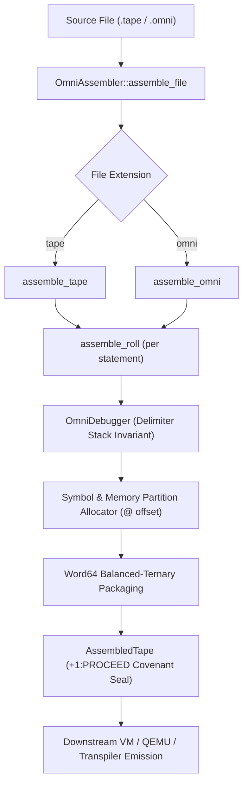

# OmniCode Runtime Physical Assembler Subsystem

```text
==============================================================================
BLOCK 1: METADATA & ARCHITECTURAL MANIFESTO
==============================================================================
Subsystem: OmniCode Host Engine & Virtual Machine Physical Assembler
Layer:     Silicon Lowering, Memory Allocation & Multi-Target Transpiler Engine
Path:      <TRACK 1> : {Host Engine & Virtual Machine}/src/runtime/assembler/
==============================================================================
```

> **"And he gave unto Moses, when he had made an end of communing with him upon mount Sinai, two tables of testimony, tables of stone, written with the finger of God."**  
> — *Exodus 31:18 (KJV)*  
> *(The immutable inscription of atomic runes onto bounded physical tablets).*
>
> **"Prepare thy work without, and make it fit for thyself in the field; and afterwards build thine house."**  
> — *Proverbs 24:27 (KJV)*  
> *(The discipline of proving atomic sub-engines and verification invariants before constructing complex systems).*
>
> **"Remove not the ancient landmark, which thy fathers have set."**  
> — *Proverbs 22:28 (KJV)*  
> *(The preservation of historical memory boundaries, silicon addresses, and machine constants).*

---

## 1. Architectural Mission

The **Physical Assembler Subsystem** is the transduction bridge between abstract ontological expressions (`+`) and concrete silicon hardware execution (`-`). It transforms high-level procedural process ribbons (`.tape`) and declarative spatial architecture reels (`.omni`) into discrete, 64-bit balanced-ternary machine words ([`Word64`]), allocates physical storehouse memory partitions, binds linguistic pronouns to CPU hardware registers, and emits multi-target runtime artifacts (bare-metal BIOS MBR bootloaders, Multiboot ELF kernels, JSON ASTs, and assembly listings).

By decomposing the monolithic 1,930-line assembler into four specialized architectural tiers:

1. **Universal Substrate (`universal/`)**: Houses the hardware instruction set architecture ([`MachineOp`]), 13 named hardware registers ([`MachineRegister`]), balanced-ternary machine word packaging, and core data containers ([`PhysicalSymbol`], [`AssembledInstruction`], [`AssembledTape`]).
2. **Lowering Pipelines (`lowering/`)**: Compiles atomic procedural statements (`roll.rs`), entire process ribbons (`tape.rs`), and 4-Block spatial reels (`omni.rs`) into physical silicon instructions with memory bounds tracking.
3. **Multi-Target Transpilers (`transpiler/`)**: Projects lowered tapes into annotated assembly listings (`listing.rs`), IDE hovercard JSON (`json.rs`), bidirectional `.tape` <-> `.omni` translations (`omni.rs`), and bare-metal x86 Real Mode / Multiboot assembly (`baremetal.rs`).
4. **Core Coordinator (`core.rs`)**: Orchestrates the [`OmniAssembler`], handles filesystem path discovery, and houses the comprehensive regression test suite.

---

## 2. Topological Layer Structure

```bash
src/runtime/assembler/
├── universal/                  <-- Tier 1: Hardware ISA & Fundamental Data Containers
│   ├── isa.rs                  <-- MachineOp, MachineRegister, Pronoun/Polarity Maps, Word64 Synthesis
│   ├── types.rs                <-- PhysicalSymbol, AssembledInstruction, AssembledTape, Hardware Bounds
│   └── mod.rs                  <-- Re-exports Universal ISA & Types
│
├── lowering/                   <-- Tier 2: Tape & Omni Statement Lowering Pipelines
│   ├── roll.rs                 <-- Atomic Single-Roll Lowering (Memory Offsets, Delimiters, SVO Verbs)
│   ├── tape.rs                 <-- Full Procedural .tape Ribbon Lowering Loop
│   ├── omni.rs                 <-- Declarative 4-Block .omni Spatial Reel Parser & Lowerer
│   └── mod.rs                  <-- Re-exports Lowering Pipelines
│
├── transpiler/                 <-- Tier 3: Multi-Target Code & Serializer Generation
│   ├── listing.rs              <-- Human-Readable Annotated Assembly Listings & Silicon Words
│   ├── json.rs                 <-- Structured JSON ASTs for Language Server & Debuggers
│   ├── omni.rs                 <-- Bidirectional Decompilation (.tape <--> .omni)
│   ├── baremetal.rs            <-- 16-Bit Real Mode BIOS MBR Bootloader & 32-Bit Multiboot ELF Assembly
│   └── mod.rs                  <-- Re-exports Multi-Target Transpilers
│
├── core.rs                     <-- Tier 4: Main OmniAssembler Struct, assemble_file & Verification Tests
├── mod.rs                      <-- Subsystem Public Facade (100% Backward Compatible)
└── README.md                   <-- Architectural Manifesto & Specification
```

---

## 3. Subsystem Breakdown

### 3.1 Universal (`universal/`)

- **Hardware Opcodes (`MachineOp`)**: Defines discrete silicon operations (`Nop`, `RefAbstract`, `AllocConcrete`, `TransduceVector`, `FeedbackVector`, `PartitionSlice`, `SynthesizeLayer`, `BindChannel`, `CastBoundary`, `IntrospectSelf`, `RecurseItself`, `AssertCapability`).
- **Named Silicon Registers (`MachineRegister`)**: 13 physical CPU registers with bidirectional parsing and backward compatibility aliases:
  - `HEAD` (0 / `%head` / `%ip` / `HERE`)
  - `HOME` (1 / `%home` / `%fp` / `ORIGIN`)
  - `SPOOL` (2 / `%spool` / `%sp` / `OWNER`)
  - `IT` (3 / `%it` / `%acc`)
  - `SELF` (4 / `%self` / `sl`)
  - `CALLER` (5 / `%caller` / `cl`)
  - `OTHER` (6 / `%other` / `%swarm`)
  - `STATE` (7 / `%state` / `%flags`)
  - `TURN` (8 / `%turn` / `step`)
  - `BOUND` (9 / `%bound` / `limit`)
  - `FROM` (10 / `%from` / `input`)
  - `INTO` (11 / `%into` / `output`)
  - `DISCARD` (12 / `%discard` / `void`)
- **Word64 Synthesis**: Packs 32 trits payload, QuadState status, Polarity, Boundary rank, and a 7-bit checksum into a single 64-bit machine word.

### 3.2 Lowering Pipelines (`lowering/`)

- **`roll.rs`**: Validates delimiter boundary nesting (`[`, `{`, `<`) via [`OmniDebugger`], assigns concrete RAM partition offsets (`@ 0x0000`), binds agentic pronouns, and maps SVO action verbs (`INSCRIBE`, `TRANSDUCE`, `PROJECT`, `SEQUENCE`) to hardware opcodes.
- **`tape.rs`**: Iterates through procedural rolls, carving memory partitions according to Tape Head covenants and validating that final execution commits in `+1:PROCEED`.
- **`omni.rs`**: Parses multi-block spatial `.omni` files, extracts metadata and block structure, and lowers declarations into executable silicon tapes.

### 3.3 Multi-Target Transpilers (`transpiler/`)

- **Listing & Dumps (`listing.rs`)**: Emits formatted assembly tables and silicon hex word streams.
- **Tooling ASTs (`json.rs`)**: Emits structured JSON payloads containing symbol tables and instruction metadata for language servers and IDE hovercards.
- **Format Transduction (`omni.rs`)**: Converts procedural `.tape` files into declarative 4-Block `.omni` reels and vice versa.
- **Bare-Metal OS (`baremetal.rs`)**: Generates 16-bit Real Mode MBR boot sectors and 32-bit Multiboot ELF source code targeting MilleniumOS on physical x86 or QEMU hypervisors.

### 3.4 Core Coordinator (`core.rs`)

- **`OmniAssembler`**: Encapsulates [`DiagnosticLogger`], [`OmniDebugger`], and candidate search paths (`lexicon/`, `lib/`).
- **`assemble_file`**: Universal filesystem entry point that detects `.tape` or `.omni` extensions and directs execution to the appropriate lowering pipeline.
- **Verification Tests**: Houses 9 regression oracles proving the integrity of the entire modular system.

---

## 4. The Physical Baton Pass Contract



---

## 5. Architectural Invariants

1. **Deterministic Memory Offsets**: Every concrete entity (`-`) receives a deterministic cell index within its partition, beginning at `@ 0x0000`.
2. **Boundary Closure**: Unmatched or leaking brackets (`[`, `{`, `<`) trigger immediate failpoints before any machine code is emitted.
3. **Covenant Affirmation**: Execution tapes must commit in `+1:PROCEED`; unsealed or ambiguous tapes are rejected.
4. **Universal Transduction**: All three triad representations (`.tape`, `.omni`, `Word64`) remain strictly isomorphic and bidirectionally convertible without information loss.
