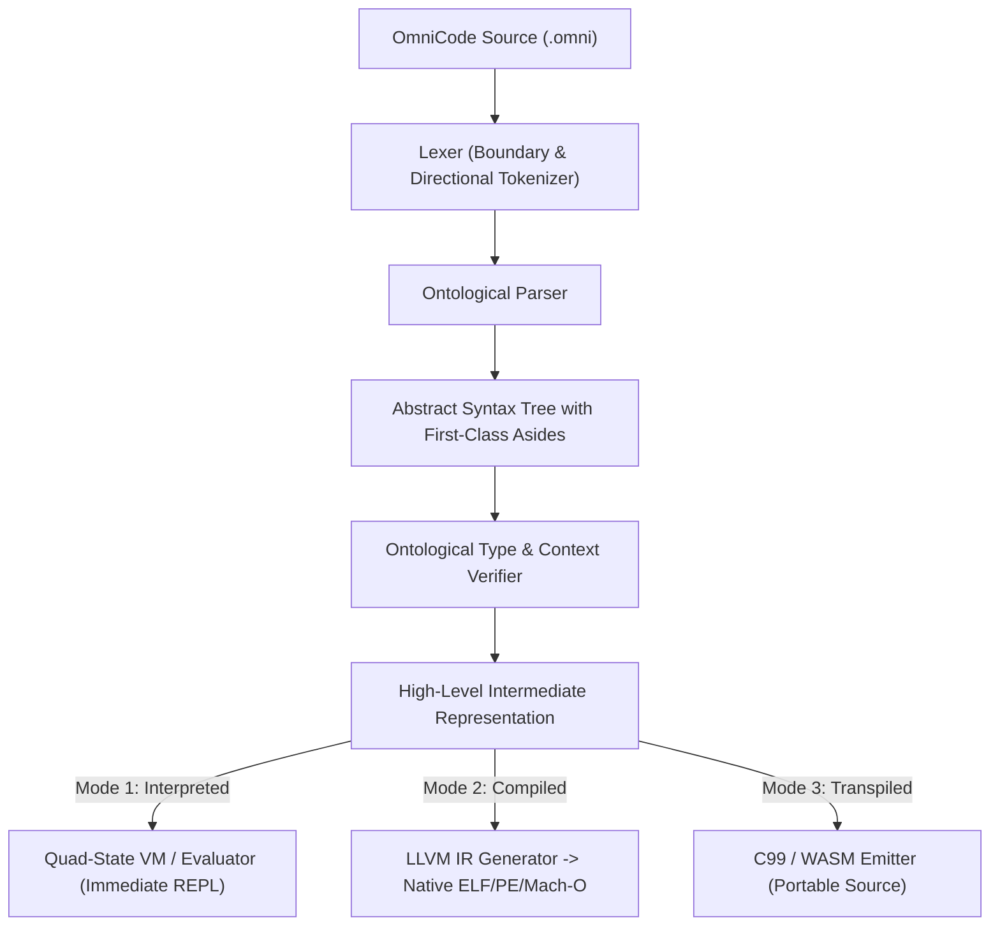

# Volume 3: Architecture & Execution

## Document 02: The Unified Execution Pipeline

---

### 1. Unified Architecture Across Three Execution Modes

OmniCode allows the exact same code to be:

1. **Compiled (AOT Native):** Ahead-of-time compilation via LLVM or assembler to standalone native binaries.
2. **Interpreted:** Real-time in-memory execution via AST/bytecode evaluation for interactive REPL and hot-reloading.
3. **Transpiled:** Source-to-source emission of ISO C99, C++, or WebAssembly for universal deployment.

---

### 2. Role of the Boundary Elements in the Pipeline

* **Denotation `[...]` and Invariant `<...>`:** Directly mapped to data structures, memory definitions, and logic bodies in the target backend.
* **Connotation `{...}`, `{...]`, and `[...}`:** Injected into the semantic checker to establish safety constraints, stack/heap qualifiers, and variable resolution rules.
* **Aside `(...)`:** Maintained in debug tables, emitted as formatted doc-comments in transpiled code, and evaluated by the verifier for formal invariant validation.
* **Quad-State Engine (`-1, 0, 1, NULL`):**
  * In the interpreter: Drives the runtime state machine directly.
  * In native C/LLVM compilation: Translated to integer return codes, branch vectors, and zero-cost error frames.

---

### 3. The Interactive Terminal Environment (REPL): Why It Is Essential

The interactive terminal environment (`omnicode` / `cargo run -- repl`) is not an afterthought; it is an essential foundational pillar of OmniCode's early development:

1. **Immediate Feedback Loop for Unprecedented Physics:**
   OmniCode introduces concepts absent in traditional C/Python/Rust languages: balanced ternary logic ($\mathbb{T}_4 = \{-1, 0, +1, \text{NULL}\}$), morphological boundary closures (`[...]`, `<...>`, `{...}`, `{...]`, `[...}`), and 3D coordinate vectors (`-->`, `<--`, `^--`, `v--`). Requiring developers to write full 4-block files and compile them AOT just to understand how a caveat (`!`) suppresses a transaction introduces excessive friction. The terminal environment gives sub-millisecond feedback for every single delimiter and operator.

2. **Real-time Manifestation of the Interpreted Pillar:**
   By establishing an interactive in-memory evaluator from day one, we guarantee that the grammar and AST definitions are cleanly decoupled from low-level LLVM code generation. The interpreter proves that the AST contains all necessary semantic and ontological data to execute autonomously.

3. **Living Failpoint & Transaction Rollback Observatory:**
   In conventional languages, runtime failures manifest as unhandled exceptions or fatal panics. In OmniCode, transitions into `-1` (Rollback) or `NULL` (Halt) are first-class ontological occurrences. The terminal environment acts as a living observatory, logging microsecond timestamps, tracking transaction snapshot unwindings, and visually displaying failpoints without crashing the session.

4. **Human-AI Co-Reasoning Sandbox:**
   Because OmniCode features first-class Asides `(...)` designed for machine-readable intent, the interactive terminal provides an ideal conversational scratchpad where human developers and AI coding agents can interactively enter expressions, verify boundary contracts, and inspect state bindings before committing logic to permanent source repositories.
