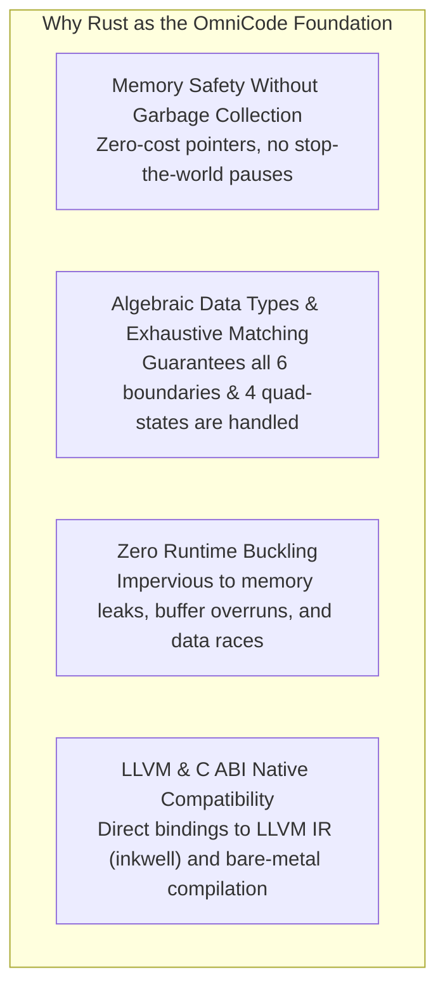

# Volume 3: Architecture & Execution

## Document 03: The Universal 4-Block Architecture & The Rust Foundation

---

### 1. The Universal 4-Block Lifecycle

Every code file in OmniCode—regardless of whether it is an `.omni` source file or a compiler module—adheres to a strict **4-Block Lifecycle Protocol**:

```text
┌────────────────────────────────────────────────────────┐
│               BLOCK 1: METADATA BLOCK                  │
│   (Module Identity, Invariant Axioms, Semantics, Asides)│
├────────────────────────────────────────────────────────┤
│               BLOCK 2: OPENING BLOCK                   │
│   (Context Setup, Preconditions, Scoped Declarations)  │
├────────────────────────────────────────────────────────┤
│               BLOCK 3: BODY BLOCK                      │
│   (Core Transformations, Causality Vectors, Logic)     │
├────────────────────────────────────────────────────────┤
│               BLOCK 4: CLOSING BLOCK                   │
│   (Postconditions, Invariant Integrity Proofs, Commit) │
└────────────────────────────────────────────────────────┘
```

#### A. Block 1: Metadata Block

* **Role:** Establishes the ontological identity of the module, licensing, semantic dependencies, and invariant axioms.
* **Grammar Elements:** `Module < Name > ( Intent Aside ) { ... }`, Invariants `< ... >`.

#### B. Block 2: Opening Block

* **Role:** Sets up the execution environment, verifies preconditions, initializes state instances, and binds contextual universes.
* **Grammar Elements:** `Opening { requires: [ ... ], preconditions: [ ... ] }`, Instances `[ ... ]`.

#### C. Block 3: Body Block

* **Role:** Implements the operational logic, directional pipelines, being relations, and caveat constraints.
* **Grammar Elements:** `Body [ source --> target ! caveat ]`, Vectors `-->`, `<--`, `^--`, `v--`.

#### D. Block 4: Closing Block

* **Role:** Verifies postconditions, proves invariant satisfaction, handles rollback teardown, and yields the final commit QuadState.
* **Grammar Elements:** `Closing { verify: [ ... ], commit_status: [ +1 ] }`.

---

### 2. Concrete Example: [examples/canonical_notation.omni](file:///home/professorseanex/OmniCode/examples/canonical_notation.omni)

```omni
# ==============================================================================
# BLOCK 1: METADATA BLOCK
# ==============================================================================
Module < CanonicalNotationShowcase > ( Foundations of Being, Causality, and Abstraction ) {
    version: < "1.0.0" >,
    author: < "ProfessorSeanEX" >,
    system: < OmniCode.Core >,
    semantics: < BalancedTernary :: QuadState :: BoundaryPhysics >
}

# Axiomatic Categories (Invariant Sets)
A < +1 > ( Invariant category A: axiomatic ground truth )
B < +1 > ( Invariant category B: independent set domain )

# ==============================================================================
# BLOCK 2: OPENING BLOCK
# ==============================================================================
Opening {
    requires: [ MemoryAligned :: TypeChecking ],
    initial_truth: [ +1 ]
}

a [ +1 ] ( Particular instance 'a' with mutable state )
b [ +1 ] ( Particular instance 'b' with mutable state )
a_in_A [ a ] { A } ( Instance 'a' validated within contextual universe A )

# ==============================================================================
# BLOCK 3: BODY BLOCK
# ==============================================================================
Body [
    instance_typing [ a : A ]
    identity_check [ a = a ]
    forward_action [ a --> b ]
    synthesis [ a ^-- A ]
    pipeline [ a --> b ! [ a : A :: b : B ] ]
]

# ==============================================================================
# BLOCK 4: CLOSING BLOCK
# ==============================================================================
Closing {
    verify: [
        identity_check = +1 ::
        forward_action = +1 ::
        pipeline = +1
    ],
    on_rollback: [ <-- unwind_state ],
    commit_status: [ +1 ]
}
```

---

### 3. Reasoning for Using Rust as the Core Engine

To ensure that the language engine is uncompromising at both low and high levels, the OmniCode compiler and runtime were implemented in **Rust**:



#### 1. Zero Runtime Buckling

A language that layers up from bare metal cannot afford to buckle under concurrency or memory corruption. Rust’s strict borrow checker and ownership model ensure that the OmniCode compiler, parser, and diagnostic engines execute with zero undefined behavior.

#### 2. Pattern Matching Over Morphological Boundaries

The OmniCode boundary system (`[]`, `<>`, `{}`, `{]`, `[}`, `()`) requires non-trivial parsing logic. Rust's pattern matching (`match`) allows the parser and evaluator to handle asymmetric boundaries and directional vectors cleanly with compile-time exhaustiveness checks.

#### 3. Deterministic Transactional Snapshots

The balanced ternary `-1` (Rollback) state requires snapshotting the environment and unwinding state upon failure. In Rust, cloning scoped bindings and performing deterministic unwinding is explicit, predictable, and fast.

#### 4. Foundation for Future AOT & Transpilation

Because Rust has direct access to LLVM C/C++ APIs, the OmniCode core is primed to generate LLVM IR for AOT native compilation and emit optimized ISO C99 code for universal cross-platform deployment.
