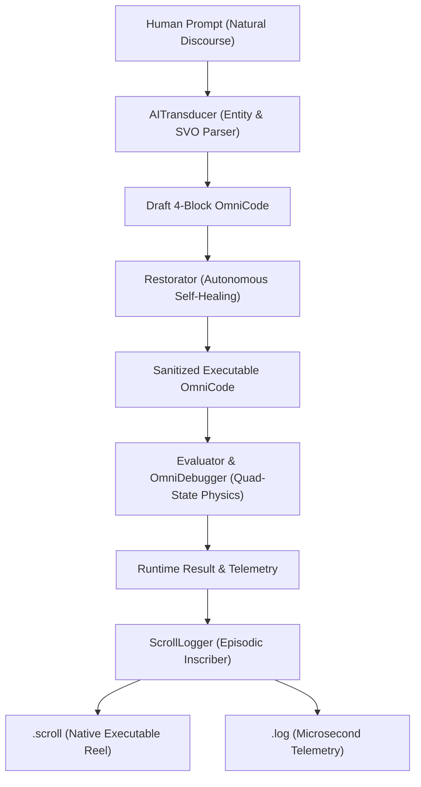

# Volume 4: Cognitive & Autonomous Systems

## Document 01: The AI Cortex & Neural-Symbolic Transduction Loop

> **Bridging Freeform Human Discourse and Deterministic Machine Execution via Dual-Readable 4-Block Turing Reels.**

In traditional computing, natural language processing and compiler execution exist in disjoint worlds: LLMs generate unverified code strings that are prone to hallucinated syntax, while compilers reject anything that deviates from rigid grammars.

OmniCode solves this duality by embedding a **Neural-Symbolic Cognitive Loop** directly within the language engine:

$$\text{Natural Prompt} \xrightarrow{\text{Transducer}} \text{Canonical 4-Block AST} \xrightarrow{\text{Restorator}} \text{Self-Healed Code} \xrightarrow{\text{Evaluator}} \text{Episodic Trace} \xrightarrow{\text{Logger}} \text{Dual Inscription}$$

---

### 1. Architectural Foundation & Preconditions

The [`AICortex`](file:///home/professorseanex/OmniCode/src/ai/model/cortex.rs) orchestrates five specialized subsystems within an integrated cognitive loop:



#### Precondition Invariants

1. **Deterministic Transduction:** All inferred entity names, numeric literals, and relational directions must be captured in explicit 4-Block sections.
2. **Intent Preservation:** Conceptual commentary and reasoning traces are preserved as first-class Asides `(...)`.
3. **Transactional Safety:** If evaluation triggers a `-1:ROLLBACK` or caveat veto, state changes are rolled back automatically.

---

### 2. Transduction Mechanics & Operational Pipeline

The [`AITransducer`](file:///home/professorseanex/OmniCode/src/ai/transducer.rs) executes a four-stage cognitive transformation:

1. **Entity & Numeric Extraction:**
   - Scans natural discourse for quantities (e.g., `5 units`, `12 items`) and targets (e.g., `inventory A`, `group B`).
   - Distinguishes initial baseline quantities from incremental operands.
2. **Subject-Verb-Object (SVO) Resolution:**
   - Maps operational verbs (`add`, `combine`, `transfer`, `mutate`, `verify`) to directional vectors:
     - Addition / Transfer $\to$ `-->` (Act Upon / Forward Causality).
     - Retroactive Feedback $\to$ `<--` (Feedback / Reverse Causality).
     - Invariant Layering $\to$ `^--` (Builds to) / `v--` (Breaks down from).
3. **Ontological Type Inference:**
   - Dynamically resolves domain nouns into ontological categories:
     - Discrete counts $\to$ `Entity?`
     - Aggregations $\to$ `Set?`
     - Contextual domains $\to$ `Domain?`
4. **Canonical 4-Block Assembly:**
   - Wraps inferred logic into standard `Module`, `Opening`, `Body`, and `Closing` blocks.

#### Concrete Transduction Walkthrough

**Input Natural Language Prompt:**

```text
"Add 5 units to inventory A which contains 12 units"
```

**Inferred 4-Block OmniCode Reel:**

```omni
# ==============================================================================
# BLOCK 1: METADATA BLOCK
# ==============================================================================
Module < NaturalReel.Addition > ( Add 5 units to inventory A which contains 12 units ) {
    version: < "1.0.0" >,
    system: < OmniCode.Core >,
    semantics: < TrackPhysics :: MultiTape :: AIInference >
}

Units < Entity? > ( Inferred discrete unit: resolved from 'Units' )
Inventory < Set? > ( Inferred collection container: resolved from 'Inventory' )

# ==============================================================================
# BLOCK 2: OPENING BLOCK
# ==============================================================================
Opening {
    import: [ Core.Arithmetic :: Core.Logic :: Core.Vectors ],
    preconditions: [ +1 ]
}

inventory_a [ 12 ] ( Initial baseline state of target container )
transfer_units [ 5 ] ( Incremental operand value )

# ==============================================================================
# BLOCK 3: BODY BLOCK
# ==============================================================================
Body [
    result_inventory_a [ inventory_a + transfer_units ]
    inventory_a --> result_inventory_a ( Directional causal update )
]

# ==============================================================================
# BLOCK 4: CLOSING BLOCK
# ==============================================================================
Closing {
    verify: [ result_inventory_a = 17 ],
    commit_status: [ +1 ]
}
```

---

### 3. Verification, Telemetry & Invariant Guarantees

1. **State Certification:** Transduced programs are executed through the [`Evaluator`](file:///home/professorseanex/OmniCode/src/runtime/evaluator.rs) before any output is returned to the user.
2. **Dual Log Persistence:** Both `.scroll` and `.log` artifacts are inscribed in `scrolls/` and verified to be valid on disk.
3. **Conversational Synthesis:** A natural-language explanation is generated alongside the machine state, guaranteeing dual human-machine transparency.
