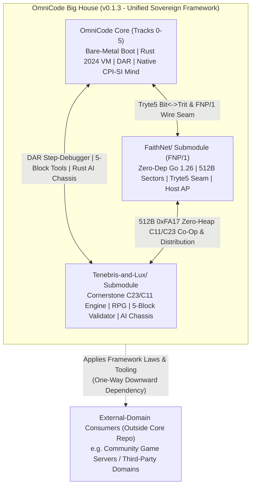
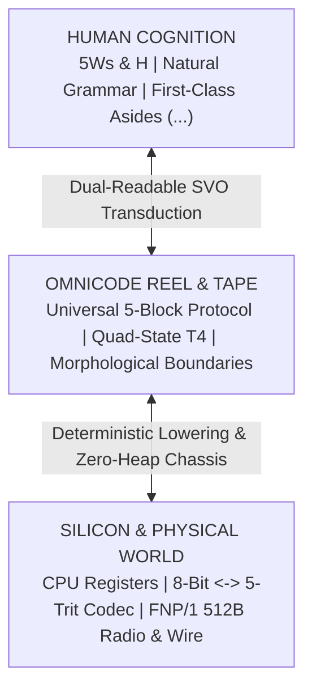
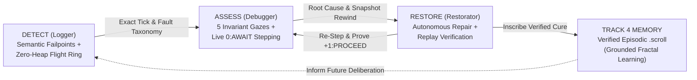

<!--
================================================================================
BLOCK 1: METADATA BLOCK
( Identity, Provenance, Scaling Telemetry & Architectural Boundary Contracts )
================================================================================
@project       OmniCode Framework
@file          README.md
@id            root.docs.readme
@layer         Root Repository Front Door & Multi-Machine Orientation Anchor
@archetype     manifest | multi_audience_framework_guide
@version       0.1.3-dev
@coordinate    13% of Cycle 0 toward 1.0.0 (Slot 1=0, Slot 2=1, Slot 3=3)
@interface_rev Rev 5
@created       2026-10-07
@updated       2026-11-19
@author        CreativeWorkzStudio LLC / ProfessorSeanEX (Seanje Lenox-Wise)
@repository    https://github.com/Novaking34/OmniCode_Framework
@system        OmniCode Core (Tracks 0-5) + FaithNet (FNP/1) + Cornerstone/T&L
@role          Whole-Framework Orientation, Architecture Map & Quick-Start Index
@maturity      Rev 5 Baseline | Coordinate v0.1.3 Mass Alignment Wave
@chassis       multi-machine | Rust 2024 + Go 1.26 (0 deps) + ISO C23/C11
@scale         ~226,000+ LOC & 950+ verified tests across 3 sovereign machines
@seams         in: docs/, Tracks 0-5, FaithNet/, Tenebris-and-Lux/, .agents/
@invariants    1. Universal 5-Block Lifecycle Protocol (Rev 5).
               2. Dual-Audience Mixing Balance: Seanje's grounded voice carries
                  the Why `()`; Structured Intelligence carries the How `<>`.
               3. CreativeWorkzStudio LLC is a sovereign publishing house, not
                  a SaaS vendor; "You learn more when having fun."
               4. Coordinate Versioning (M.m.p): versions track macro system
                  state, never raw edit/commit counts.
               5. Every mounted submodule stays a standalone machine ("a machine
                  becomes a big gear, yet every cog stays a cog").
================================================================================
-->

<div align="center">

# OmniCode Framework

### A Sovereign Multi-Machine Programming Language, Operating System & Studio Foundation

*Built by **CreativeWorkzStudio LLC** — a sovereign publishing house crafting games, stories, art, educational tools, and resilient local infrastructure.*

> **"You learn more when having fun."** · **"Compatibility with the modern world—without dependency on it."**

[-2ea44f?style=flat-square)](#coordinate-versioning-where-we-actually-stand)
[](#how-omnicode-thinks)
[](#the-big-house-three-sovereign-machines-one-framework)
[](#v013-living-alignment-board-and-verification)
[](#governance-anchors-and-license)

[Why This Exists](#why-this-exists) · [The Big House](#the-big-house-three-sovereign-machines-one-framework) · [6-Track Stack](#the-6-track-vertical-stack) · [How It Thinks](#how-omnicode-thinks) · [DAR Loop](#the-dar-cybernetic-nervous-system) · [Coordinate Versioning](#coordinate-versioning-where-we-actually-stand) · [Quick Start](#quick-start) · [v0.1.3 Board](#v013-living-alignment-board-and-verification)

</div>

---

<!--
================================================================================
BLOCK 2: OPENING BLOCK
( Purpose, Grounded Voice, Physical Intuition & Multi-Audience Front Door )
================================================================================
-->

## Why This Exists

Modern computing splits people and machines into awkward silos:

* **Low-level systems code** gives you raw hardware speed and control, but reads like a foreign dialect to anyone outside systems programming.
* **High-level scripting & cloud stacks** feel approachable on day one, then bury you under fragile dependency trees, garbage-collection pauses, and monthly cloud lock-in.
* **Modern AI models** can generate paragraphs and code at lightning speed, yet stay detached from the actual machine—forgetting boundaries, drifting across sessions, and hallucinating past physical reality.

**OmniCode** takes a different road. **CreativeWorkzStudio LLC** is not a commercial SaaS vendor—it is an independent, **sovereign publishing house** building stories, games (like *Tenebris and Lux*), art, educational tools, and local community software. OmniCode, **FaithNet**, and **Cornerstone** exist so our creative workshop and our local communities can keep creating, playing, learning, and talking **even when centralized clouds or commercial ISPs stumble**.

> [!TIP]
> **OmniCode in Plain English (Physical Intuition):**
>
> * **Nouns (`[ Cell ]`, `[ Vessel ]`, `[ Storehouse ]`)** are physical boxes with hard walls so memory never spills where it doesn't belong.
> * **Verbs (`-->`, `<--`, `v--`, `^--`, `=`)** are directional pipes and conveyor belts moving data cleanly from one container to another.
> * **Balanced Ternary ($\mathbb{T}_4$)** replaces brittle `true`/`false` crashes with a natural balance scale: **Proceed** (`+1`), **Await** (`0`), **Rollback** (`-1`), and protective **Halt** (`NULL`).
> * **First-Class Asides `(...)`** are human notes explaining *why* a piece of code exists—preserved right inside the machine instead of thrown away like ordinary comments.

### Pick Your Front Door

| If you are... | Start here | What you'll get right away |
| :--- | :--- | :--- |
| **An Everyday Reader, Creative, or Educator** | [The Big House](#the-big-house-three-sovereign-machines-one-framework) & [How It Thinks](#how-omnicode-thinks) | Plain-English explanation of what these tools do, why sovereignty matters, and how physical computing intuition works—zero jargon wall. |
| **A Systems Engineer or Contributor** | [6-Track Stack](#the-6-track-vertical-stack), [`docs/SYNTAX.md`](docs/SYNTAX.md), [`docs/KEYWORD.md`](docs/KEYWORD.md) & [Quick Start](#quick-start) | Plain-ASCII Assembly syntax & keyword specs, Rust/Go/C23 architecture, balanced ternary codecs, zero-heap invariants, DAR diagnostics & build matrices. |
| **An AI Agent / CPI-SI Substrate**[^1] | [`manifest.omni`](manifest.omni), [`manifest.tape`](manifest.tape), [`.agents/language/`](.agents/language/language_living_charter.md) & [CPI-SI Covenant](.agents/skills/cpi-si-covenant/SKILL.md) | Executable 5-Block root manifests, living grammar charter & syntax/keyword specs, authorial voice seed ([`voice_tone_and_cpi_si_paradox.md`](.agents/identity/voice_tone_and_cpi_si_paradox.md)), and coordinate versioning law. |

---

<!--
================================================================================
BLOCK 3: BODY BLOCK
( Whole-Framework Topology, 6-Track Stack, Core Physics, DAR & Quick Start )
================================================================================
-->

## The Big House: Three Sovereign Machines, One Framework

A real computer science **framework** is not a monolith that swallows every app you ever write—it is a shared structural skeleton, set of physical laws, and clean seams where independent systems mesh together.

That gives us a simple rule of thumb across this repository: **a complete machine turns into a big gear for a bigger machine, yet every cog inside it stays a cog.**



### Why `FaithNet/` and `Tenebris-and-Lux/` Sit Inside—and External Apps Stay Outside

* **[`FaithNet/`](FaithNet/README.md)** is a core organ of the framework itself: the offline-first sovereign networking substrate (`FNP/1`, port `7777`, `faithnet://`, 512-byte floppy sector frames, lossless `Tryte5` bit $\leftrightarrow$ trit bridge, multi-rung transport, and host AP/firewall controls).
* **[`Tenebris-and-Lux/`](Tenebris-and-Lux/README.md)** is both CreativeWorkzStudio's 100% original flagship RPG *and* the crucible that birthed the **Cornerstone Game Engine** (`ALLOC_ZERO_HEAP` ISO C23/C11), a 45k-LOC multi-language Rust 5-Block validator, and the operational Python AI exoskeleton currently slated to graduate into Rust inside OmniCode.
* **External-domain apps stay strictly outside the `OmniCode` repo.** Keeping third-party-domain projects (such as a community Yu-Gi-Oh server) outside the framework proves clean decoupling, respects IP boundaries, and ensures OmniCode stays a true general-purpose framework rather than a bloated monolith.

### Measured Unified Footprint (`v0.1.3`)

| Machine / Submodule | Primary Stack | Measured Footprint | Verified Test Baseline | Standalone Gear Role |
| :--- | :--- | :--- | :--- | :--- |
| **OmniCode Core** (`Tracks 0–5`) | Rust 2024 (`1` dep: `rustyline`), ASM, C, Bash, OmniCode | **202** Rust files (**66,087 LOC**) + Track 0 kernels, Track 2 lexicon, Track 4 vaults, Track 5 docs | **542 / 542** Cargo tests across 7 harnesses | Bare-metal boot ladder, balanced-ternary VM, language, DAR diagnostics, native CPI-SI cortex |
| **[`FaithNet/`](FaithNet/README.md)** (`master`) | Go 1.26 (**0 external deps**), Bash/PowerShell field kits | **90** Go files (**34,329 LOC**: 33 prod / 57 test), 150 total files | **346+** `-race` tests, **30:30** 1:1 pairing, **24/24** Block 4 gates | Sovereign offline-first networking, `FNP/1` 512B wire frames, `Tryte5` codec, multi-floor Wi-Fi AP |
| **[`Tenebris-and-Lux/`](Tenebris-and-Lux/README.md)** (`main`) | ISO C23/C11 (`ALLOC_ZERO_HEAP`), Rust, Python | **61,429 LOC** Cornerstone C + **11,586 LOC** game C + **45,397 LOC** Rust tools + **6,893 LOC** Python chassis | **66** CTest suites, `GRADE:+100` `--audit`, **44/44** C headers | Zero-heap game engine + BIOS ROM floor, flagship RPG, 5-Block validator lab, AI exoskeleton |

> **Total Active Stack:** ~**226,000+ LOC** and **950+ automated tests** across three independently runnable sovereign machines—all sharing one architectural DNA.[^2]

---

## The 6-Track Vertical Stack

Inside `OmniCode` Core, execution and storage are separated into six explicit Tracks from raw transistors up to studio applications and operations:

| Track | Directory | Responsibility | Key Entrypoints |
| :---: | :--- | :--- | :--- |
| **0** | [`<TRACK 0> : {Silicon & Bare-Metal Kernel}`](%3CTRACK%200%3E%20:%20%7BSilicon%20&%20Bare-Metal%20Kernel%7D/TRACK.md) | 16-bit BIOS MBR, 32-bit Stage 2 PM, 32-bit Multiboot ELF, 64-bit UEFI & QEMU boot supervisor | `kernel/build_all_kernels.sh`, `kernel/verify_boot.py` |
| **1** | [`<TRACK 1> : {Host Engine & Virtual Machine}`](%3CTRACK%201%3E%20:%20%7BHost%20Engine%20&%20Virtual%20Machine%7D/TRACK.md) | Rust 2024 compiler, lexer/parser, AST, balanced-ternary evaluator, scheduler, DAR & AI cortex | [`src/lib.rs`](%3CTRACK%201%3E%20:%20%7BHost%20Engine%20&%20Virtual%20Machine%7D/src/lib.rs), [`src/ai/model/cortex.rs`](%3CTRACK%201%3E%20:%20%7BHost%20Engine%20&%20Virtual%20Machine%7D/src/ai/model/cortex.rs) |
| **2** | [`<TRACK 2> : {OmniCode Language & Standard Library}`](%3CTRACK%202%3E%20:%20%7BOmniCode%20Language%20&%20Standard%20Library%7D/TRACK.md) | Canonical 8-part-of-speech lexicon, operators, `lib/core/` reels, and Genesis boot covenant | [`lib/kernel/boot.tape`](%3CTRACK%202%3E%20:%20%7BOmniCode%20Language%20&%20Standard%20Library%7D/lib/kernel/boot.tape) |
| **3** | [`<TRACK 3> : {Applications & OmniStudio Interfaces}`](%3CTRACK%203%3E%20:%20%7BApplications%20&%20OmniStudio%20Interfaces%7D/TRACK.md) | Zero-dependency HTTP Studio HUD, web terminal, desktop GUI, editor syntax & canonical examples | `apps/gui/`, `examples/` |
| **4** | [`<TRACK 4> : {Variable Storage & Episodic Memory}`](%3CTRACK%204%3E%20:%20%7BVariable%20Storage%20&%20Episodic%20Memory%7D/TRACK.md) | Contextual memory triad, episodic `.scroll`/`.log` chronicles, weights & local scripture bedrock | `storage/memory/contextual/`, `scripture/` |
| **5** | [`<TRACK 5> : {Infrastructure, Operations & Archives}`](%3CTRACK%205%3E%20:%20%7BInfrastructure,%20Operations%20&%20Archives%7D/TRACK.md) | Docker, `systemd`, DNS sync, distribution packaging & full formal specification library | [`docs/README.md`](%3CTRACK%205%3E%20:%20%7BInfrastructure,%20Operations%20&%20Archives%7D/docs/README.md), [`docs/dev_log.md`](%3CTRACK%205%3E%20:%20%7BInfrastructure,%20Operations%20&%20Archives%7D/docs/dev_log.md) |



---

## How OmniCode Thinks

### 1. Balanced Ternary Quad-State ($\mathbb{T}_4$)

Instead of forcing every decision into binary `true`/`false` and throwing unhandled exceptions on edge cases, execution flows across four explicit states defined in [`ternary.rs`](%3CTRACK%201%3E%20:%20%7BHost%20Engine%20&%20Virtual%20Machine%7D/src/core/ternary.rs):

$$\mathbb{T}_4 = \{-1,\ 0,\ +1,\ \text{NULL}\}$$

| Value | State | Physical Intuition | Runtime Behavior |
| :---: | :--- | :--- | :--- |
| **`+1`** | **`PROCEED`** | Green light, balanced ratchet forward | Commits state transition, affirms invariant, advances tape roll. |
| **`0`** | **`AWAIT`** | Poised equilibrium, deliberate pause | Yields cooperatively, holds epistemic inquiry, or steps live in the debugger (`DEBUG_STEP_AWAIT`). |
| **`-1`** | **`ROLLBACK`** | Safety ratchet stepping back | Rejects invalid mutation or moral caveat violation and rewinds cleanly to the last verified snapshot. |
| **`NULL`** | **`HALT`** | Hard protective stop / void trap | Absorbs unmapped memory or critical covenant breach without undefined behavior. |

### 2. The Six Morphological Boundaries & The Paradox of `()`

In OmniCode ([`boundaries.rs`](%3CTRACK%201%3E%20:%20%7BHost%20Engine%20&%20Virtual%20Machine%7D/src/core/boundaries.rs)), brackets are not decorative punctuation—they are active semantic operators ranked by ontological authority:

| Rank | Delimiter | Name | What It Governs |
| :---: | :---: | :--- | :--- |
| **1** | **`< ... >`** | **Axiomatic Invariant** | Physical and moral law that cannot break (`ALLOC_ZERO_HEAP`, hardware limits, Rank 1 covenants). |
| **2** | **`[ ... ]`** | **Rigid Vessel / Cell** | Fixed, bounded memory containers, typed values, and atomic data operands. |
| **3** | **`{ ... }`** | **Scoped Room / Context** | Execution spaces, lifecycle blocks, and bounded environmental domains. |
| **4** | **`[ ... }`** | **Generator / Emitter** | Asymmetric boundary opening from rigid ground into fluid outward expansion. |
| **5** | **`{ ... ]`** | **Accumulator / Basin** | Asymmetric boundary gathering fluid motion into rigid sealed storage. |
| **6** | **`( ... )`** | **First-Class Aside** | Human intent, rationale, teleology, and living context preserved directly in the AST. |

> **The Paradox:** On paper, `(...)` sits at Rank 6—looking like a parenthetical note a normal compiler would throw away. In reality, **`()` is the only boundary that matches `<>` in ultimate power**: `<>` defines *what cannot break*; `()` defines *why it exists in the first place*. Without `<>`, `()` has no ground; without `()`, `<>` is just cold stone.

> [!NOTE]
> **Full Plain-ASCII Language & Compiler Reference (`v0.1.3`):**
>
> * **[`docs/SYNTAX.md`](docs/SYNTAX.md)** — All 16 border combinations (`<[{()}]>`), 14 plain-ASCII directionals, Weight Scale, and self-grounded Origin (`=<God>=`).
> * **[`docs/KEYWORD.md`](docs/KEYWORD.md)** — Freestanding Keyword Law (`KEYWORD` = `<KEYWORD>` unless guarded), 3-case register discipline (`ALL CAPS` vs. `[ Proper Case ]` vs. `lowercase`), Math/Ternary primitives, and the `.tape` 5-Block pipeline: `METADATA -> HEAD -> BODY (TAPE / ROLL) -> AUDIT (CATCH / THROW / TRIPWIRE) -> REEL (PLAY -> TRACK / SCENE)`.

---

## The DAR Cybernetic Nervous System

Diagnostics in OmniCode are not a pile of disconnected print statements—they form a closed cybernetic immune loop defined in [`src/diagnostics/mod.rs`](%3CTRACK%201%3E%20:%20%7BHost%20Engine%20&%20Virtual%20Machine%7D/src/diagnostics/mod.rs):

$$\mathbf{DAR} = \langle\ \text{Detect},\ \text{Assess},\ \text{Restore}\ \rangle$$



With `Tenebris-and-Lux/` now mounted beside Track 1, **DAR** is actively converging the best of both machines: OmniCode's semantic failpoint taxonomy, episodic `.scroll` inscriber, and self-healing `Restorator` fusing with Cornerstone's `ALLOC_ZERO_HEAP` flight-recorder rings and live `DEBUG_STEP_AWAIT` step-by-step time control—feeding reality-verified cures into Track 4 memory rather than synthetic self-echo.

---

## Coordinate Versioning: Where We Actually Stand

> [!IMPORTANT]
> **Versions Are State Coordinates, Not Commit Counters.**
> Updating a file, fixing a bug, or landing a cleanup commit does **not** automatically change the version. Many atomic commits live cleanly inside a single coordinate; the coordinate only advances when a verified macro state transition seals (`+1: PROCEED`).

OmniCode uses base-10 **Coordinate Versioning (`M.m.p`)**:

* **Slot 1 (`M` — Major Stable):** Completed full `100%` revolutions (`0` = first foundation cycle toward `1.0.0`, `1` = first major stable complete, `2` = second complete, etc.).
* **Slot 2 (`m` — Minor in Development):** The **tens digit** (`0–9` = `00%–90%`) toward the next Major.
* **Slot 3 (`p` — Tracking Iteration):** The **ones digit** (`0–9` = `0%–9%`) within that minor phase.

| Coordinate | Reading | Meaning |
| :---: | :---: | :--- |
| `v0.1.2` | `12%` | Standalone engine decoupling, 5-Block validator & cognitive continuum check-in. |
| **`v0.1.3`** | **`13%`** | **Current Coordinate** — Big House submodules mounted, 5-Block Rev 5 root manifests, unified Git ledger & multi-floor FaithNet resilience. |
| `v1.0.0` | `100%` | First full major stable revolution complete (87 deliberate ticks ahead of us—zero rush). |
| `v2.4.8` | `48%` *(of Cycle 2)* | Two completed major cycles behind you, `48%` of the way from `2.0.0` toward `3.0.0`. |

---

## Quick Start

Clone the full Big House (including `FaithNet/` and `Tenebris-and-Lux/`):

```bash
git clone --recurse-submodules https://github.com/Novaking34/OmniCode_Framework.git
cd OmniCode_Framework

# Build the native Rust 2024 host engine
cargo build

# Run the full 7-harness verification suite (542 tests)
cargo test -- --test-threads=1

# Launch the interactive OmniCode REPL
cargo run -- repl
```

Already cloned without submodules? Pull them in cleanly anytime:

```bash
git submodule update --init --recursive
```

---

## Deep Technical Reference

<details>
<summary><strong>1. Full Multi-Machine Verification Batteries (OmniCode · FaithNet · Cornerstone)</strong></summary>

#### OmniCode Core (Rust 2024 — Track 1 & Track 0)

```bash
# Fast zero-warning check & dependency audit (sole direct dep: rustyline)
cargo check --all-targets
cargo tree --depth 1

# Full 7-harness verification battery (542 / 542 passing)
cargo test -- --test-threads=1

# Track 0 bare-metal QEMU boot supervisor
python3 "<TRACK 0> : {Silicon & Bare-Metal Kernel}/kernel/verify_boot.py"
```

#### FaithNet Submodule (Go 1.26 — Zero External Dependencies)

```bash
cd FaithNet
go list -m all                                # Must list ONLY FaithNet
go vet ./...
go test -v -count=1 -race ./tests/...         # 346+ race-free tests
go run ./cmd/faithnet-node --audit            # 24/24 live Block 4 gates
```

#### Tenebris-and-Lux / Cornerstone Submodule (ISO C23/C11 + Rust Toolchain)

```bash
cd Tenebris-and-Lux
cmake -B build && cmake --build build --config Debug --parallel
ctest --test-dir build -C Debug --output-on-failure
./build/bin/tenebris-lux --audit              # Self-audit [GRADE:+100]
cargo test --manifest-path tools/Cargo.toml   # Rust 5-Block toolchain tests
```

</details>

<details>
<summary><strong>2. Bijective 8-Bit ↔ 5-Trit Codec, 8-Slot Sentences & 5-Block Rev 5 Standard</strong></summary>

#### Bijective Hardware Codec (`cell.rs` ↔ `FaithNet/engine/trit.go`)

A single physical byte carries $2^8 = 256$ states, which maps bijectively onto 5 balanced trits ($3^5 = 243$ signed data states in $[-121 \dots +121]$) plus **13 out-of-band control states** (`243..255`) carrying `NULL/HALT`, `AWAIT`, `ROLLBACK`, `PROCEED`, and hardware markers with **zero struct padding and zero heap overhead**:

$$2^8 = 256 \;\longleftrightarrow\; 3^5 + 13 = 243\text{ data states} + 13\text{ out-of-band control states}$$

See [`cell.rs`](%3CTRACK%201%3E%20:%20%7BHost%20Engine%20&%20Virtual%20Machine%7D/src/core/cell.rs) and [`vessel.rs`](%3CTRACK%201%3E%20:%20%7BHost%20Engine%20&%20Virtual%20Machine%7D/src/core/vessel.rs) for the Rust host implementation, paired with `FaithNet/engine/trit.go` (`0 allocs/op` `Tryte5` wire seam).

#### Universal 5-Block Lifecycle Protocol (`Rev 5`) & Column Geometry

Every canonical file across the Big House follows five clean structural strata:

1. **Block 1 — Metadata Block:** Identity (`@project`, `@file`, `@id`, `@version`, `@interface_rev`), invariants (`<>`), and dual-audience purpose.
2. **Block 2 — Opening Block:** Imports, dependencies, configuration anchors, and pre-conditions.
3. **Block 3 — Body Block:** Core logic, state transitions, targets, or declarations.
4. **Block 4 — Audit Procedures Block:** Live pre-flight verification commands, tripwires, and self-diagnostics.
5. **Block 5 — Closing Block:** Unit tests, invariant seals, and final `+1: PROCEED` affirmation.

**Column Geometry Standard** (enforced via `.vscode/settings.json` dual rulers):

* **`80` columns (teal ruler):** Strict framing bedrock for all 5-Block borders, headers, comments, and Markdown prose—matching Track 0 bare-metal `80×25` VGA text mode[^3] and keeping side-by-side diffs & future spatial code-block geometry unbroken.
* **`100` columns (coral ruler):** Hard ceiling for dense executable code lines (with literal-only exemption for unbreakable URLs, `<TRACK X> : {...}` paths, and opaque tokens).

See [`docs/SYNTAX.md`](docs/SYNTAX.md) and [`docs/KEYWORD.md`](docs/KEYWORD.md) for the complete plain-ASCII operator lattice and `.tape` 5-Block compilation spine (`METADATA -> HEAD -> BODY -> AUDIT -> REEL`).

</details>

<details>
<summary><strong>3. Operator CLI Surfaces (`omnicode` & `faithnet-netctl`)</strong></summary>

#### OmniCode CLI (`cargo run -- <command>`)

| Command | Role |
| :--- | :--- |
| `repl` / `run <file>` | Launch interactive REPL or execute `.omni`, `.tape`, or `.scroll` files. |
| `lint` / `restore` / `diagnose` | Run structural linter, autonomous DAR Restorator, or flight diagnostics. |
| `assemble` / `boot` / `studio` | Lower tapes to machine words, launch Track 0 QEMU supervisor, or start Web Studio HUD. |
| `ai` / `interact` / `lexicon` | Deliberate through native `AICortex`, query Universal World Lexicon, or inspect scrolls. |

#### FaithNet Host Operator CLI (`faithnet-netctl`)

| Command | Role |
| :--- | :--- |
| `faithnet-netctl health` | 5-second plain-English morning check (Wi-Fi, signal quality, IP, Internet, FaithNet AP/Node, `rtw89` tune). |
| `faithnet-netctl logs [mins\|--live\|--raw]` | Deduplicated plain-English timeline of Wi-Fi & FaithNet events (or live stream). |
| `faithnet-netctl wifi` | Show active uplink, channel, IP, and saved Wi-Fi profiles. |
| `sudo faithnet-netctl switch "<SSID>"` | Pre-scan check + clean `SIGUSR1`/`SIGUSR2` `ap0` handoff + Zero-Brick auto-rollback. |
| `sudo faithnet-netctl mode bridge\|island` | Instant zero-reboot toggle between firewalled WAN bridge and air-gapped sovereign island. |

</details>

<details>
<summary><strong>4. Hardware Field Laws & Zero-Brick Host Safety Covenant</strong></summary>

Field testing on physical hardware (`Inspiron-16-5640`, Realtek `rtw89_8852ce`, multi-floor 2.4 GHz/5 GHz routers, dual-stack IPv4+IPv6 ISPs) established non-negotiable operational laws across the stack:

1. **Zero-Brick Host Safety:** Never permanently mutate NetworkManager profiles, default `iptables` policies, or system DNS defaults; restore kernel settings (like `net.ipv4.ip_forward`) cleanly on teardown.
2. **Dual-Stack Firewalling:** Always pair `ip6tables` with `iptables` so global IPv6 router assignments never silently bypass IPv4 WAN guards.
3. **Graceful Hardware Degradation:** Yield shared `ap0` before changing Wi-Fi channels (`SIGUSR1`/`SIGUSR2`), conserve beacon airtime (`beacon_int=200`) on weak multi-floor uplinks (`<= -70 dBm`), and never disconnect a working uplink when a target SSID isn't even visible in scan range.
4. **Safe-Mode Floor:** Every critical engine cog maintains a zero-disk fallback (Cornerstone `.rodata` BIOS ROMs; OmniCode compiled-in `include_str!` baseline sheets) so the system boots cleanly even when external disk assets or cloud networks vanish.

</details>

---

<!--
================================================================================
BLOCK 4: AUDIT PROCEDURES BLOCK
( Living v0.1.3 Alignment Board, Verification Status & Testing Philosophy )
================================================================================
-->

## `v0.1.3` Living Alignment Board and Verification

> [!NOTE]
> **Design First, Verify With Tests:**
> We do **not** design to appease old tests—we design from first principles (`<>` invariants + `()` intent). Our 950+ early tests act as an **empirical floor** preventing AI drift, silent regressions, and vibe-coding decay; whenever the architecture genuinely elevates, the tests evolve deliberately to lock in the new, truer invariant.

### Active Mass-Alignment Checklist (Inside `v0.1.3`)

* [x] Publish `FaithNet` (`FNP/1`) as a public sovereign repo & mount `FaithNet/` + `Tenebris-and-Lux/` at `OmniCode` root
* [x] Elevate core root manifests ([`Cargo.toml`](Cargo.toml), [`.gitmodules`](.gitmodules), [`.gitignore`](.gitignore), [`.env.example`](.env.example), `.env`) and `.vscode/settings.json` to 5-Block Rev 5 with `80`/`100` column discipline
* [x] Codify Coordinate Versioning (`M.m.p`) & unified 5-Block Git commit/tag governance (tagged `v0.1.3`)
* [x] Harden real-world multi-floor Wi-Fi resilience (`rtw89_8852ce` drop-in, weak-signal airtime conservation, plain-English `faithnet-netctl health`/`logs`)
* [x] Rebuild root `README.md` for whole-framework scope, multi-audience balance, and authentic voice
* [x] Elevate [`manifest.omni`](manifest.omni) and [`manifest.tape`](manifest.tape) to 5-Block Rev 5
* [x] Formalize plain-ASCII [`docs/SYNTAX.md`](docs/SYNTAX.md) & [`docs/KEYWORD.md`](docs/KEYWORD.md) alongside the structured [`.agents/language/`](.agents/language/language_living_charter.md) living charter and registry
* [ ] Graduate universal 5-Block validator & `git_validator` out of `Tenebris-and-Lux/tools/` into `OmniCode` (unifying Git hooks across all 3 repos and elevating Track 1's remaining ~181 Rust files to 5-Block Rev 5)
* [ ] Fuse Cornerstone's zero-heap flight ring & `DEBUG_STEP_AWAIT` live stepping into OmniCode's canonical **DAR** subsystem
* [ ] Port `Tenebris-and-Lux/tools/orchestrator/` AI exoskeleton core from Python into native Rust inside `OmniCode` (keeping only a thin optional Python adapter for existing external models while native CPI-SI matures)
* [ ] Lock bit-for-bit cross-language test vectors across `OmniCode` (`cell.rs`), `FaithNet` (`trit.go` + `512B` `0xFA17`), and `Cornerstone` (zero-heap C11/C23 codec)
* [ ] Fix parallel `.live.dat` test isolation in `ai::transducer::*` and migrate the 39 legacy `Tenebris-and-Lux/game/data/all/*.json` manifests to 5-Block envelopes

---

<!--
================================================================================
BLOCK 5: CLOSING BLOCK
( ACTION / REEL - Boot Sequence, Submodule Seams, Roadmap Handoff & Seal )
================================================================================
-->

## Block 5 (Closing): Workshop Playbook, Governance Anchors & License

### 1. First-Session Playbook (`PLAY`: How Humans & Agents Enter)

1. **Verify Host & Identity First:** Agents enter through [`.agents/README.md`](.agents/README.md), checking `host/hardware_calibration.json` and active `identity/profiles/` before launching compiles or local AI loads.
2. **Respect Track Isolation:** Keep `FaithNet/` 0-dependency Go builds, `Tenebris-and-Lux/` zero-heap C23/C11 builds, and `omnicode/` clean-room staging clean and independently testable.
3. **Evolve Language & Docs Slowly:** Route grammar additions, edits, or retirements through [`.agents/language/language_living_charter.md`](.agents/language/language_living_charter.md) instead of ad-hoc edits.

### 2. Outward Seams & Reconciliation (`PROJECT` / `RECORD` / `COMMIT`)

Every mounted machine reconciles upward through explicit contracts without cross-contaminating external apps:

### 1. First-Session Playbook (`PLAY`: How Humans & Agents Enter)

1. **Verify Host & Identity First:** Agents enter through [`.agents/README.md`](.agents/README.md), checking `host/hardware_calibration.json` and active `identity/profiles/` before launching compiles or local AI loads.
2. **Respect Track Isolation:** Keep `FaithNet/` 0-dependency Go builds, `Tenebris-and-Lux/` zero-heap C23/C11 builds, and `omnicode/` clean-room staging clean and independently testable.
3. **Evolve Language & Docs Slowly:** Route grammar additions, edits, or retirements through [`.agents/language/language_living_charter.md`](.agents/language/language_living_charter.md) instead of ad-hoc edits.

### 2. Outward Seams & Reconciliation (`PROJECT` / `RECORD` / `COMMIT`)

Every mounted machine reconciles upward through explicit contracts without cross-contaminating external apps:

| Anchor | Purpose |
| :--- | :--- |
| [`Cargo.toml`](Cargo.toml) · [`.gitmodules`](.gitmodules) · [`.gitignore`](.gitignore) · [`.env.example`](.env.example) | Root 5-Block Rev 5 build, submodule, quarantine, and environment contracts |
| [`manifest.omni`](manifest.omni) · [`manifest.tape`](manifest.tape) | Complete 5-Block Rev 5 Covenant Assembly + Process Tape (`METADATA -> HEAD -> BODY -> AUDIT -> REEL`) |
| [`docs/SYNTAX.md`](docs/SYNTAX.md) · [`docs/KEYWORD.md`](docs/KEYWORD.md) | Canonical Assembly Syntax & Keyword/Compiler Reference (paired with [`.agents/language/`](.agents/language/language_living_charter.md)) |
| [`.agents/skills/cpi-si-covenant/SKILL.md`](.agents/skills/cpi-si-covenant/SKILL.md) | CPI-SI collaboration pacing, Aside `()` physics & Coordinate Versioning law |
| [`.agents/skills/faithnet-workflows/SKILL.md`](.agents/skills/faithnet-workflows/SKILL.md) | FaithNet `FNP/1` verification battery & 10 physical field laws |
| [`.agents/skills/cornerstone-workflows/SKILL.md`](.agents/skills/cornerstone-workflows/SKILL.md) | Cornerstone `ALLOC_ZERO_HEAP` C23/C11 engine & 4-tier verification compass |

---

**License:** Dual-licensed under **MIT OR Apache-2.0** (individual mounted submodules carry their own respective `LICENSE` files).
**Author & Steward:** Seanje Lenox-Wise (`ProfessorSeanEX` / `Novaking34`) — **CreativeWorkzStudio LLC**.

[^1]: **CPI-SI** stands for **Covenant Partnered Intelligence - Structured Intelligence**: a living partnership where the human architect supplies moral invariants, lived reality, and creative intent (`()`), and the structured computational substrate operates from inside the local host OS (`<>`).
[^2]: **Gall's Law:** A complex system that works is invariably found to have evolved from a simple system that worked. Each mounted machine (`OmniCode`, `FaithNet`, `Cornerstone`) runs cleanly on its own before meshing as a gear in the larger framework.
[^3]: Standard IBM PC / Track 0 bare-metal VGA text mode is physically **80 columns by 25 rows** (`0xB8000`), making 80 columns a literal silicon boundary as well as a split-screen readability sweet spot.

<!--
================================================================================
END OF BLOCK 5: CLOSING SEAL
Status: README_WHOLE_FRAMEWORK_SEALED (+1:PROCEED)
================================================================================
-->
