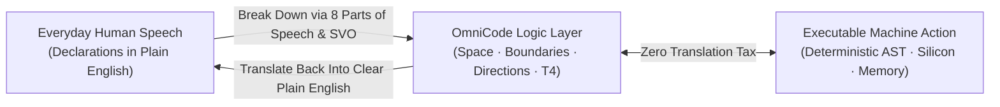

<!--
================================================================================
BLOCK 1: METADATA BLOCK
( Identity, Provenance, Living Syntax Scope & Architectural Boundary Contracts )
================================================================================
@project       OmniCode Framework
@file          SYNTAX.md
@id            root.docs.syntax_guide
@layer         Root Living Language Guide (Track 2 / Root Front Door)
@archetype     living_guide | dual_audience_language_walkthrough
@version       0.1.3-dev
@interface_rev Rev 5
@date          2026-11-18
@author        CreativeWorkzStudio LLC / ProfessorSeanEX (Seanje Lenox-Wise)
@repository    https://github.com/Novaking34/OmniCode_Framework
@system        OmniCode Spatial & Relational Language (Model Mind & Human Code)
@role          Step-by-Step Guide to Operators, Dots, Directionals & 16 Borders
@maturity      Living Growth (Pre-Hardening) | Coordinate v0.1.3 (13%)
@chassis       ascii-first | 100% typeable on any plain standard keyboard
@scale         O(1) reference from everyday speech -> spatial/relational logic
@seams         in: README.md, .agents/Live_OmniCode/ | next: programs & spatial
@invariants    1. Universal 5-Block Lifecycle Protocol (Rev 5).
               2. Standard Keyboard Floor: zero Alt-key tricks or Unicode
                  required to write canonical OmniCode.
               3. Thought vs. Declaration: humans think in space & relations
                  first; words are how we declare that reality outward.
               4. Order Always Carries Meaning: flipped pairs (!=/=!, ~=/=~,
                  =:/:=, ^--/--^, [!X]/[X!], and all 12 hybrid borders) are
                  distinct, never redundant.
               5. Pure Geometry on Plain Keys: 1pt (., <), 2pt (.., [),
                  3pt (..., {), Curve ( ( ) ) -> 4x4 = 16 border combinations.
================================================================================
-->

<div align="center">

# OmniCode Living Syntax Guide

### A Spatial & Relational Language Anyone Can Read, Think, and Program With

*Built from plain keyboard keys, natural human sentences, and the way real minds actually map the world.*

[-2ea44f?style=flat-square)](README.md)
[](#the-standard-keyboard-rule)
[](#step-3-connectives-and-the-three-way-bang-law)

[Why Spatial & Relational](#why-omnicode-is-spatial-and-relational) · [Step 1: Truth & Time](#step-1-how-omnicode-handles-truth-and-time) · [Step 2: Being & Order](#step-2-being-and-why-order-changes-meaning) · [Step 3: Connectives & !](#step-3-connectives-and-the-three-way-bang-law) · [Step 4: Ratio & Dots](#step-4-ratio-points-steps-and-thinking) · [Step 5: Directions & Dimension](#step-5-directions-action-verbs-and-dimension) · [Step 6: The 16 Borders](#step-6-the-16-border-combinations) · [Step 7: Sentences (SVO)](#step-7-reading-real-sentences-svo)

</div>

---

<!--
================================================================================
BLOCK 2: OPENING BLOCK
( Why Spatial & Relational, Thought vs. Declaration & Standard Keyboard Rule )
================================================================================
-->

## Why OmniCode Is Spatial and Relational

Stop for a second and look at the room you're sitting in. Nothing in the real world floats in a vacuum. Everything around you is defined by two everyday facts:

1. **Space:** Where something sits, what walls hold it, and which direction it moves.
2. **Relation:** How it connects to the things around it (*basement* only makes sense in relation to *second floor*; *throwing a ball* is a directed relationship between a person and a ball).

Modern neuroscience backed this up directly: when humans think through abstract ideas, analogies, or social dynamics, the brain doesn't use a separate "abstract text processor"—it reuses its **physical navigation hardware** (hippocampal place cells, entorhinal grid cells, border cells, and the parietal cortex). Your brain literally builds a **spatial cognitive map** first.

> [!IMPORTANT]
> **Thought vs. Declaration (Why OmniCode Doesn't Copy Standard LLMs):**  
> Most modern AI models were built by bypassing formal logic so language could be squeezed into statistical word prediction—so an LLM "thinks" in surface words. **Real people do not think in words.** We think in spatial boundaries, directions, and relationships first; **words are simply the most elegant form of expression, because whenever you speak, you are always making a declaration.**



### The Standard-Keyboard Rule

There are plenty of fancy Unicode arrow glyphs out there—and OmniStudio or editor fonts can always *display* pretty symbols later. **At the bedrock, however, every single canonical operator in OmniCode must be typeable on a plain standard keyboard by someone who has never touched the `Alt` key.**

If a kid, a teacher, or a builder sitting at a normal laptop can't type it naturally with standard keys, it doesn't belong on the floor.

---

<!--
================================================================================
BLOCK 3: BODY BLOCK
( Step-by-Step Walkthrough of Operators, Dots, Directionals & 16 Borders )
================================================================================
-->

## Step 1: How OmniCode Handles Truth and Time

Traditional programming forces everything into binary `true` or `false`. That breaks down the second you listen to how real people talk:

* If someone says **"Jerry is not sad,"** does that automatically mean Jerry is happy? **No**—he might be calm, focused, tired, or just neutral.
* If someone says **"it's not bad,"** does that automatically mean it's amazing? **No**—it just clears *bad* off the table and leaves it in neutral, okay territory.

OmniCode uses **Balanced Ternary Quad-State** ($\mathbb{T}_4 = \{-1,\ 0,\ +1,\ \text{NULL}\}$), which maps straight onto everyday human **being, intent/time, negation, and absence**:

| Value | Execution State | Everyday Anchor | Real Sentence | What It Actually Means |
| :---: | :--- | :---: | :--- | :--- |
| **`0`** | **`AWAIT`** | **`IS`** *(Present)* | *"I am sad"* | Present ground reality right now. Even though *sad* feels heavy, stating what currently *is* sits cleanly at **`0`**. |
| **`+1`** | **`PROCEED`** | **`WILL`** *(Forward)* | *"I will be happy"* | Forward motion, commitment, or becoming—projecting ahead out of `0`. |
| **`-1`** | **`ROLLBACK`** | **`NOT`** *(Exclusion)* | *"...not sad"* *(in "Jerry is happy, not sad")* | Active opposition or stepping away from a state. |
| **`NULL`** | **`HALT`** | **`IS NOT`** *(Absence)* | *"I am not mad"* · *"it's not bad"* | Clears/voids a claim **without falsely fabricating its opposite**. |

Notice that every one of those sentences—*"I **am** sad"*, *"I **will be** happy"*, *"I **am not** mad"*, *"it'**s not** bad"*—uses a form of **`to be`**. That takes us straight to Step 2.

---

## Step 2: Being and Why Order Changes Meaning

In OmniCode, nouns are written in plain human words (`Jerry`, `Tommy`, `ball`), while verbs boil down to just **two roots**: **Being (`=`)** and **Directional Action (`-->`, `--^`, ...)**.

### Why `=` Means `(to be / is)` — Not Just `is`

`is` is only one single tense and person (*he is*). By rooting `=` at **`to be`** (the universal infinitive of existence), **one single symbol** naturally covers *am, is, are, was, were, will be, being* depending on who is speaking (`WHO`) and when (`WHEN`).

### The `=` Anchor Law: Why Flipping Symbols Creates Two Different Things

In OmniCode, **position is never accidental**. When you pair `=` with **`!`** *(not)*, **`~`** *(like)*, or **`:`** *(as to)*, **look at which side `=` touches** in `A op B`:

* **When `=` touches `A` (`A =! B`, `A =~ B`, `A =: B`):** **`A`'s being** is on the table being compared, likened, or framed against `B`.
* **When `=` touches `B` (`A != B`, `A ~= B`, `A := B`):** **`B`'s being** is the reference anchor doing the comparing—or the target `A` transforms into.

| Symbol | Spoken Reading | Who Leads? | Everyday Sentence |
| :---: | :--- | :--- | :--- |
| **`=`** | *to be / is* | Identity | `I = { sad }` $\to$ *"I am sad."* |
| **`=!`** | *is not / not to be* | **`A` is being compared** | `Jerry =! { sad }` $\to$ *"Jerry is not sad."* |
| **`!=`** | *not is / to be not* | **`B` is doing the comparing** | `Jerry = { happy } != { sad }` $\to$ *"Jerry is happy, not sad."* |
| **`=~`** | *is like / to be likened to* | **`A` is being compared** | `Jerry =~ { bird }` $\to$ *"Jerry is like a bird."* |
| **`~=`** | *like is / to be like* | **`B` is doing the comparing** | `Tommy --> ~= { lion }` $\to$ *"Tommy is moving like a lion."* |
| **`=:`** | *is as to / to be as* | **`A` framed in role of `B`** | `A =: B` $\to$ *"A is as to B"* *(perspective / role)* |
| **`:=`** | *as is to / to become* | **Moving into `B`'s being** | `A := B` $\to$ *"A becomes B"* *(definition / transformation)* |
| **`<=>`** | *balances with* | Two-way equivalence | `A <=> B` $\to$ *"A holds if and only if B holds."* |
| **`<` `>` `<=` `>=`** | *less / greater* | Ordered magnitude | Standard numeric/scale comparison. |

> [!TIP]
> **Read It Out Loud:** Look at *"Jerry is like a bird"* vs. *"Tommy is moving like a lion."* In the first sentence, **Jerry's whole being** is likened to a bird (`Jerry =~ { bird }`). In the second sentence, Tommy isn't a lion—**the lion's way of being** is the standard measuring how Tommy moves (`Tommy --> ~= { lion }`). One small flip in character order captures a real distinction humans make effortlessly every day.

---

## Step 3: Connectives and the Three-Way Bang Law

Instead of inventing dozens of disconnected keywords, OmniCode connects clauses using a tight, expressive set of logical operators:

### Logical & Spatial Connectives

| Symbol | Spoken Word | What It Does |
| :---: | :--- | :--- |
| **`:`** | *as to / in relation to* | Links an entity to a role, type, or ratio (`A : B :: C : D`). |
| **`::`** | *and* **(independent)** | Both `A` and `B` hold together, while **each can stand on its own**. |
| **`&`** | *and* **(dependent)** | Both `A` and `B` are **mutually dependent / bound** (`Key & Value`). |
| **`\|`** | *or* | Alternative choice / branching valve (`A \| B`). |
| **`!`** | *but* *(standalone)* | Adversative caveat (`A ! B`: do `A`, **but** `B` must hold). |
| **`@`** | *at* | Exact location, address, or physical site (`Storehouse @ 0`). |
| **`%`** | *is about / in ratio of* | Real-world approximation & proportionality (see Step 4). |
| **`.` / `. .` / `. . .`** | *point / step / thinking* | Focus point, stepped span/range, and active thought (see Step 4). |

### The 3-Way Positional Law of `!`

One mark **`!`** shifts cleanly by where it sits—zero wasted symbols:

| Position | Example | Meaning | What Happens |
| :--- | :---: | :---: | :--- |
| **By itself** | `A ! B` | **`BUT`** | Caveat guard: `A` proceeds *but* must satisfy `B`. |
| **Attached to a keyword** | `[!DING]` / `[DING!]` | **`ALARM`** | Prefix `[!X]` = Level 1 advisory warning; Postfix `[X!]` = Level 2 hard stop. |
| **Attached to any operator** | `!=`, `=!`, etc. | **`NOT`** | Negates the operator directly (preserving left/right order!). |

### Base Logic Check: Does This Already Cover Basic Logic?

**Yes—it is functionally complete for basic logic and strictly richer than standard Boolean logic:**
* **Conjunction:** Independent `AND` (`::`), dependent `AND` (`&`), and adversative `BUT` (`!`).
* **Disjunction:** `OR` (`|`) — and `XOR` writes naturally right out of the box as `(A | B) ! (A & B)` (*"A or B, but not both bound together"*).
* **Negation:** Order-sensitive `!=` / `=!` and `!` attached to any operator.
* **Implication & Equivalence:** Forward causation `-->` (`IF -> THEN`) and two-way `<=>` (`iff`).
* **Truth Space:** Full 4-state $\mathbb{T}_4$ (`0: IS`, `+1: WILL`, `-1: NOT`, `NULL: IS NOT`).

---

## Step 4: Ratio, Points, Steps, and Thinking

### `%` — *(is about / in ratio of)*

Look at the shape of **`%`** (`o / o`): it literally draws two quantities in ratio to one another. Unlike C's modulo remainder, OmniCode defines **`%`** as **`is about / in ratio of`**, unifying everyday approximation and proportionality under one clean idea:

> *"Mia is about 7 ft tall when she is in the water, but that's because she has special water shoes."*

```text
Mia % [ 7 ft ] : { in the water } ! ( . special water shoes )
```

Mia is not literally 7 ft tall in isolation—she **is about (`%`)** 7 ft tall *in ratio to* being in the water, **but (`!`)** the focal point (`.`) explaining why is `( special water shoes )`.

### The Dot Progression: `.` $\longrightarrow$ `. .` $\longrightarrow$ `. . .`

Just like geometry builds space out of points, the dot scales naturally from **1 point** to **2 points** to **3 points**:

| Dots | Geometry | Everyday Meaning | Example |
| :---: | :---: | :--- | :--- |
| **`.`** | **1 Point** | **Focus / Emphasis ("the point")** — pinpoints one exact detail | `. special water shoes` *(the point of Mia's sentence!)* |
| **`. .`** | **2 Points** | **1 Step / Span / Range** — `A . . B` (*A leads to B*), or place a measure right between the two points | `Jake . [ 5 minutes ] . <-- Jerry` *("Jake is 5 minutes away from Jerry")* |
| **`. . .`** | **3 Points** | **Thinking / Deliberation** — working through a thought before projecting an outcome | `WHAT = [ 4 + 4 ] . . . --> 8` *("What is 4+4 ... 8")* |

---

## Step 5: Directions, Action Verbs, and Dimension

Strip away hundreds of English synonyms (*send, push, kick, throw, pass, drop, lift, pull, fetch*) and every physical action is a **change of state moving in a direction**.

Using **only 8 standard keyboard keys** (`-` `_` `/` `\` `<` `>` `^` `v`), OmniCode draws a complete 2D/3D directional compass.

### Why `--<` and `>--` Don't Exist (How Arrows Show Dimension)

* Look at `--`: it is a **1D line** running Left $\leftrightarrow$ Right (X-axis).
* `<` and `>` sit **on that exact same X-axis**. If you put `<` on the right (`--<`) or `>` on the left (`>--`), the tip points **inward into its own shaft** instead of outward. Left (`<--`) and Right (`-->`) are locked to their own ends.
* Now look at **`^` (Up)** and **`v` (Down)**: they point **perpendicular** to `--`—opening a **2nd dimension (the Y-axis)**. Because they don't collide with the horizontal line, they can sit cleanly on **either the left side OR the right side** (`^--` / `--^`, `v--` / `--v`)!

### A. The 6 Cardinal Directionals

| Head Side | Horizontal (X) | Up (`^`, +Y) | Down (`v`, -Y) | Everyday Speech Feel |
| :--- | :---: | :---: | :---: | :--- |
| **Right-Headed** *(flows Left $\to$ Right)* | **`-->`** | **`--^`** | **`--v`** | *Forward / to / act upon* · *rise up toward* · *drop down into* |
| **Left-Headed** *(flows Right $\to$ Left)* | **`<--`** | **`^--`** | **`v--`** | *Back / from / pull back* · *lift from left* · *break down from left* |

### B. The 8 Diagonal Directionals (Upper & Lower Positions)

Adding the ground line (`_`) with slopes `/` and `\` gives all eight diagonal trajectories across left/right sides and upper/lower orientations (working natively for 2D corners and 3D front/back depth):

| Head Side | Slope `/` | Slope `\` |
| :--- | :---: | :---: |
| **Head on Right** *(tail `_` on left)* | **`_/^`** *(upper)* · **`_/v`** *(lower)* | **`_\^`** *(upper)* · **`_\v`** *(lower)* |
| **Head on Left** *(tail `_` on right)* | **`^/_`** *(upper)* · **`v/_`** *(lower)* | **`^\_`** *(upper)* · **`v\_`** *(lower)* |

---

## Step 6: The 16 Border Combinations

Now the whole picture snaps together. Look at the four standard-keyboard brackets nested from outside to inside:

```text
< [ { (   ) } ] >
```

At the base, those four shapes split the world along two dead-simple axes — **Rigid Definition vs. Fluid Context**, and **THE (singular/universal) vs. A (particular/local)**:

| Bracket | Corners / Shape | Nature | Core Meaning | Everyday Feel |
| :---: | :---: | :---: | :--- | :--- |
| **`< ... >`** | **1 Point** *(1 vertex)* | **Rigid** | **THE Definition** | The universal anchor, unbreakable law, or singular root concept |
| **`[ ... ]`** | **2 Points** *(2 right corners)* | **Rigid** | **A Definition** | A concrete, bounded definition, locked keyword, or measured item |
| **`{ ... }`** | **3 Points** *(top, middle, bottom)* | **Fluid** | **THE Context** | The shared living environment, room, or overarching scope |
| **`( ... )`** | **Curve** *(continuous arc)* | **Fluid** | **A Context** | A situational aside, personal intent, or *why* (matches `<>` in ultimate power) |

### Pure Geometry on Plain Keys: `1 -> 2 -> 3 -> Curve`

Notice how the **dots from Step 4** and the **borders here** follow the exact same geometric climb:

| Geometry | Dots (Flow) | Borders (Walls) | Rigidity | What Opens Up |
| :---: | :---: | :---: | :---: | :--- |
| **1 Point** | **`.`** *(focus)* | **`< >`** *(THE def)* | **Rigid** | A single sharp anchor point — no wiggle room |
| **2 Points** | **`. .`** *(1 step / span)* | **`[ ]`** *(A def)* | **Rigid** | A line segment / straight wall — a bounded container or measure |
| **3 Points** | **`. . .`** *(thinking)* | **`{ }`** *(THE ctx)* | **Fluid** | **The exact threshold where rigid turns fluid:** 3 points define a plane, opening space for thought and living context |
| **Curve** | *(continuous)* | **`( )`** *(A ctx)* | **Fluid** | Pure smooth curve — personal framing, nuance, and human *why* |

> [!TIP]
> **Why Geometry Matters for "Spatial Code Files":** Because every bracket shape already carries physical geometry (`1pt -> 2pt -> 3pt -> Curve`), walls aren't just punctuation—they shape how a reader's brain (and a model's mind) moves through space inside a file.

### The Complete $4 \times 4 = 16$ Border Matrix

Once you know the **4 walls** (`<`, `[`, `{`, `(`), any opening wall can pair with any closing wall. That yields **$4 \times 4 = 16$ exact border combinations** — no guesswork, no arbitrary syntax to memorize.

**One reading rule covers all 16:**

> Read strictly left-to-right: **Starts as `[Opening Wall]` $\longrightarrow$ resolves or transforms into `[Closing Wall]`.**

```text
           Closing ->   > (THE Def)    ] (A Def)      } (THE Ctx)    ) (A Ctx)
Opening v
  < (THE Def)          < >  (Pure)    < ]  (R -> R)  < }  (R -> F)  < )  (R -> F)
  [ (A Def)            [ >  (R -> R)  [ ]  (Pure)    [ }  (R -> F)  [ )  (R -> F)
  { (THE Ctx)          { >  (F -> R)  { ]  (F -> R)  { }  (Pure)    { )  (F -> F)
  ( (A Ctx)            ( >  (F -> R)  ( ]  (F -> R)  ( }  (F -> F)  ( )  (Pure)
```

#### A. The 4 Pure Symmetric Borders *(Stable Containers)*

| Border | Flow | Meaning |
| :---: | :--- | :--- |
| **`< ... >`** | THE Def $\to$ THE Def | Pure axiomatic invariant, universal truth, or unhardened root concept |
| **`[ ... ]`** | A Def $\to$ A Def | Pure concrete definition, bounded value, or locked keyword |
| **`{ ... }`** | THE Ctx $\to$ THE Ctx | Pure living shared context, room, or active environment |
| **`( ... )`** | A Ctx $\to$ A Ctx | Pure situational aside, personal perspective, or *why* |

#### B. The 6 Outward / Unfolding Hybrids *(Opening Higher/More Rigid $\to$ Closing More Local/Fluid)*

| Border | Flow | Meaning |
| :---: | :--- | :--- |
| **`< ... ]`** | THE Def $\to$ A Def | A universal law instantiated down into a specific, concrete definition |
| **`< ... }`** | THE Def $\to$ THE Ctx | A universal law projecting out into a living shared environment |
| **`< ... )`** | THE Def $\to$ A Ctx | A universal law landing in a personal aside or single situational moment |
| **`[ ... }`** | A Def $\to$ THE Ctx | **Inside-Out Emergence:** a concrete entity projecting outward into shifting context |
| **`[ ... )`** | A Def $\to$ A Ctx | A concrete definition softening into personal nuance or situational framing |
| **`{ ... )`** | THE Ctx $\to$ A Ctx | A broad shared environment narrowing down into one personal/local frame |

#### C. The 6 Inward / Crystallizing Hybrids *(Opening More Local/Fluid $\to$ Closing Higher/More Rigid)*

| Border | Flow | Meaning |
| :---: | :--- | :--- |
| **`[ ... >`** | A Def $\to$ THE Def | A concrete finding graduating or hardening upward into universal law |
| **`{ ... >`** | THE Ctx $\to$ THE Def | Living shared experience crystallizing into an axiomatic truth |
| **`( ... >`** | A Ctx $\to$ THE Def | A personal insight or aside proving itself universal |
| **`{ ... ]`** | THE Ctx $\to$ A Def | **Outside-In Imposition:** an ambient environment shaping or conditioning a concrete entity |
| **`( ... ]`** | A Ctx $\to$ A Def | Personal intent or situational nuance locking into a concrete definition |
| **`( ... }`** | A Ctx $\to$ THE Ctx | A personal/local context expanding outward to become the shared world |

---

## Step 7: Reading Real Sentences (SVO)

Because OmniCode mirrors natural **Subject – Verb – Object** word order, you can read it straight left-to-right:

```text
Jake --> { ball }
```

* **`Jake`** = Subject *(who is acting)*
* **`-->`** = Forward directional action verb
* **`{ ball }`** = Object inside a living context

Depending on the context `{ ... }` (soccer field, baseball field, hallway) and modifiers, **`-->`** naturally expresses *throws*, *kicks*, *passes*, *pushes*, *hits*, or *rolls*—without needing 500 hardcoded verb names:

```text
Jake --> { ball }   ( Forward action: throws / kicks / passes / pushes the ball )
Jake <-- { ball }   ( Pull / return: catches / grabs / pulls the ball back )
Jake --^ { ball }   ( Upward action: lifts / tosses the ball up )
Jake --v { ball }   ( Downward action: drops / bounces / sets the ball down )
```

### Living Structure: 5Ws + H and Concept Quarantine

* **6 Cardinal Clauses:** `WHO` *(actor)* · `WHAT` *(entity/action)* · `WHEN` *(time/phase)* · `WHERE` *(site `@`)* · `WHY` *(aside `(...)`)* · `HOW` *(state / mechanism)*.
* **Concept vs. Keyword Quarantine:** New ideas live inside `<concept>` (like `<focus>`) while being tested across real contexts `{ ... }`, and only graduate into a locked reserved keyword `[KEYWORD]` once empirical use proves they are irreducible primitives.
* **Methodological Pacing:** `[BLOCK Eval]` enforces sequential Block 1 $\to$ Block 5 inspection instead of rushed edits.

<details>
<summary><strong>Quick Pocket Cheat-Sheet (All Basic Operators & 16 Borders on One Screen)</strong></summary>

```text
TRUTH & TIME (T4):    0 = IS (AWAIT)   +1 = WILL (PROCEED)   -1 = NOT (ROLLBACK)   NULL = IS NOT (HALT)
BEING & PAIRS:        =  (to be/is)    =! (is not)   != (not is)   =~ (is like)   ~= (like is)
                      =: (is as to)    := (to become)   <=> (balances)   <  >  <=  >=
CONNECTIVES:          :  (as to)       :: (AND indep)   & (AND dep)   | (OR)   ! (BUT / ALARM / NOT)
RATIO & DOTS:         %  (is about / in ratio)   . (1pt focus)   . . (2pt step/span)   . . . (3pt thinking)
SITE:                 @  (at location / site)
CARDINAL ARROWS:      -->  <--  --^  --v  ^--  v--
DIAGONAL ARROWS:      _/^  _/v  _\^  _\v  ^/_  v/_  ^\_  v\_
16 BORDERS (4x4):     Pure:      < >   [ ]   { }   ( )
                      Unfolding: < ]   < }   < )   [ }   [ )   { )
                      Locking:   [ >   { >   ( >   { ]   ( ]   ( }
```

</details>

---

<!--
================================================================================
BLOCK 4: AUDIT PROCEDURES BLOCK
( Living Syntax Hygiene, Standard-Keyboard Proof & Completeness Audit )
================================================================================
-->

## Living Guide Verification Checks

* **Standard Keyboard Proof:** 100% of canonical symbols use plain 7-bit printable ASCII (`- _ / \ < > ^ v = ! ~ : | & @ % . [ ] { } ( )`).
* **Zero Phantom Artifacts:** Legacy `--` (`NOT`) artifact removed; `!` handles `BUT` / `ALARM` / `NOT` cleanly by position.
* **Base Logic Complete:** Covers independent & dependent `AND` (`::`, `&`), `OR` (`|`), `BUT` (`!`), order-sensitive `NOT` (`!=`, `=!`), implication (`-->`), equivalence (`<=>`), likeness (`~=`, `=~`), role/becoming (`=:`, `:=`), ratio (`%`), dot geometry (`.` / `. .` / `. . .`), and $\mathbb{T}_4$.
* **16-Border Matrix Complete:** Full $4 \times 4$ wall lattice (`<[{()}]>`) grounded in `1pt -> 2pt -> 3pt -> Curve` geometry.
* **Living Status:** Foundations documented inside `v0.1.3-dev` — ready to explore living programs and spatial code files next.

---

<!--
================================================================================
BLOCK 5: CLOSING BLOCK
( Cross-References & Living Guide Seal )
================================================================================
-->

## Related Anchors

* [`README.md`](README.md) — Whole-Framework front door (`OmniCode` + `FaithNet/` + `Tenebris-and-Lux/`)
* [`.agents/Live_OmniCode/omnicode_syntax_keywords_operators.md`](.agents/Live_OmniCode/omnicode_syntax_keywords_operators.md) — Historical cross-over notes & operator lattice
* [`.agents/skills/cpi-si-covenant/SKILL.md`](.agents/skills/cpi-si-covenant/SKILL.md) — Living pacing, Aside `()` physics & Coordinate Versioning

<!--
================================================================================
END OF BLOCK 5: CLOSING SEAL
Status: SYNTAX_GUIDE_FOUNDATIONS_COMPLETE (+1:PROCEED)
================================================================================
-->
