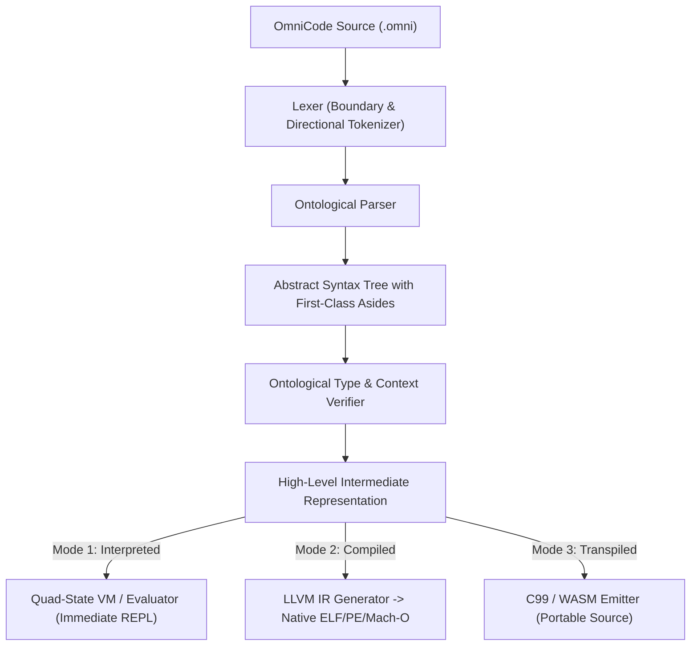

# Volume 3: Architecture & Execution

## Document 02: The Unified Execution Pipeline

---

### 1. Unified Architecture Across Three Execution Modes

OmniCode allows the exact same code to be:

1. **Compiled (AOT Native):** Ahead-of-time compilation via LLVM or assembler to standalone native binaries.
2. **Interpreted:** Real-time in-memory execution via AST/bytecode evaluation for interactive REPL and hot-reloading.
3. **Transpiled:** Source-to-source emission of ISO C99, C++, or WebAssembly for universal deployment.

---

### 2. Role of the Boundary Elements in the Pipeline

* **Denotation `[...]` and Invariant `<...>`:** Directly mapped to data structures, memory definitions, and logic bodies in the target backend.
* **Connotation `{...}`, `{...]`, and `[...}`:** Injected into the semantic checker to establish safety constraints, stack/heap qualifiers, and variable resolution rules.
* **Aside `(...)`:** Maintained in debug tables, emitted as formatted doc-comments in transpiled code, and evaluated by the verifier for formal invariant validation.
* **Quad-State Engine (`-1, 0, 1, NULL`):**
  * In the interpreter: Drives the runtime state machine directly.
  * In native C/LLVM compilation: Translated to integer return codes, branch vectors, and zero-cost error frames.
